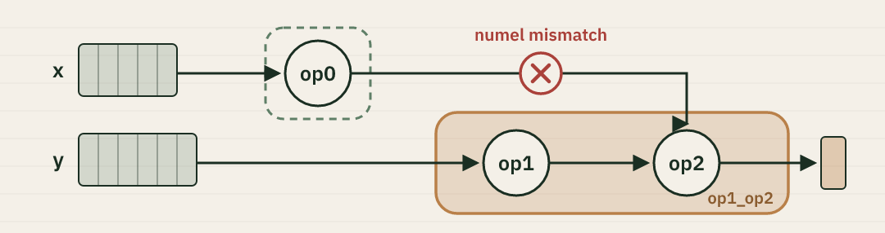

#### Written: October 31, 2026 · Guest post by Elias Ellison



Elias recently shared this notebook with me. I thought, "Wow, this is an amazing description of inductor, we should share this." So here it is :)

<a class="colab-badge" href="https://colab.research.google.com/github/drisspg/nuggets/blob/main/source/content/media/inductor-walkthrough/inductor_walkthrough.ipynb">Open in Colab</a> <a class="colab-badge" href="./media/inductor-walkthrough/inductor_walkthrough.ipynb" download>Download .ipynb</a>

We are going to walk through the various stages of torch.compile IR. 

## Pre-grad: 

Dynamo, as it traces the graph, builds up an IR representation that is essentially equivalent to what exists in user code. At
this point:
- IR has not been normalized: both `torch.nn.functional.relu()` and `x.relu()` may both exist 
- Mutation and unclear aliasing relationships still remain. For instance - operators like `.to` may return the input or clone it.
- Decompositions have not yet been applied. Pytorch's [2000](https://dev-discuss.pytorch.org/t/where-do-the-2000-pytorch-operators-come-from-more-than-you-wanted-to-know/373) operators still exist, as opposed to the much more limited set operators post decomposition.
- the forward and backward have not been traced out. It's unclear which operators will require what saved activations.
- Tensor Subclasses may exist in the graph with their semantics not yet traced through
- Similarly, Automated Mixed Precision, or other global modes which affect dispatching, will not yet be present.

For all of the above reasons, we discourage graph manipulation on this stage of the ir. 

```python cell
import os
os.environ['TORCH_LOGS_FORMAT'] = "[%(levelname)s]:%(message)s"
import torch
torch._inductor.config.force_disable_caches = True

torch._logging.set_logs(pre_grad_graphs=True)


@torch.compile()
def matmul(x):
    out = torch.nn.functional.linear(x, x)
    return out.relu(), torch.nn.functional.relu(out.add_(1)).to(torch.float16)


inp = torch.rand([256, 256], device="cuda", requires_grad=True)
out = matmul(inp)
```

```output python
[DEBUG]:TRACED GRAPH
 ===== BEFORE PRE GRAD =====
 torch/fx/_lazy_graph_module.py class GraphModule(torch.nn.Module):
    def forward(self, L_x_: "f32[256, 256][256, 1]cuda:0"):
        l_x_ = L_x_

        # File: <cell>:11 in matmul, code: out = torch.nn.functional.linear(x, x)
        out: "f32[256, 256][256, 1]cuda:0" = torch._C._nn.linear(l_x_, l_x_);  l_x_ = None

        # File: <cell>:12 in matmul, code: return out.relu(), torch.nn.functional.relu(out.add_(1)).to(torch.float16)
        relu: "f32[256, 256][256, 1]cuda:0" = out.relu()
        add_: "f32[256, 256][256, 1]cuda:0" = out.add_(1);  out = None
        relu_1: "f32[256, 256][256, 1]cuda:0" = torch.nn.functional.relu(add_);  add_ = None
        to: "f16[256, 256][256, 1]cuda:0" = relu_1.to(torch.float16);  relu_1 = None
        return (relu, to)
```

## Joint Graph 

To convert from the pre grad to joint graph representation, we trace through the graph with a custom `TorchDispatchMode` that builds up a graph on the fly. See [ProxyTorchDispatchMode](https://github.com/pytorch/pytorch/blob/6f6acb412828844ee3bcdbf277283144faba2524/torch/fx/experimental/proxy_tensor.py#L1379-L1410). During this tracing, we also functionalize the graph. For a more detailed overview of Tensor Subclasses, check out this existing [colab presentation](https://colab.research.google.com/drive/1zjAisRrc8R6uixKsrs1DRm3lwz5MWN68).


The Joint Graph is functional and made up of aten-IR. `torch.nn.functional.relu` is transformed to `aten.relu`, and the specific overload `aten.relu.default` corresponding to a particular input schemas has been determined. [CompositeImplicit Operators](https://github.com/pytorch/pytorch/blob/main/aten/src/ATen/native/README.md#dispatch), which internally dispatch to operators (`.to` for instance), will have been removed from the graph. Decompositions have also been applied. 

The Joint Graph is the first stage of the IR that inductor applies transformations to. 

**When to use joint graph passes:**

* **if you need to change both the forward and backward implementation of an operator**
* **if you expect your pass to decisions the partitioner makes about what tensors are saved, and what is recomputed**

Joint Graph passes should keep the graph functional, and composed of aten-ir. 

[Inductor Joint Graph Passes](https://github.com/pytorch/pytorch/blob/41de0f2eaf97fa9419190b93dc0b5b3b051a9adf/torch/_inductor/fx_passes/joint_graph.py).

```python cell
torch._dynamo.reset()
torch._logging.set_logs(pre_grad_graphs=False, aot_joint_graph=True)

out = matmul(inp)
```

```output python
[INFO]:TRACED GRAPH
 ===== Joint graph 1 =====
 torch/fx/_lazy_graph_module.py class inner_f(torch.nn.Module):
    def forward(self, primals, tangents):
        primals_1: "f32[256, 256][256, 1]cuda:0"; tangents_1: "f32[256, 256][256, 1]cuda:0"; tangents_2: "f16[256, 256][256, 1]cuda:0";

        primals_1, tangents_1, tangents_2, = fx_pytree.tree_flatten_spec([primals, tangents], self._in_spec)
        # File: <cell>:11 in matmul, code: out = torch.nn.functional.linear(x, x)
        permute: "f32[256, 256][1, 256]cuda:0" = torch.ops.aten.permute.default(primals_1, [1, 0])
        mm: "f32[256, 256][256, 1]cuda:0" = torch.ops.aten.mm.default(primals_1, permute)

        # File: <cell>:12 in matmul, code: return out.relu(), torch.nn.functional.relu(out.add_(1)).to(torch.float16)
        relu: "f32[256, 256][256, 1]cuda:0" = torch.ops.aten.relu.default(mm)
        alias: "f32[256, 256][256, 1]cuda:0" = torch.ops.aten.alias.default(relu)
        add: "f32[256, 256][256, 1]cuda:0" = torch.ops.aten.add.Tensor(mm, 1);  mm = None
        relu_1: "f32[256, 256][256, 1]cuda:0" = torch.ops.aten.relu.default(add);  add = None
        alias_1: "f32[256, 256][256, 1]cuda:0" = torch.ops.aten.alias.default(relu_1)
        convert_element_type: "f16[256, 256][256, 1]cuda:0" = torch.ops.prims.convert_element_type.default(relu_1, torch.float16);  relu_1 = None

        # Backward of forward node: File: <cell>:12 in matmul, code: return out.relu(), torch.nn.functional.relu(out.add_(1)).to(torch.float16)
        convert_element_type_1: "f32[256, 256][256, 1]cuda:0" = torch.ops.prims.convert_element_type.default(tangents_2, torch.float32);  tangents_2 = None
        alias_2: "f32[256, 256][256, 1]cuda:0" = torch.ops.aten.alias.default(alias_1);  alias_1 = None
        le: "b8[256, 256][256, 1]cuda:0" = torch.ops.aten.le.Scalar(alias_2, 0);  alias_2 = None
        scalar_tensor: "f32[][]cuda:0" = torch.ops.aten.scalar_tensor.default(0, dtype = torch.float32, layout = torch.strided, device = device(type='cuda', index=0))
        where: "f32[256, 256][256, 1]cuda:0" = torch.ops.aten.where.self(le, scalar_tensor, convert_element_type_1);  le = scalar_tensor = convert_element_type_1 = None
        alias_3: "f32[256, 256][256, 1]cuda:0" = torch.ops.aten.alias.default(alias);  alias = None
        le_1: "b8[256, 256][256, 1]cuda:0" = torch.ops.aten.le.Scalar(alias_3, 0);  alias_3 = None
        scalar_tensor_1: "f32[][]cuda:0" = torch.ops.aten.scalar_tensor.default(0, dtype = torch.float32, layout = torch.strided, device = device(type='cuda', index=0))
        where_1: "f32[256, 256][256, 1]cuda:0" = torch.ops.aten.where.self(le_1, scalar_tensor_1, tangents_1);  le_1 = scalar_tensor_1 = tangents_1 = None
        add_1: "f32[256, 256][256, 1]cuda:0" = torch.ops.aten.add.Tensor(where, where_1);  where = where_1 = None

        # Backward of forward node: File: <cell>:11 in matmul, code: out = torch.nn.functional.linear(x, x)
        permute_1: "f32[256, 256][1, 256]cuda:0" = torch.ops.aten.permute.default(add_1, [1, 0])
        mm_1: "f32[256, 256][256, 1]cuda:0" = torch.ops.aten.mm.default(permute_1, primals_1);  permute_1 = primals_1 = None
        permute_2: "f32[256, 256][1, 256]cuda:0" = torch.ops.aten.permute.default(mm_1, [1, 0]);  mm_1 = None
        permute_3: "f32[256, 256][256, 1]cuda:0" = torch.ops.aten.permute.default(permute, [1, 0]);  permute = None
        mm_2: "f32[256, 256][256, 1]cuda:0" = torch.ops.aten.mm.default(add_1, permute_3);  add_1 = permute_3 = None
        permute_4: "f32[256, 256][256, 1]cuda:0" = torch.ops.aten.permute.default(permute_2, [1, 0]);  permute_2 = None
        add_2: "f32[256, 256][256, 1]cuda:0" = torch.ops.aten.add.Tensor(mm_2, permute_4);  mm_2 = permute_4 = None
        return pytree.tree_unflatten([relu, convert_element_type, add_2], self._out_spec)
```

# (WIP) Post Grad Passes

After the partitioner has partitioned the joint graph into a separate forward and backward graph, we apply our post grad passes. 

There are two stages of post grad passes: functional and non-functional. 

# TorchInductor Scheduler

To start, lets look at a very simple example, a decomposed gelu. 

```python cell
torch._logging.set_logs(ir_pre_fusion=True, ir_post_fusion=True)


@torch.compile()
def foo(x):
    mul = torch.ops.aten.mul.Tensor(x, 0.5)
    mul_1 = torch.ops.aten.mul.Tensor(x, 0.7071067811865476)
    erf = torch.ops.aten.erf.default(mul_1)
    add = torch.ops.aten.add.Tensor(erf, 1)
    mul_2 = torch.ops.aten.mul.Tensor(mul, add)
    return (mul_2,)


_ = foo(torch.rand([32, 32], device="cuda"))
```

```output python
[INFO]:BEFORE FUSION
op0: SchedulerNode(ComputedBuffer)
op0.writes = [MemoryDep('buf0', 32*d0 + d1, {d0: 32, d1: 32})]
op0.unmet_dependencies = []
op0.met_dependencies = [MemoryDep('arg0_1', 32*d0 + d1, {d0: 32, d1: 32})]
op0.min_input_distance = 0
op0.max_input_distance = 0
op0.outputs = [
    buf0: ComputedBuffer
    buf0.layout = FixedLayout('cuda:0', torch.float32, size=[32, 32], stride=[32, 1])
    buf0.users = [NodeUser(node=OUTPUT, can_inplace=False, is_weak=False)]
]
op0.group.device = cuda:0
op0.group.iteration = (1024, 1)
op0.sizes = ([32, 32], [])
arg0_1_layout = FixedLayout('cuda:0', torch.float32, size=[32, 32], stride=[32, 1])
buf0_layout = FixedLayout('cuda:0', torch.float32, size=[32, 32], stride=[32, 1])
class op0_loop_body:
    var_ranges = {p0: 32, p1: 32}
    index0 = 32*p0 + p1
    def body(self, ops):
        get_index = self.get_index('index0')
        load = ops.load('arg0_1', get_index)
        constant = ops.constant(0.5, torch.float32)
        mul = ops.mul(load, constant)
        get_index_1 = self.get_index('index0')
        load_1 = ops.load('arg0_1', get_index_1)
        constant_1 = ops.constant(0.7071067811865476, torch.float32)
        mul_1 = ops.mul(load_1, constant_1)
        erf = ops.erf(mul_1)
        constant_2 = ops.constant(1.0, torch.float32)
        add = ops.add(erf, constant_2)
        mul_2 = ops.mul(mul, add)
        get_index_2 = self.get_index('index0')
        store = ops.store('buf0', get_index_2, mul_2, None)
        return store


[INFO]:AFTER FUSION
op0: SchedulerNode(ComputedBuffer)
op0.writes = [MemoryDep('buf0', c0, {c0: 1024})]
op0.unmet_dependencies = []
op0.met_dependencies = [MemoryDep('arg0_1', c0, {c0: 1024})]
op0.min_input_distance = 0
op0.max_input_distance = 0
op0.outputs = [
    buf0: ComputedBuffer
    buf0.layout = FixedLayout('cuda:0', torch.float32, size=[32, 32], stride=[32, 1])
    buf0.users = [NodeUser(node=OUTPUT, can_inplace=False, is_weak=False)]
]
op0.group.device = cuda:0
op0.group.iteration = (1024, 1)
op0.sizes = ((1024,), ())
arg0_1_layout = FixedLayout('cuda:0', torch.float32, size=[32, 32], stride=[32, 1])
buf0_layout = FixedLayout('cuda:0', torch.float32, size=[32, 32], stride=[32, 1])
class op0_loop_body:
    var_ranges = {p0: 1024}
    index0 = p0
    def body(self, ops):
        get_index = self.get_index('index0')
        load = ops.load('arg0_1', get_index)
        constant = ops.constant(0.5, torch.float32)
        mul = ops.mul(load, constant)
        get_index_1 = self.get_index('index0')
        load_1 = ops.load('arg0_1', get_index_1)
        constant_1 = ops.constant(0.7071067811865476, torch.float32)
        mul_1 = ops.mul(load_1, constant_1)
        erf = ops.erf(mul_1)
        constant_2 = ops.constant(1.0, torch.float32)
        add = ops.add(erf, constant_2)
        mul_2 = ops.mul(mul, add)
        get_index_2 = self.get_index('index0')
        store = ops.store('buf0', get_index_2, mul_2, None)
        return store
```

Oops, no fusion occurred - there was only a single Scheduler Node before and after fusion.

That is because during aten IR lowering to Inductor IR, we do some amount of inlining as we lower. We only inline pointwise objects. 

Recomputing operations can allow us to improve fusion. Here, on the left, we assume that `clone` cannot be fused. By inlining `cos` and `relu` into their use in `add`, we avoid having to materialize them in global memory. 

This can be especially important when broadcasts result in a output of pointwise node being much larger than its inputs, and in the backward, where we often save smaller tensors that get reused multiple times, and broadcasted/converted to a larger dtype.

<figure class="inlining-fig"><svg viewBox="0 0 960 690" role="img" aria-label="Two fusion graphs. Left: cos and relu form fused_1, clone cannot be fused, and add inside fused_0 reads cos and relu from global memory. Right: cos and relu are recomputed inside fused_0, so add no longer reads fused_1's outputs."><defs><marker id="inl-arrow" viewBox="0 0 10 10" refX="9" refY="5" markerWidth="7" markerHeight="7" orient="auto-start-reverse"><path d="M0,0L10,5L0,10z" fill="currentColor"/></marker></defs><rect class="fused" x="70" y="105" width="250" height="195" rx="24"/><text class="fl" x="308" y="130">fused_1</text><rect class="fused" x="70" y="400" width="250" height="195" rx="24"/><text class="fl" x="308" y="584">fused_0</text><path class="e" d="M150,89V119"/><path class="e" d="M150,189V214"/><path class="e" d="M150,284V314"/><path class="e" d="M150,384V414"/><path class="e" d="M150,484V509"/><path class="e" d="M150,579V609"/><path class="e" d="M275,484V545H186"/><path class="e" d="M184,155H289V415"/><path class="e" d="M184,250H261V415"/><g class="n "><circle cx="150" cy="55" r="34"/><text x="150" y="55">a</text></g><g class="n "><circle cx="150" cy="155" r="34"/><text x="150" y="155">cos</text></g><g class="n "><circle cx="150" cy="250" r="34"/><text x="150" y="250">relu</text></g><g class="n "><circle cx="150" cy="350" r="34"/><text x="150" y="350">clone</text></g><g class="n "><circle cx="150" cy="450" r="34"/><text x="150" y="450">relu_1</text></g><g class="n "><circle cx="275" cy="450" r="34"/><text x="275" y="450">add</text></g><g class="n "><circle cx="150" cy="545" r="34"/><text x="150" y="545">add_1</text></g><g class="n "><circle cx="150" cy="645" r="34"/><text x="150" y="645">output</text></g><line class="divider" x1="475" y1="25" x2="475" y2="670"/><rect class="fused" x="560" y="105" width="250" height="195" rx="24"/><text class="fl" x="798" y="130">fused_1</text><rect class="fused" x="560" y="400" width="370" height="195" rx="24"/><text class="fl" x="830" y="584">fused_0</text><path class="e" d="M640,89V119"/><path class="e" d="M640,189V214"/><path class="e" d="M640,284V314"/><path class="e" d="M640,384V414"/><path class="e" d="M640,484V509"/><path class="e" d="M640,579V609"/><path class="e" d="M765,484V545H676"/><path class="e" d="M674,55H890V414"/><path class="e" d="M890,484V509"/><path class="e" d="M856,444H801"/><path class="e" d="M856,545H828V458H801"/><g class="n "><circle cx="640" cy="55" r="34"/><text x="640" y="55">a</text></g><g class="n "><circle cx="640" cy="155" r="34"/><text x="640" y="155">cos</text></g><g class="n "><circle cx="640" cy="250" r="34"/><text x="640" y="250">relu</text></g><g class="n "><circle cx="640" cy="350" r="34"/><text x="640" y="350">clone</text></g><g class="n "><circle cx="640" cy="450" r="34"/><text x="640" y="450">relu_1</text></g><g class="n "><circle cx="765" cy="450" r="34"/><text x="765" y="450">add</text></g><g class="n "><circle cx="640" cy="545" r="34"/><text x="640" y="545">add_1</text></g><g class="n "><circle cx="640" cy="645" r="34"/><text x="640" y="645">output</text></g><g class="n re"><circle cx="890" cy="450" r="34"/><text x="890" y="450">cos</text></g><g class="n re"><circle cx="890" cy="545" r="34"/><text x="890" y="545">relu</text></g></svg></figure>


In some cases, inlining also avoids current scheduler-level limitations where we wouldn't fuse two nodes. 


To update the inlining heuristcs, see `config.realize_reads_threshold`, `config.realize_opcount_threshold`, and `realize_acc_reads_threshold` [here](https://github.com/pytorch/pytorch/blob/f0c9b3385d99a74075dae3cc3e53d79b619bee7f/torch/_inductor/config.py#L505-L512).

## Scheduler

The scheduler has 2 components. There’s the back-end agnostic component (Scheduler in scheduler.py), and the back-end specific component (TritonScheduling in codegen/triton.py). Different backends may have different heuristics on what is fusable and how profitable the fusions might be. 


The first thing the scheduler does is convert lowering IR `ComputedBuffer` nodes into schedule.SchedulerNode nodes with corresponding `SchedulerBuffer`. (this happens [here](https://github.com/pytorch/pytorch/blob/main/torch/_inductor/scheduler.py#L1025-L1068))

There are a few important fields on the SchedulerNode, in addition to various use/def metadata you might be familiar.
```
class SchedulerNode:
    _sizes: tuple[Sequence[sympy.Expr], ...]
    _body: LoopBody
    read_writes: dependencies.ReadWrites
```

`_sizes` correspond to the iteration variables inductor will codegen. The first sequence is the pointwise iteration sizes, and the second sequence is the reduction iteration size. 

`_body` is the persistent representation of Inductor IR that we will do loop level modifications to. For instance, [applying a new loop order](https://github.com/pytorch/pytorch/blob/8cb6957e019086c1f6e39941047ead6e29f6f402/torch/_inductor/scheduler.py#L1108-L1113).

`_read_writes`: are the global reads and writes of the ir. 

In order to fuse we need to have compatible iteration variables, and we need a matching read and write which indicates fusing the two nodes would result in reduced global memory access. 

Lets take a look at an example.

```python cell
torch._logging.set_logs(ir_pre_fusion=True, fusion=True, ir_post_fusion=True)

@torch.compile(dynamic=True)
def foo(x, y):
    return x.sum(dim=1) + (y + 3).sum(dim=1)

_ = foo(torch.rand([10, 50], device="cuda"), torch.rand([10, 60], device="cuda"))
```

```output python
[INFO]:BEFORE FUSION
op0: SchedulerNode(ComputedBuffer)
op0.writes = [MemoryDep('buf0', d0, {d0: s77})]
op0.unmet_dependencies = []
op0.met_dependencies = [MemoryDep('arg2_1', d0*s27 + d1, {d0: s77, d1: s27})]
op0.min_input_distance = 0
op0.max_input_distance = 0
op0.outputs = [
    buf0: ComputedBuffer
    buf0.layout = FixedLayout('cuda:0', torch.float32, size=[s77], stride=[1])
    buf0.users = [NodeUser(node=SchedulerNode(name='op2'), can_inplace=True, is_weak=False)]
]
op0.group.device = cuda:0
op0.group.iteration = (s77, s27)
op0.sizes = ([s77], [s27])
arg2_1_layout = FixedLayout('cuda:0', torch.float32, size=[s77, s27], stride=[s27, 1])
buf0_layout = FixedLayout('cuda:0', torch.float32, size=[s77], stride=[1])
class op0_loop_body:
    var_ranges = {p0: s77, p1: s27}
    index0 = p0*s27 + p1
    index1 = p0
    def body(self, ops):
        get_index = self.get_index('index0')
        load = ops.load('arg2_1', get_index)
        reduction = ops.reduction(torch.float32, torch.float32, 'sum', load)
        get_index_1 = self.get_index('index1')
        store_reduction = ops.store_reduction('buf0', get_index_1, reduction)
        return None


op1: SchedulerNode(ComputedBuffer)
op1.writes = [MemoryDep('buf1', d0, {d0: s77})]
op1.unmet_dependencies = []
op1.met_dependencies = [MemoryDep('arg4_1', d0*s94 + d1, {d0: s77, d1: s94})]
op1.min_input_distance = 0
op1.max_input_distance = 0
op1.outputs = [
    buf1: ComputedBuffer
    buf1.layout = FixedLayout('cuda:0', torch.float32, size=[s77], stride=[1])
    buf1.users = [NodeUser(node=SchedulerNode(name='op2'), can_inplace=True, is_weak=False)]
]
op1.group.device = cuda:0
op1.group.iteration = (s77, s94)
op1.sizes = ([s77], [s94])
arg4_1_layout = FixedLayout('cuda:0', torch.float32, size=[s77, s94], stride=[s94, 1])
buf1_layout = FixedLayout('cuda:0', torch.float32, size=[s77], stride=[1])
class op1_loop_body:
    var_ranges = {p0: s77, p1: s94}
    index0 = p0*s94 + p1
    index1 = p0
    def body(self, ops):
        get_index = self.get_index('index0')
        load = ops.load('arg4_1', get_index)
        constant = ops.constant(3.0, torch.float32)
        add = ops.add(load, constant)
        reduction = ops.reduction(torch.float32, torch.float32, 'sum', add)
        get_index_1 = self.get_index('index1')
        store_reduction = ops.store_reduction('buf1', get_index_1, reduction)
        return None


op2: SchedulerNode(ComputedBuffer)
op2.writes = [MemoryDep('buf2', d0, {d0: s77})]
op2.unmet_dependencies = [MemoryDep('buf0', d0, {d0: s77}), MemoryDep('buf1', d0, {d0: s77})]
op2.met_dependencies = []
op2.min_input_distance = 1
op2.max_input_distance = 1
op2.outputs = [
    buf2: ComputedBuffer
    buf2.layout = FixedLayout('cuda:0', torch.float32, size=[s77], stride=[1])
    buf2.users = [NodeUser(node=OUTPUT, can_inplace=False, is_weak=False)]
]
op2.group.device = cuda:0
op2.group.iteration = (s77, 1)
op2.sizes = ([s77], [])
buf0_layout = FixedLayout('cuda:0', torch.float32, size=[s77], stride=[1])
buf1_layout = FixedLayout('cuda:0', torch.float32, size=[s77], stride=[1])
buf2_layout = FixedLayout('cuda:0', torch.float32, size=[s77], stride=[1])
class op2_loop_body:
    var_ranges = {p0: s77}
    index0 = p0
    def body(self, ops):
        get_index = self.get_index('index0')
        load = ops.load('buf0', get_index)
        get_index_1 = self.get_index('index0')
        load_1 = ops.load('buf1', get_index_1)
        add = ops.add(load, load_1)
        get_index_2 = self.get_index('index0')
        store = ops.store('buf2', get_index_2, add, None)
        return store


[DEBUG]:===== attempting fusion (1/10): 3 nodes =====
[DEBUG]:fuse_nodes_once, candidates:
[DEBUG]:  SchedulerNode(name='op0'), Reduction(['[s27]', 'sum', 'origins=OrderedSet([sum_1])', 'stack_traces = {', '  File "<cell>", line 5, in foo', '    return x.sum(dim=1) + (y + 3).sum(dim=1)', '           ^^^^^^^^^^^^', '', '}'])
[DEBUG]:  SchedulerNode(name='op1'), Reduction(['[s94]', 'sum', 'origins=OrderedSet([sum_2, add])', 'stack_traces = {', '  File "<cell>", line 5, in foo', '    return x.sum(dim=1) + (y + 3).sum(dim=1)', '                          ^^^^^^^^^^^^^^^^^^', '', '}', 'stack_traces = {', '  File "<cell>", line 5, in foo', '    return x.sum(dim=1) + (y + 3).sum(dim=1)', '                           ~~^~~', '', '}'])
[DEBUG]:  SchedulerNode(name='op2'), Pointwise(['[s77]', 'origins=OrderedSet([add_1])', 'stack_traces = {', '  File "<cell>", line 5, in foo', '    return x.sum(dim=1) + (y + 3).sum(dim=1)', '           ~~~~~~~~~~~~~^~~~~~~~~~~~~~~~~~~~', '', '}'])
[DEBUG]:found 2 possible fusions
[DEBUG]:fusing op1 with op2
[DEBUG]:cannot fuse op0 with op1_op2: numel/rnumel mismatch (reduce) (s77, s77), (s27, s94)
[DEBUG]:completed fusion round (1/10): fused 3 nodes into 2 nodes

[DEBUG]:===== attempting fusion (2/10): 2 nodes =====
[DEBUG]:fuse_nodes_once, candidates:
[DEBUG]:  SchedulerNode(name='op0'), Reduction(['[s27]', 'sum', 'origins=OrderedSet([sum_1])', 'stack_traces = {', '  File "<cell>", line 5, in foo', '    return x.sum(dim=1) + (y + 3).sum(dim=1)', '           ^^^^^^^^^^^^', '', '}'])
[DEBUG]:  FusedSchedulerNode(nodes=op1_op2), snodes: ['SchedulerNode(name=\'op1\'), Reduction([\'[s94]\', \'sum\', \'origins=OrderedSet([sum_2, add])\', \'stack_traces = {\', \'  File "<cell>", line 5, in foo\', \'    return x.sum(dim=1) + (y + 3).sum(dim=1)\', \'                          ^^^^^^^^^^^^^^^^^^\', \'\', \'}\', \'stack_traces = {\', \'  File "<cell>", line 5, in foo\', \'    return x.sum(dim=1) + (y + 3).sum(dim=1)\', \'                           ~~^~~\', \'\', \'}\'])', 'SchedulerNode(name=\'op2\'), Pointwise([\'[s77]\', \'origins=OrderedSet([add_1])\', \'stack_traces = {\', \'  File "<cell>", line 5, in foo\', \'    return x.sum(dim=1) + (y + 3).sum(dim=1)\', \'           ~~~~~~~~~~~~~^~~~~~~~~~~~~~~~~~~~\', \'\', \'}\'])']
[DEBUG]:cannot fuse op0 with op1_op2: numel/rnumel mismatch (reduce) (s77, s77), (s27, s94)
[DEBUG]:found 0 possible fusions
[DEBUG]:completed fusion round (2/10): fused 2 nodes into 2 nodes

[DEBUG]:===== fusion complete (2 iterations) =====
[DEBUG]:fuse_nodes_once, candidates:
[DEBUG]:  SchedulerNode(name='op0'), Reduction(['[s27]', 'sum', 'origins=OrderedSet([sum_1])', 'stack_traces = {', '  File "<cell>", line 5, in foo', '    return x.sum(dim=1) + (y + 3).sum(dim=1)', '           ^^^^^^^^^^^^', '', '}'])
[DEBUG]:  FusedSchedulerNode(nodes=op1_op2), snodes: ['SchedulerNode(name=\'op1\'), Reduction([\'[s94]\', \'sum\', \'origins=OrderedSet([sum_2, add])\', \'stack_traces = {\', \'  File "<cell>", line 5, in foo\', \'    return x.sum(dim=1) + (y + 3).sum(dim=1)\', \'                          ^^^^^^^^^^^^^^^^^^\', \'\', \'}\', \'stack_traces = {\', \'  File "<cell>", line 5, in foo\', \'    return x.sum(dim=1) + (y + 3).sum(dim=1)\', \'                           ~~^~~\', \'\', \'}\'])', 'SchedulerNode(name=\'op2\'), Pointwise([\'[s77]\', \'origins=OrderedSet([add_1])\', \'stack_traces = {\', \'  File "<cell>", line 5, in foo\', \'    return x.sum(dim=1) + (y + 3).sum(dim=1)\', \'           ~~~~~~~~~~~~~^~~~~~~~~~~~~~~~~~~~\', \'\', \'}\'])']
[DEBUG]:cannot fuse op0 with op1_op2: numel/rnumel mismatch (reduce) (s77, s77), (s27, s94)
[DEBUG]:found 0 possible fusions
[INFO]:AFTER FUSION
op0: SchedulerNode(ComputedBuffer)
op0.writes = [MemoryDep('buf0', c0, {c0: s77})]
op0.unmet_dependencies = []
op0.met_dependencies = [MemoryDep('arg2_1', c0, {c0: s27*s77})]
op0.min_input_distance = 0
op0.max_input_distance = 0
op0.outputs = [
    buf0: ComputedBuffer
    buf0.layout = FixedLayout('cuda:0', torch.float32, size=[s77], stride=[1])
    buf0.users = [NodeUser(node=SchedulerNode(name='op2'), can_inplace=True, is_weak=False)]
]
op0.group.device = cuda:0
op0.group.iteration = (s77, s27)
op0.sizes = ((s77,), (s27,))
arg2_1_layout = FixedLayout('cuda:0', torch.float32, size=[s77, s27], stride=[s27, 1])
buf0_layout = FixedLayout('cuda:0', torch.float32, size=[s77], stride=[1])
class op0_loop_body:
    var_ranges = {p0: s77, p1: s27}
    index0 = p0*s27 + p1
    index1 = p0
    def body(self, ops):
        get_index = self.get_index('index0')
        load = ops.load('arg2_1', get_index)
        reduction = ops.reduction(torch.float32, torch.float32, 'sum', load)
        get_index_1 = self.get_index('index1')
        store_reduction = ops.store_reduction('buf0', get_index_1, reduction)
        return None


op1_op2: FusedSchedulerNode(SchedulerNode,SchedulerNode)
op1_op2.writes = [MemoryDep('buf1', d0, {d0: s77}), MemoryDep('buf2', d0, {d0: s77})]
op1_op2.unmet_dependencies = [MemoryDep('buf0', d0, {d0: s77})]
op1_op2.met_dependencies = [MemoryDep('arg4_1', d0*s94 + d1, {d0: s77, d1: s94})]
op1_op2.min_input_distance = 0
op1_op2.max_input_distance = 1
op1_op2.outputs = [
    buf1: ComputedBuffer
    buf1.layout = FixedLayout('cuda:0', torch.float32, size=[s77], stride=[1])
    buf1.users = [NodeUser(node=SchedulerNode(name='op2'), can_inplace=True, is_weak=False)]
    buf2: ComputedBuffer
    buf2.layout = FixedLayout('cuda:0', torch.float32, size=[s77], stride=[1])
    buf2.users = [NodeUser(node=OUTPUT, can_inplace=False, is_weak=False)]
]
op1_op2.snodes[0] =
op1: SchedulerNode(ComputedBuffer)
op1.writes = [MemoryDep('buf1', c0, {c0: s77})]
op1.unmet_dependencies = []
op1.met_dependencies = [MemoryDep('arg4_1', c0, {c0: s77*s94})]
op1.min_input_distance = 0
op1.max_input_distance = 0
op1.outputs = [
    buf1: ComputedBuffer
    buf1.layout = FixedLayout('cuda:0', torch.float32, size=[s77], stride=[1])
    buf1.users = [NodeUser(node=SchedulerNode(name='op2'), can_inplace=True, is_weak=False)]
]
op1.group.device = cuda:0
op1.group.iteration = (s77, s94)
op1.sizes = ((s77,), (s94,))
arg4_1_layout = FixedLayout('cuda:0', torch.float32, size=[s77, s94], stride=[s94, 1])
buf1_layout = FixedLayout('cuda:0', torch.float32, size=[s77], stride=[1])
class op1_loop_body:
    var_ranges = {p0: s77, p1: s94}
    index0 = p0*s94 + p1
    index1 = p0
    def body(self, ops):
        get_index = self.get_index('index0')
        load = ops.load('arg4_1', get_index)
        constant = ops.constant(3.0, torch.float32)
        add = ops.add(load, constant)
        reduction = ops.reduction(torch.float32, torch.float32, 'sum', add)
        get_index_1 = self.get_index('index1')
        store_reduction = ops.store_reduction('buf1', get_index_1, reduction)
        return None
op1_op2.snodes[1] =
op2: SchedulerNode(ComputedBuffer)
op2.writes = [MemoryDep('buf2', c0, {c0: s77})]
op2.unmet_dependencies = [MemoryDep('buf0', c0, {c0: s77}), MemoryDep('buf1', c0, {c0: s77})]
op2.met_dependencies = []
op2.min_input_distance = 1
op2.max_input_distance = 1
op2.outputs = [
    buf2: ComputedBuffer
    buf2.layout = FixedLayout('cuda:0', torch.float32, size=[s77], stride=[1])
    buf2.users = [NodeUser(node=OUTPUT, can_inplace=False, is_weak=False)]
]
op2.group.device = cuda:0
op2.group.iteration = (s77, 1)
op2.sizes = ((s77,), ())
buf0_layout = FixedLayout('cuda:0', torch.float32, size=[s77], stride=[1])
buf1_layout = FixedLayout('cuda:0', torch.float32, size=[s77], stride=[1])
buf2_layout = FixedLayout('cuda:0', torch.float32, size=[s77], stride=[1])
class op2_loop_body:
    var_ranges = {p0: s77}
    index0 = p0
    def body(self, ops):
        get_index = self.get_index('index0')
        load = ops.load('buf0', get_index)
        get_index_1 = self.get_index('index0')
        load_1 = ops.load('buf1', get_index_1)
        add = ops.add(load, load_1)
        get_index_2 = self.get_index('index0')
        store = ops.store('buf2', get_index_2, add, None)
        return store
```

There are three nodes before fusion, corresponding to the two sums, and the addition of the sum. Note, that the `y + 3` was inlined into the reduction. 

We were able to fuse one of the reductions with the add, then, we are unable to fuse the subsequent reduction. 

See: `[DEBUG]:cannot fuse op0 with op1_op2: numel/rnumel mismatch (reduce) (s77, s77), (s27, s94)`

The reduction iteration variables between the first sum and second sum differ. [Here](https://github.com/pytorch/pytorch/blob/8cb6957e019086c1f6e39941047ead6e29f6f402/torch/_inductor/codegen/simd.py#L1091-L1225) is the code that checks this.

If we re-run this example with the same sizes we should see fusion.

```python cell
torch._logging.set_logs(ir_pre_fusion=False, fusion=True, ir_post_fusion=False)

@torch.compile(dynamic=True)
def foo(x, y):
    return x.sum(dim=1) + (y + 3).sum(dim=1)

_ = foo(torch.rand([10, 60], device="cuda"), torch.rand([10, 60], device="cuda"))
```

```output python
[DEBUG]:===== attempting fusion (1/10): 3 nodes =====
[DEBUG]:fuse_nodes_once, candidates:
[DEBUG]:  SchedulerNode(name='op0'), Reduction(['[s27]', 'sum', 'origins=OrderedSet([sum_1])', 'stack_traces = {', '  File "<cell>", line 5, in foo', '    return x.sum(dim=1) + (y + 3).sum(dim=1)', '           ^^^^^^^^^^^^', '', '}'])
[DEBUG]:  SchedulerNode(name='op1'), Reduction(['[s27]', 'sum', 'origins=OrderedSet([sum_2, add])', 'stack_traces = {', '  File "<cell>", line 5, in foo', '    return x.sum(dim=1) + (y + 3).sum(dim=1)', '                          ^^^^^^^^^^^^^^^^^^', '', '}', 'stack_traces = {', '  File "<cell>", line 5, in foo', '    return x.sum(dim=1) + (y + 3).sum(dim=1)', '                           ~~^~~', '', '}'])
[DEBUG]:  SchedulerNode(name='op2'), Pointwise(['[s77]', 'origins=OrderedSet([add_1])', 'stack_traces = {', '  File "<cell>", line 5, in foo', '    return x.sum(dim=1) + (y + 3).sum(dim=1)', '           ~~~~~~~~~~~~~^~~~~~~~~~~~~~~~~~~~', '', '}'])
[DEBUG]:found 2 possible fusions
[DEBUG]:fusing op1 with op2
[DEBUG]:fusing op0 with op1_op2
[DEBUG]:completed fusion round (1/10): fused 3 nodes into 1 nodes

[DEBUG]:===== fusion complete (1 iterations) =====
[DEBUG]:fuse_nodes_once, candidates:
[DEBUG]:  FusedSchedulerNode(nodes=op0_op1_op2), snodes: ['SchedulerNode(name=\'op0\'), Reduction([\'[s27]\', \'sum\', \'origins=OrderedSet([sum_1])\', \'stack_traces = {\', \'  File "<cell>", line 5, in foo\', \'    return x.sum(dim=1) + (y + 3).sum(dim=1)\', \'           ^^^^^^^^^^^^\', \'\', \'}\'])', 'SchedulerNode(name=\'op1\'), Reduction([\'[s27]\', \'sum\', \'origins=OrderedSet([sum_2, add])\', \'stack_traces = {\', \'  File "<cell>", line 5, in foo\', \'    return x.sum(dim=1) + (y + 3).sum(dim=1)\', \'                          ^^^^^^^^^^^^^^^^^^\', \'\', \'}\', \'stack_traces = {\', \'  File "<cell>", line 5, in foo\', \'    return x.sum(dim=1) + (y + 3).sum(dim=1)\', \'                           ~~^~~\', \'\', \'}\'])', 'SchedulerNode(name=\'op2\'), Pointwise([\'[s77]\', \'origins=OrderedSet([add_1])\', \'stack_traces = {\', \'  File "<cell>", line 5, in foo\', \'    return x.sum(dim=1) + (y + 3).sum(dim=1)\', \'           ~~~~~~~~~~~~~^~~~~~~~~~~~~~~~~~~~\', \'\', \'}\'])']
[DEBUG]:found 0 possible fusions
```

Similarly, if the, reads and writes were accessed differently, we might not fuse. We do have an option to reorder loops in the scheduler to make fusion occur, which we are working on enabling by defualt. `loop_ordering_after_fusion`.

Now that we have the basics of SchedulerNode down, lets take a higher level look at how the Scheduler works. At a high level, the Scheduler has a single objective: minimize global reads and writes. 

There are essentially three parts:

-  [Generate possible fusions](https://github.com/pytorch/pytorch/blob/f1d636f85b1d00e73c8e6d14c10d739efdaec124/torch/_inductor/scheduler.py#L3164-L3212) by grouping nodes which access the same buffer

```
buffer_names_grouping = collections.defaultdict(list)
for node in nodes:
    if self.unfusable_node(node):
        continue
    for buf in node.used_buffer_names():
        buffer_names_grouping[buf].append(node)
for node_grouping in buffer_names_grouping.values():
    check_all_pairs(node_grouping)
```


- [Rank possible fusions](https://github.com/pytorch/pytorch/blob/f1d636f85b1d00e73c8e6d14c10d739efdaec124/torch/_inductor/choices.py#L378-L413) by amount of global memory saved, 


```
Assign a score (higher comes first) to the fusion of node1 and node2.
When different fusions conflict with each other, this is the way we
decide what order to run them in.

Our current score is based on:
- The type of fusion (template/reduction/etc)
- Estimate of the saved memory operations
- Fusions closer together in original graph order
```


- [Try to fuse nodes in order of the above ranking](https://github.com/pytorch/pytorch/blob/f1d636f85b1d00e73c8e6d14c10d739efdaec124/torch/_inductor/scheduler.py#L3070-L3080)

```
for node1, node2 in self.get_possible_fusions(nodes):
    resolve_pending_fusions(node1, node2)
    node1 = self.get_fused_node(node1)
    node2 = self.get_fused_node(node2)

    if self.can_fuse(node1, node2) and not self.will_fusion_create_cycle(
        node1, node2
    ):
```

When we successfully fuse two SchedulerNodes, we create a [FusedSchedulerNode](https://github.com/pytorch/pytorch/blob/f1d636f85b1d00e73c8e6d14c10d739efdaec124/torch/_inductor/scheduler.py#L1322) :


```
class FusedSchedulerNode(BaseSchedulerNode):
    """
    This is a "fake" scheduler node that represents a group of scheduler nodes
    that are meant to be fused together. The way it does this is by maintaining
    its unmet dependencies as the union of its constituent nodes.
    """

    snodes: list[BaseSchedulerNode]
```

# Case Study: epilogue aware matmul choice

In autotuning between Cublas and Triton Templates for matmuls, we take into account the surrounding possible fusions before deciding which kernel to choose. 

During scheduling time we invoke [speedup_by_fusion](https://github.com/pytorch/pytorch/blob/f1d636f85b1d00e73c8e6d14c10d739efdaec124/torch/_inductor/scheduler.py#L2750-L2756) which for matmuls will benchmark the possible fusion and finalize the choice as a TritonTemplate if a fusion is profitable. 

Below, a triton template for a matmul is not profitable on its own, but becomes profitable with fusion. 

```python cell
import torch
torch._logging.set_logs(fusion=True)


@torch.compile(mode='max-autotune-no-cudagraphs')
def foo(x, y):
    return (x @ y).relu()


x = torch.rand([8192, 1024], device="cuda", dtype=torch.float16)
y = torch.rand([1024, 1024], device="cuda", dtype=torch.float16)

_ = foo(x, y)
```

```output python
[DEBUG]:===== attempting fusion (1/10): 2 nodes =====
[DEBUG]:fuse_nodes_once, candidates:
[DEBUG]:  SchedulerNode(name='op0')
[DEBUG]:  SchedulerNode(name='op1'), Pointwise(['[8192, 1024]', 'origins=OrderedSet([relu])', 'stack_traces = {', '  File "<cell>", line 7, in foo', '    return (x @ y).relu()', '           ^^^^^^^^^^^^^^', '', '}'])
[DEBUG]:found 1 possible fusions
Autotune Choices Stats:
{"num_choices": 22, "num_triton_choices": 21, "best_kernel": "mm", "best_time": 0.029952000826597214, "best_triton_pos": 1, "best_triton_time": 0.03372799977660179, "best_triton_kernel": "triton_mm_17", "best_triton_kernel_desc": "ACC_TYPE='tl.float32', ALLOW_TF32=False, BLOCK_K=64, BLOCK_M=128, BLOCK_N=128, EVEN_K=True, GROUP_M=8, USE_FAST_ACCUM=False, num_stages=3, num_warps=4"}
AUTOTUNE mm(8192x1024, 1024x1024)
strides: [1024, 1], [1024, 1]
dtypes: torch.float16, torch.float16
  mm 0.0300 ms 100.0% 
  triton_mm_17 0.0337 ms 88.8% ACC_TYPE='tl.float32', ALLOW_TF32=False, BLOCK_K=64, BLOCK_M=128, BLOCK_N=128, EVEN_K=True, GROUP_M=8, USE_FAST_ACCUM=False, num_stages=3, num_warps=4
  triton_mm_20 0.0338 ms 88.6% ACC_TYPE='tl.float32', ALLOW_TF32=False, BLOCK_K=64, BLOCK_M=128, BLOCK_N=256, EVEN_K=True, GROUP_M=8, USE_FAST_ACCUM=False, num_stages=4, num_warps=8
  triton_mm_18 0.0387 ms 77.4% ACC_TYPE='tl.float32', ALLOW_TF32=False, BLOCK_K=64, BLOCK_M=128, BLOCK_N=128, EVEN_K=True, GROUP_M=8, USE_FAST_ACCUM=False, num_stages=5, num_warps=8
  triton_mm_16 0.0402 ms 74.5% ACC_TYPE='tl.float32', ALLOW_TF32=False, BLOCK_K=32, BLOCK_M=128, BLOCK_N=128, EVEN_K=True, GROUP_M=8, USE_FAST_ACCUM=False, num_stages=3, num_warps=4
  triton_mm_11 0.0404 ms 74.1% ACC_TYPE='tl.float32', ALLOW_TF32=False, BLOCK_K=64, BLOCK_M=64, BLOCK_N=128, EVEN_K=True, GROUP_M=8, USE_FAST_ACCUM=False, num_stages=3, num_warps=4
  triton_mm_9 0.0408 ms 73.5% ACC_TYPE='tl.float32', ALLOW_TF32=False, BLOCK_K=32, BLOCK_M=64, BLOCK_N=128, EVEN_K=True, GROUP_M=8, USE_FAST_ACCUM=False, num_stages=3, num_warps=4
  triton_mm_10 0.0464 ms 64.5% ACC_TYPE='tl.float32', ALLOW_TF32=False, BLOCK_K=32, BLOCK_M=64, BLOCK_N=128, EVEN_K=True, GROUP_M=8, USE_FAST_ACCUM=False, num_stages=4, num_warps=8
  triton_mm_12 0.0480 ms 62.4% ACC_TYPE='tl.float32', ALLOW_TF32=False, BLOCK_K=128, BLOCK_M=64, BLOCK_N=128, EVEN_K=True, GROUP_M=8, USE_FAST_ACCUM=False, num_stages=4, num_warps=4
  triton_mm_13 0.0498 ms 60.2% ACC_TYPE='tl.float32', ALLOW_TF32=False, BLOCK_K=32, BLOCK_M=128, BLOCK_N=64, EVEN_K=True, GROUP_M=8, USE_FAST_ACCUM=False, num_stages=3, num_warps=4
SingleProcess AUTOTUNE benchmarking takes 0.6907 seconds and 4.0562 seconds precompiling for 22 choices
[DEBUG]:can fuse (benchmark): fusing OrderedSet(['buf0']) with OrderedSet(['buf1']) cause 1.130x speedup
[DEBUG]:fusing op0 with op1
[DEBUG]:completed fusion round (1/10): fused 2 nodes into 1 nodes

[DEBUG]:===== fusion complete (1 iterations) =====
[DEBUG]:fuse_nodes_once, candidates:
[DEBUG]:  FusedSchedulerNode(nodes=op0_op1), snodes: ["SchedulerNode(name='op0')", 'SchedulerNode(name=\'op1\'), Pointwise([\'[8192, 1024]\', \'origins=OrderedSet([relu])\', \'stack_traces = {\', \'  File "<cell>", line 7, in foo\', \'    return (x @ y).relu()\', \'           ^^^^^^^^^^^^^^\', \'\', \'}\'])']
[DEBUG]:found 0 possible fusions
```

Because compilation of Triton Matmuls is expensive, there are actually three possible returns from `speedup_by_fusion`:

- False
- True
- Callable that will return True or False

We async compile any epilogue fusion, and store it as [a pending fusion](https://github.com/pytorch/pytorch/blob/f1d636f85b1d00e73c8e6d14c10d739efdaec124/torch/_inductor/scheduler.py#L3022-L3027). Then, before we fuse either of its two nodes, or at the ending of the fusion, we resolve all pending fusions

Any matmuls that are unfused, either because lack of fusion or lack of profitability, will be finalized post fusion and pre-codegen in [finalize_multi_template_buffers](https://github.com/pytorch/pytorch/blob/f1d636f85b1d00e73c8e6d14c10d739efdaec124/torch/_inductor/scheduler.py#L2086). 

# Combo Kernels / Horizontal Fusion

The scheduler fusion examples above are *vertical* fusion: two nodes share a producer/consumer relationship or a common buffer access pattern, so fusing them can remove a global read/write.

Combo kernels are a horizontal fusion pass. They target independent scheduler nodes that do not share tensors and do not have data dependencies. There is no loop-body rewrite to make them read the same data; the win is that several small kernels can share one launch.

The relevant knobs are:

- `torch._inductor.config.combo_kernels`: enable combo kernel generation.
- `torch._inductor.config.benchmark_combo_kernel`: optionally require a benchmarked speedup before accepting a combo.
- `torch._inductor.config.combo_kernel_per_subkernel_blocks`: let each subkernel keep its own autotuned block sizes.
- `test/inductor/test_combo_kernels.py`: the main test coverage for the feature.

```python cell
import os

os.environ.setdefault("TORCH_LOGS_FORMAT", "[%(levelname)s]:%(message)s")

import torch
from torch._inductor import config as inductor_config

inductor_config.force_disable_caches = True


def set_demo_logs():
    torch._logging.set_logs(
        fusion=True,
        ir_pre_fusion=True,
        ir_post_fusion=True,
        output_code=True,
        schedule=True,
    )


def run_combo_kernel_demo(combo: bool):
    torch._dynamo.reset()
    set_demo_logs()

    @torch.compile(fullgraph=True)
    def independent_reductions(a, b):
        return a.sum(dim=-1), b.sum(dim=-1)

    # Two independent reductions with different reduction sizes.
    a = torch.randn(1024, 64, device="cuda")
    b = torch.randn(1024, 512, device="cuda")

    with inductor_config.patch({
        "combo_kernels": combo,
        "benchmark_combo_kernel": False,
        "combo_kernel_per_subkernel_blocks": combo,
        "triton.unique_kernel_names": True,
    }):
        out = independent_reductions(a, b)
        torch.cuda.synchronize()
        return out


for combo in (False, True):
    print(f"\n=== combo_kernels={combo} ===")
    _ = run_combo_kernel_demo(combo)
```

```output python
=== combo_kernels=False ===
[INFO]:BEFORE FUSION
op0: SchedulerNode(ComputedBuffer)
op0.writes = [MemoryDep('buf0', d0, {d0: 1024})]
op0.unmet_dependencies = []
op0.met_dependencies = [MemoryDep('arg0_1', 64*d0 + d1, {d0: 1024, d1: 64})]
op0.min_input_distance = 0
op0.max_input_distance = 0
op0.outputs = [
    buf0: ComputedBuffer
    buf0.layout = FixedLayout('cuda:0', torch.float32, size=[1024], stride=[1])
    buf0.users = [NodeUser(node=OUTPUT, can_inplace=False, is_weak=False)]
]
op0.group.device = cuda:0
op0.group.iteration = (1024, 64)
op0.sizes = ([1024], [64])
arg0_1_layout = FixedLayout('cuda:0', torch.float32, size=[1024, 64], stride=[64, 1])
buf0_layout = FixedLayout('cuda:0', torch.float32, size=[1024], stride=[1])
class op0_loop_body:
    var_ranges = {p0: 1024, p1: 64}
    index0 = 64*p0 + p1
    index1 = p0
    def body(self, ops):
        get_index = self.get_index('index0')
        load = ops.load('arg0_1', get_index)
        reduction = ops.reduction(torch.float32, torch.float32, 'sum', load)
        get_index_1 = self.get_index('index1')
        store_reduction = ops.store_reduction('buf0', get_index_1, reduction)
        return None


op1: SchedulerNode(ComputedBuffer)
op1.writes = [MemoryDep('buf1', d0, {d0: 1024})]
op1.unmet_dependencies = []
op1.met_dependencies = [MemoryDep('arg1_1', 512*d0 + d1, {d0: 1024, d1: 512})]
op1.min_input_distance = 0
op1.max_input_distance = 0
op1.outputs = [
    buf1: ComputedBuffer
    buf1.layout = FixedLayout('cuda:0', torch.float32, size=[1024], stride=[1])
    buf1.users = [NodeUser(node=OUTPUT, can_inplace=False, is_weak=False)]
]
op1.group.device = cuda:0
op1.group.iteration = (1024, 512)
op1.sizes = ([1024], [512])
arg1_1_layout = FixedLayout('cuda:0', torch.float32, size=[1024, 512], stride=[512, 1])
buf1_layout = FixedLayout('cuda:0', torch.float32, size=[1024], stride=[1])
class op1_loop_body:
    var_ranges = {p0: 1024, p1: 512}
    index0 = 512*p0 + p1
    index1 = p0
    def body(self, ops):
        get_index = self.get_index('index0')
        load = ops.load('arg1_1', get_index)
        reduction = ops.reduction(torch.float32, torch.float32, 'sum', load)
        get_index_1 = self.get_index('index1')
        store_reduction = ops.store_reduction('buf1', get_index_1, reduction)
        return None


[DEBUG]:===== attempting fusion (1/10): 2 nodes =====
[DEBUG]:fuse_nodes_once, candidates:
[DEBUG]:  SchedulerNode(name='op0'), Reduction(['[64]', 'sum', 'origins=OrderedSet([sum_1])', 'stack_traces = {', '  File "<cell>", line 27, in independent_reductions', '    return a.sum(dim=-1), b.sum(dim=-1)', '           ^^^^^^^^^^^^^', '', '}'])
[DEBUG]:  SchedulerNode(name='op1'), Reduction(['[512]', 'sum', 'origins=OrderedSet([sum_2])', 'stack_traces = {', '  File "<cell>", line 27, in independent_reductions', '    return a.sum(dim=-1), b.sum(dim=-1)', '                          ^^^^^^^^^^^^^', '', '}'])
[DEBUG]:found 0 possible fusions
[DEBUG]:completed fusion round (1/10): fused 2 nodes into 2 nodes

[DEBUG]:===== fusion complete (1 iterations) =====
[DEBUG]:fuse_nodes_once, candidates:
[DEBUG]:  SchedulerNode(name='op0'), Reduction(['[64]', 'sum', 'origins=OrderedSet([sum_1])', 'stack_traces = {', '  File "<cell>", line 27, in independent_reductions', '    return a.sum(dim=-1), b.sum(dim=-1)', '           ^^^^^^^^^^^^^', '', '}'])
[DEBUG]:  SchedulerNode(name='op1'), Reduction(['[512]', 'sum', 'origins=OrderedSet([sum_2])', 'stack_traces = {', '  File "<cell>", line 27, in independent_reductions', '    return a.sum(dim=-1), b.sum(dim=-1)', '                          ^^^^^^^^^^^^^', '', '}'])
[DEBUG]:found 0 possible fusions
[INFO]:AFTER FUSION
op0: SchedulerNode(ComputedBuffer)
op0.writes = [MemoryDep('buf0', c0, {c0: 1024})]
op0.unmet_dependencies = []
op0.met_dependencies = [MemoryDep('arg0_1', c0, {c0: 65536})]
op0.min_input_distance = 0
op0.max_input_distance = 0
op0.outputs = [
    buf0: ComputedBuffer
    buf0.layout = FixedLayout('cuda:0', torch.float32, size=[1024], stride=[1])
    buf0.users = [NodeUser(node=OUTPUT, can_inplace=False, is_weak=False)]
]
op0.group.device = cuda:0
op0.group.iteration = (1024, 64)
op0.sizes = ((1024,), (64,))
arg0_1_layout = FixedLayout('cuda:0', torch.float32, size=[1024, 64], stride=[64, 1])
buf0_layout = FixedLayout('cuda:0', torch.float32, size=[1024], stride=[1])
class op0_loop_body:
    var_ranges = {p0: 1024, p1: 64}
    index0 = 64*p0 + p1
    index1 = p0
    def body(self, ops):
        get_index = self.get_index('index0')
        load = ops.load('arg0_1', get_index)
        reduction = ops.reduction(torch.float32, torch.float32, 'sum', load)
        get_index_1 = self.get_index('index1')
        store_reduction = ops.store_reduction('buf0', get_index_1, reduction)
        return None


op1: SchedulerNode(ComputedBuffer)
op1.writes = [MemoryDep('buf1', c0, {c0: 1024})]
op1.unmet_dependencies = []
op1.met_dependencies = [MemoryDep('arg1_1', c0, {c0: 524288})]
op1.min_input_distance = 0
op1.max_input_distance = 0
op1.outputs = [
    buf1: ComputedBuffer
    buf1.layout = FixedLayout('cuda:0', torch.float32, size=[1024], stride=[1])
    buf1.users = [NodeUser(node=OUTPUT, can_inplace=False, is_weak=False)]
]
op1.group.device = cuda:0
op1.group.iteration = (1024, 512)
op1.sizes = ((1024,), (512,))
arg1_1_layout = FixedLayout('cuda:0', torch.float32, size=[1024, 512], stride=[512, 1])
buf1_layout = FixedLayout('cuda:0', torch.float32, size=[1024], stride=[1])
class op1_loop_body:
    var_ranges = {p0: 1024, p1: 512}
    index0 = 512*p0 + p1
    index1 = p0
    def body(self, ops):
        get_index = self.get_index('index0')
        load = ops.load('arg1_1', get_index)
        reduction = ops.reduction(torch.float32, torch.float32, 'sum', load)
        get_index_1 = self.get_index('index1')
        store_reduction = ops.store_reduction('buf1', get_index_1, reduction)
        return None


[DEBUG]:Schedule:
 [SchedulerNode(name='op0')]
[DEBUG]:Schedule:
 [SchedulerNode(name='op1')]
[DEBUG]:Output code: 
# AOT ID: ['6_inference']
import torch
from torch import device, empty_strided
from torch._inductor.async_compile import AsyncCompile
from torch._C._dynamo.guards import copy_if_misaligned
from torch._C import _cuda_getCurrentRawStream as get_raw_stream

assert_size_stride = torch._C._dynamo.guards.assert_size_stride
empty_strided_cuda = torch._C._dynamo.guards._empty_strided_cuda
async_compile = AsyncCompile()


# kernel path: /tmp/torchinductor_root/tmp2ky1qoba/wg/cwgfo7ozgqp56wljn54hdi5gjwhuhz7hrt4kvk4s5hvpaigwngvg.py
# Topologically Sorted Source Nodes: [sum_1], Original ATen: [aten.sum]
# Source node to ATen node mapping:
#   sum_1 => sum_1
# Graph fragment:
#   %arg0_1 : Tensor "f32[1024, 64][64, 1]cuda:0" = PlaceHolder[target=arg0_1]
#   %sum_1 : Tensor "f32[1024][1]cuda:0"[num_users=1] = call_function[target=torch.ops.aten.sum.dim_IntList](args = (%arg0_1, [-1]), kwargs = {})
#   return %sum_1
import os
from torch._inductor.runtime.runtime_utils import cache_dir

import triton
import triton.language as tl

from torch._inductor.runtime import triton_helpers, triton_heuristics
from torch._inductor.runtime.triton_helpers import libdevice, math as tl_math
from torch._inductor.runtime.hints import AutotuneHint, ReductionHint, TileHint, DeviceProperties
triton_helpers.set_driver_to_gpu()

@triton_heuristics.persistent_reduction(
    size_hints={'x': 1024, 'r0_': 64},
    reduction_hint=ReductionHint.INNER,


[Showing lines 1-924 of 925 (50.0KB limit). Use offset=925 to continue.]