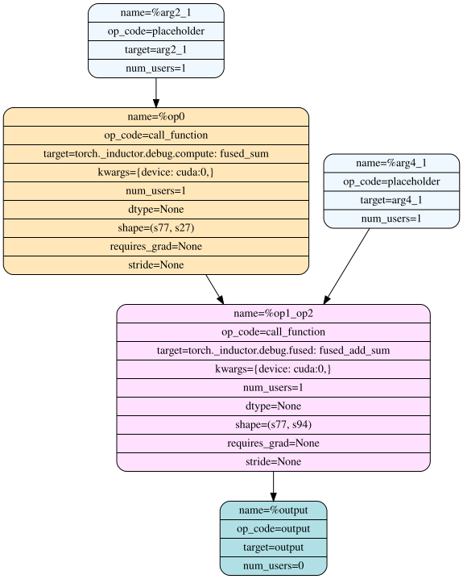

#### Written: October 31, 2026 · Guest post by Elias Ellison

This is Elias's notebook, as he wrote it. Each code cell sits beside the logs it produced on an H100 with `torch 2.16.0.dev20261031+cu132`. Hover over quoted code in the text to highlight it in the cell. To run it yourself:

<a class="colab-badge" href="https://colab.research.google.com/github/drisspg/nuggets/blob/main/source/content/media/inductor-walkthrough/inductor_walkthrough.ipynb">Open in Colab</a> <a class="colab-badge" href="./media/inductor-walkthrough/inductor_walkthrough.ipynb" download>Download .ipynb</a>

# Torchinductor Walkthrough 

We are going to walk through the various stages of torch.compile IR. 

## Pre-grad: 

Dynamo, as it traces the graph, builds up an IR representation that is essentially equivalent to what exists in user code. At
this point:
- IR has not been normalized: both `torch.nn.functional.relu()` and `x.relu()` may both exist 
- Mutation and unclear aliasing relationships still remain. For instance - operators like `.to` may return the input or clone it.
- Decompositions have not yet been applied. Pytorch's [2000](https://dev-discuss.pytorch.org/t/where-do-the-2000-pytorch-operators-come-from-more-than-you-wanted-to-know/373) operators still exist, as opposed to the much more limited set operators post decomposition.
- the forward and backward have not been traced out. It's unclear which operators will require what saved activations.
- Tensor Subclasses may exist in the graph with their semantics not yet traced through
- Similarly, Automated Mixed Precision, or other global modes which affect dispatching, will not yet be present.

For all of the above reasons, we discourage graph manipulation on this stage of the ir. 

```python cell
import os
os.environ['TORCH_LOGS_FORMAT'] = "[%(levelname)s]:%(message)s"
import torch
torch._inductor.config.force_disable_caches = True

torch._logging.set_logs(pre_grad_graphs=True)


@torch.compile()
def matmul(x):
    out = torch.nn.functional.linear(x, x)
    return out.relu(), torch.nn.functional.relu(out.add_(1)).to(torch.float16)


inp = torch.rand([256, 256], device="cuda", requires_grad=True)
out = matmul(inp)
```

```output python
[DEBUG]:TRACED GRAPH
 ===== BEFORE PRE GRAD =====
 torch/fx/_lazy_graph_module.py class GraphModule(torch.nn.Module):
    def forward(self, L_x_: "f32[256, 256][256, 1]cuda:0"):
        l_x_ = L_x_

        # File: <cell>:11 in matmul, code: out = torch.nn.functional.linear(x, x)
        out: "f32[256, 256][256, 1]cuda:0" = torch._C._nn.linear(l_x_, l_x_);  l_x_ = None

        # File: <cell>:12 in matmul, code: return out.relu(), torch.nn.functional.relu(out.add_(1)).to(torch.float16)
        relu: "f32[256, 256][256, 1]cuda:0" = out.relu()
        add_: "f32[256, 256][256, 1]cuda:0" = out.add_(1);  out = None
        relu_1: "f32[256, 256][256, 1]cuda:0" = torch.nn.functional.relu(add_);  add_ = None
        to: "f16[256, 256][256, 1]cuda:0" = relu_1.to(torch.float16);  relu_1 = None
        return (relu, to)
```

## Joint Graph 

To convert from the pre grad to joint graph representation, we trace through the graph with a custom `TorchDispatchMode` that builds up a graph on the fly. See [ProxyTorchDispatchMode](https://github.com/pytorch/pytorch/blob/6f6acb412828844ee3bcdbf277283144faba2524/torch/fx/experimental/proxy_tensor.py#L1379-L1410). During this tracing, we also functionalize the graph. For a more detailed overview of Tensor Subclasses, check out this existing [colab presentation](https://colab.research.google.com/drive/1zjAisRrc8R6uixKsrs1DRm3lwz5MWN68).


The Joint Graph is functional and made up of aten-IR. `torch.nn.functional.relu` is transformed to `aten.relu`, and the specific overload `aten.relu.default` corresponding to a particular input schemas has been determined. [CompositeImplicit Operators](https://github.com/pytorch/pytorch/blob/main/aten/src/ATen/native/README.md#dispatch), which internally dispatch to operators (`.to` for instance), will have been removed from the graph. Decompositions have also been applied. 

The Joint Graph is the first stage of the IR that inductor applies transformations to. 

**When to use joint graph passes:**

* **if you need to change both the forward and backward implementation of an operator**
* **if you expect your pass to decisions the partitioner makes about what tensors are saved, and what is recomputed**

Joint Graph passes should keep the graph functional, and composed of aten-ir. 

[Inductor Joint Graph Passes](https://github.com/pytorch/pytorch/blob/41de0f2eaf97fa9419190b93dc0b5b3b051a9adf/torch/_inductor/fx_passes/joint_graph.py).

```python cell
torch._dynamo.reset()
torch._logging.set_logs(pre_grad_graphs=False, aot_joint_graph=True)

out = matmul(inp)
```

```output python
[INFO]:TRACED GRAPH
 ===== Joint graph 1 =====
 torch/fx/_lazy_graph_module.py class inner_f(torch.nn.Module):
    def forward(self, primals, tangents):
        primals_1: "f32[256, 256][256, 1]cuda:0"; tangents_1: "f32[256, 256][256, 1]cuda:0"; tangents_2: "f16[256, 256][256, 1]cuda:0";

        primals_1, tangents_1, tangents_2, = fx_pytree.tree_flatten_spec([primals, tangents], self._in_spec)
        # File: <cell>:11 in matmul, code: out = torch.nn.functional.linear(x, x)
        permute: "f32[256, 256][1, 256]cuda:0" = torch.ops.aten.permute.default(primals_1, [1, 0])
        mm: "f32[256, 256][256, 1]cuda:0" = torch.ops.aten.mm.default(primals_1, permute)

        # File: <cell>:12 in matmul, code: return out.relu(), torch.nn.functional.relu(out.add_(1)).to(torch.float16)
        relu: "f32[256, 256][256, 1]cuda:0" = torch.ops.aten.relu.default(mm)
        alias: "f32[256, 256][256, 1]cuda:0" = torch.ops.aten.alias.default(relu)
        add: "f32[256, 256][256, 1]cuda:0" = torch.ops.aten.add.Tensor(mm, 1);  mm = None
        relu_1: "f32[256, 256][256, 1]cuda:0" = torch.ops.aten.relu.default(add);  add = None
        alias_1: "f32[256, 256][256, 1]cuda:0" = torch.ops.aten.alias.default(relu_1)
        convert_element_type: "f16[256, 256][256, 1]cuda:0" = torch.ops.prims.convert_element_type.default(relu_1, torch.float16);  relu_1 = None

        # Backward of forward node: File: <cell>:12 in matmul, code: return out.relu(), torch.nn.functional.relu(out.add_(1)).to(torch.float16)
        convert_element_type_1: "f32[256, 256][256, 1]cuda:0" = torch.ops.prims.convert_element_type.default(tangents_2, torch.float32);  tangents_2 = None
        alias_2: "f32[256, 256][256, 1]cuda:0" = torch.ops.aten.alias.default(alias_1);  alias_1 = None
        le: "b8[256, 256][256, 1]cuda:0" = torch.ops.aten.le.Scalar(alias_2, 0);  alias_2 = None
        scalar_tensor: "f32[][]cuda:0" = torch.ops.aten.scalar_tensor.default(0, dtype = torch.float32, layout = torch.strided, device = device(type='cuda', index=0))
        where: "f32[256, 256][256, 1]cuda:0" = torch.ops.aten.where.self(le, scalar_tensor, convert_element_type_1);  le = scalar_tensor = convert_element_type_1 = None
        alias_3: "f32[256, 256][256, 1]cuda:0" = torch.ops.aten.alias.default(alias);  alias = None
        le_1: "b8[256, 256][256, 1]cuda:0" = torch.ops.aten.le.Scalar(alias_3, 0);  alias_3 = None
        scalar_tensor_1: "f32[][]cuda:0" = torch.ops.aten.scalar_tensor.default(0, dtype = torch.float32, layout = torch.strided, device = device(type='cuda', index=0))
        where_1: "f32[256, 256][256, 1]cuda:0" = torch.ops.aten.where.self(le_1, scalar_tensor_1, tangents_1);  le_1 = scalar_tensor_1 = tangents_1 = None
        add_1: "f32[256, 256][256, 1]cuda:0" = torch.ops.aten.add.Tensor(where, where_1);  where = where_1 = None

        # Backward of forward node: File: <cell>:11 in matmul, code: out = torch.nn.functional.linear(x, x)
        permute_1: "f32[256, 256][1, 256]cuda:0" = torch.ops.aten.permute.default(add_1, [1, 0])
        mm_1: "f32[256, 256][256, 1]cuda:0" = torch.ops.aten.mm.default(permute_1, primals_1);  permute_1 = primals_1 = None
        permute_2: "f32[256, 256][1, 256]cuda:0" = torch.ops.aten.permute.default(mm_1, [1, 0]);  mm_1 = None
        permute_3: "f32[256, 256][256, 1]cuda:0" = torch.ops.aten.permute.default(permute, [1, 0]);  permute = None
        mm_2: "f32[256, 256][256, 1]cuda:0" = torch.ops.aten.mm.default(add_1, permute_3);  add_1 = permute_3 = None
        permute_4: "f32[256, 256][256, 1]cuda:0" = torch.ops.aten.permute.default(permute_2, [1, 0]);  permute_2 = None
        add_2: "f32[256, 256][256, 1]cuda:0" = torch.ops.aten.add.Tensor(mm_2, permute_4);  mm_2 = permute_4 = None
        return pytree.tree_unflatten([relu, convert_element_type, add_2], self._out_spec)
```

# (WIP) Post Grad Passes

After the partitioner has partitioned the joint graph into a separate forward and backward graph, we apply our post grad passes. 

There are two stages of post grad passes: functional and non-functional. 

# TorchInductor Scheduler

To start, lets look at a very simple example, a decomposed gelu. 

```python cell
torch._logging.set_logs(ir_pre_fusion=True, ir_post_fusion=True)


@torch.compile()
def foo(x):
    mul = torch.ops.aten.mul.Tensor(x, 0.5)
    mul_1 = torch.ops.aten.mul.Tensor(x, 0.7071067811865476)
    erf = torch.ops.aten.erf.default(mul_1)
    add = torch.ops.aten.add.Tensor(erf, 1)
    mul_2 = torch.ops.aten.mul.Tensor(mul, add)
    return (mul_2,)


_ = foo(torch.rand([32, 32], device="cuda"))
```

```output python
[INFO]:BEFORE FUSION
op0: SchedulerNode(ComputedBuffer)
op0.writes = [MemoryDep('buf0', 32*d0 + d1, {d0: 32, d1: 32})]
op0.unmet_dependencies = []
op0.met_dependencies = [MemoryDep('arg0_1', 32*d0 + d1, {d0: 32, d1: 32})]
op0.min_input_distance = 0
op0.max_input_distance = 0
op0.outputs = [
    buf0: ComputedBuffer
    buf0.layout = FixedLayout('cuda:0', torch.float32, size=[32, 32], stride=[32, 1])
    buf0.users = [NodeUser(node=OUTPUT, can_inplace=False, is_weak=False)]
]
op0.group.device = cuda:0
op0.group.iteration = (1024, 1)
op0.sizes = ([32, 32], [])
arg0_1_layout = FixedLayout('cuda:0', torch.float32, size=[32, 32], stride=[32, 1])
buf0_layout = FixedLayout('cuda:0', torch.float32, size=[32, 32], stride=[32, 1])
class op0_loop_body:
    var_ranges = {p0: 32, p1: 32}
    index0 = 32*p0 + p1
    def body(self, ops):
        get_index = self.get_index('index0')
        load = ops.load('arg0_1', get_index)
        constant = ops.constant(0.5, torch.float32)
        mul = ops.mul(load, constant)
        get_index_1 = self.get_index('index0')
        load_1 = ops.load('arg0_1', get_index_1)
        constant_1 = ops.constant(0.7071067811865476, torch.float32)
        mul_1 = ops.mul(load_1, constant_1)
        erf = ops.erf(mul_1)
        constant_2 = ops.constant(1.0, torch.float32)
        add = ops.add(erf, constant_2)
        mul_2 = ops.mul(mul, add)
        get_index_2 = self.get_index('index0')
        store = ops.store('buf0', get_index_2, mul_2, None)
        return store


[INFO]:AFTER FUSION
op0: SchedulerNode(ComputedBuffer)
op0.writes = [MemoryDep('buf0', c0, {c0: 1024})]
op0.unmet_dependencies = []
op0.met_dependencies = [MemoryDep('arg0_1', c0, {c0: 1024})]
op0.min_input_distance = 0
op0.max_input_distance = 0
op0.outputs = [
    buf0: ComputedBuffer
    buf0.layout = FixedLayout('cuda:0', torch.float32, size=[32, 32], stride=[32, 1])
    buf0.users = [NodeUser(node=OUTPUT, can_inplace=False, is_weak=False)]
]
op0.group.device = cuda:0
op0.group.iteration = (1024, 1)
op0.sizes = ((1024,), ())
arg0_1_layout = FixedLayout('cuda:0', torch.float32, size=[32, 32], stride=[32, 1])
buf0_layout = FixedLayout('cuda:0', torch.float32, size=[32, 32], stride=[32, 1])
class op0_loop_body:
    var_ranges = {p0: 1024}
    index0 = p0
    def body(self, ops):
        get_index = self.get_index('index0')
        load = ops.load('arg0_1', get_index)
        constant = ops.constant(0.5, torch.float32)
        mul = ops.mul(load, constant)
        get_index_1 = self.get_index('index0')
        load_1 = ops.load('arg0_1', get_index_1)
        constant_1 = ops.constant(0.7071067811865476, torch.float32)
        mul_1 = ops.mul(load_1, constant_1)
        erf = ops.erf(mul_1)
        constant_2 = ops.constant(1.0, torch.float32)
        add = ops.add(erf, constant_2)
        mul_2 = ops.mul(mul, add)
        get_index_2 = self.get_index('index0')
        store = ops.store('buf0', get_index_2, mul_2, None)
        return store
```

Oops, no fusion occurred - there was only a single Scheduler Node before and after fusion.

That is because during aten IR lowering to Inductor IR, we do some amount of inlining as we lower. We only inline pointwise objects. 

Recomputing operations can allow us to improve fusion. Here, on the left, we assume that `clone` cannot be fused. By inlining `cos` and `relu` into their use in `add`, we avoid having to materialize them in global memory. 

This can be especially important when broadcasts result in a output of pointwise node being much larger than its inputs, and in the backward, where we often save smaller tensors that get reused multiple times, and broadcasted/converted to a larger dtype.

<!-- TODO: inlining diagram (clone not fusible; cos and relu inlined into add) is not yet exported from the internal notebook. -->


In some cases, inlining also avoids current scheduler-level limitations where we wouldn't fuse two nodes. 


To update the inlining heuristcs, see `config.realize_reads_threshold`, `config.realize_opcount_threshold`, and `realize_acc_reads_threshold` [here](https://github.com/pytorch/pytorch/blob/f0c9b3385d99a74075dae3cc3e53d79b619bee7f/torch/_inductor/config.py#L505-L512).

## Scheduler

The scheduler has 2 components. There’s the back-end agnostic component (Scheduler in scheduler.py), and the back-end specific component (TritonScheduling in codegen/triton.py). Different backends may have different heuristics on what is fusable and how profitable the fusions might be. 


The first thing the scheduler does is convert lowering IR `ComputedBuffer` nodes into schedule.SchedulerNode nodes with corresponding `SchedulerBuffer`. (this happens [here](https://github.com/pytorch/pytorch/blob/main/torch/_inductor/scheduler.py#L1025-L1068))

There are a few important fields on the SchedulerNode, in addition to various use/def metadata you might be familiar.
```
class SchedulerNode:
    _sizes: tuple[Sequence[sympy.Expr], ...]
    _body: LoopBody
    read_writes: dependencies.ReadWrites
```

`_sizes` correspond to the iteration variables inductor will codegen. The first sequence is the pointwise iteration sizes, and the second sequence is the reduction iteration size. 

`_body` is the persistent representation of Inductor IR that we will do loop level modifications to. For instance, [applying a new loop order](https://github.com/pytorch/pytorch/blob/8cb6957e019086c1f6e39941047ead6e29f6f402/torch/_inductor/scheduler.py#L1108-L1113).

`_read_writes`: are the global reads and writes of the ir. 

In order to fuse we need to have compatible iteration variables, and we need a matching read and write which indicates fusing the two nodes would result in reduced global memory access. 

Lets take a look at an example.

```python cell
torch._logging.set_logs(ir_pre_fusion=True, fusion=True, ir_post_fusion=True)

@torch.compile(dynamic=True)
def foo(x, y):
    return x.sum(dim=1) + (y + 3).sum(dim=1)

_ = foo(torch.rand([10, 50], device="cuda"), torch.rand([10, 60], device="cuda"))
```

```output python
[INFO]:BEFORE FUSION
op0: SchedulerNode(ComputedBuffer)
op0.writes = [MemoryDep('buf0', d0, {d0: s77})]
op0.unmet_dependencies = []
op0.met_dependencies = [MemoryDep('arg2_1', d0*s27 + d1, {d0: s77, d1: s27})]
op0.min_input_distance = 0
op0.max_input_distance = 0
op0.outputs = [
    buf0: ComputedBuffer
    buf0.layout = FixedLayout('cuda:0', torch.float32, size=[s77], stride=[1])
    buf0.users = [NodeUser(node=SchedulerNode(name='op2'), can_inplace=True, is_weak=False)]
]
op0.group.device = cuda:0
op0.group.iteration = (s77, s27)
op0.sizes = ([s77], [s27])
arg2_1_layout = FixedLayout('cuda:0', torch.float32, size=[s77, s27], stride=[s27, 1])
buf0_layout = FixedLayout('cuda:0', torch.float32, size=[s77], stride=[1])
class op0_loop_body:
    var_ranges = {p0: s77, p1: s27}
    index0 = p0*s27 + p1
    index1 = p0
    def body(self, ops):
        get_index = self.get_index('index0')
        load = ops.load('arg2_1', get_index)
        reduction = ops.reduction(torch.float32, torch.float32, 'sum', load)
        get_index_1 = self.get_index('index1')
        store_reduction = ops.store_reduction('buf0', get_index_1, reduction)
        return None


op1: SchedulerNode(ComputedBuffer)
op1.writes = [MemoryDep('buf1', d0, {d0: s77})]
op1.unmet_dependencies = []
op1.met_dependencies = [MemoryDep('arg4_1', d0*s94 + d1, {d0: s77, d1: s94})]
op1.min_input_distance = 0
op1.max_input_distance = 0
op1.outputs = [
    buf1: ComputedBuffer
    buf1.layout = FixedLayout('cuda:0', torch.float32, size=[s77], stride=[1])
    buf1.users = [NodeUser(node=SchedulerNode(name='op2'), can_inplace=True, is_weak=False)]
]
op1.group.device = cuda:0
op1.group.iteration = (s77, s94)
op1.sizes = ([s77], [s94])
arg4_1_layout = FixedLayout('cuda:0', torch.float32, size=[s77, s94], stride=[s94, 1])
buf1_layout = FixedLayout('cuda:0', torch.float32, size=[s77], stride=[1])
class op1_loop_body:
    var_ranges = {p0: s77, p1: s94}
    index0 = p0*s94 + p1
    index1 = p0
    def body(self, ops):
        get_index = self.get_index('index0')
        load = ops.load('arg4_1', get_index)
        constant = ops.constant(3.0, torch.float32)
        add = ops.add(load, constant)
        reduction = ops.reduction(torch.float32, torch.float32, 'sum', add)
        get_index_1 = self.get_index('index1')
        store_reduction = ops.store_reduction('buf1', get_index_1, reduction)
        return None


op2: SchedulerNode(ComputedBuffer)
op2.writes = [MemoryDep('buf2', d0, {d0: s77})]
op2.unmet_dependencies = [MemoryDep('buf0', d0, {d0: s77}), MemoryDep('buf1', d0, {d0: s77})]
op2.met_dependencies = []
op2.min_input_distance = 1
op2.max_input_distance = 1
op2.outputs = [
    buf2: ComputedBuffer
    buf2.layout = FixedLayout('cuda:0', torch.float32, size=[s77], stride=[1])
    buf2.users = [NodeUser(node=OUTPUT, can_inplace=False, is_weak=False)]
]
op2.group.device = cuda:0
op2.group.iteration = (s77, 1)
op2.sizes = ([s77], [])
buf0_layout = FixedLayout('cuda:0', torch.float32, size=[s77], stride=[1])
buf1_layout = FixedLayout('cuda:0', torch.float32, size=[s77], stride=[1])
buf2_layout = FixedLayout('cuda:0', torch.float32, size=[s77], stride=[1])
class op2_loop_body:
    var_ranges = {p0: s77}
    index0 = p0
    def body(self, ops):
        get_index = self.get_index('index0')
        load = ops.load('buf0', get_index)
        get_index_1 = self.get_index('index0')
        load_1 = ops.load('buf1', get_index_1)
        add = ops.add(load, load_1)
        get_index_2 = self.get_index('index0')
        store = ops.store('buf2', get_index_2, add, None)
        return store


[DEBUG]:===== attempting fusion (1/10): 3 nodes =====
[DEBUG]:fuse_nodes_once, candidates:
[DEBUG]:  SchedulerNode(name='op0'), Reduction(['[s27]', 'sum', 'origins=OrderedSet([sum_1])', 'stack_traces = {', '  File "<cell>", line 5, in foo', '    return x.sum(dim=1) + (y + 3).sum(dim=1)', '           ^^^^^^^^^^^^', '', '}'])
[DEBUG]:  SchedulerNode(name='op1'), Reduction(['[s94]', 'sum', 'origins=OrderedSet([sum_2, add])', 'stack_traces = {', '  File "<cell>", line 5, in foo', '    return x.sum(dim=1) + (y + 3).sum(dim=1)', '                          ^^^^^^^^^^^^^^^^^^', '', '}', 'stack_traces = {', '  File "<cell>", line 5, in foo', '    return x.sum(dim=1) + (y + 3).sum(dim=1)', '                           ~~^~~', '', '}'])
[DEBUG]:  SchedulerNode(name='op2'), Pointwise(['[s77]', 'origins=OrderedSet([add_1])', 'stack_traces = {', '  File "<cell>", line 5, in foo', '    return x.sum(dim=1) + (y + 3).sum(dim=1)', '           ~~~~~~~~~~~~~^~~~~~~~~~~~~~~~~~~~', '', '}'])
[DEBUG]:found 2 possible fusions
[DEBUG]:fusing op1 with op2
[DEBUG]:cannot fuse op0 with op1_op2: numel/rnumel mismatch (reduce) (s77, s77), (s27, s94)
[DEBUG]:completed fusion round (1/10): fused 3 nodes into 2 nodes

[DEBUG]:===== attempting fusion (2/10): 2 nodes =====
[DEBUG]:fuse_nodes_once, candidates:
[DEBUG]:  SchedulerNode(name='op0'), Reduction(['[s27]', 'sum', 'origins=OrderedSet([sum_1])', 'stack_traces = {', '  File "<cell>", line 5, in foo', '    return x.sum(dim=1) + (y + 3).sum(dim=1)', '           ^^^^^^^^^^^^', '', '}'])
[DEBUG]:  FusedSchedulerNode(nodes=op1_op2), snodes: ['SchedulerNode(name=\'op1\'), Reduction([\'[s94]\', \'sum\', \'origins=OrderedSet([sum_2, add])\', \'stack_traces = {\', \'  File "<cell>", line 5, in foo\', \'    return x.sum(dim=1) + (y + 3).sum(dim=1)\', \'                          ^^^^^^^^^^^^^^^^^^\', \'\', \'}\', \'stack_traces = {\', \'  File "<cell>", line 5, in foo\', \'    return x.sum(dim=1) + (y + 3).sum(dim=1)\', \'                           ~~^~~\', \'\', \'}\'])', 'SchedulerNode(name=\'op2\'), Pointwise([\'[s77]\', \'origins=OrderedSet([add_1])\', \'stack_traces = {\', \'  File "<cell>", line 5, in foo\', \'    return x.sum(dim=1) + (y + 3).sum(dim=1)\', \'           ~~~~~~~~~~~~~^~~~~~~~~~~~~~~~~~~~\', \'\', \'}\'])']
[DEBUG]:cannot fuse op0 with op1_op2: numel/rnumel mismatch (reduce) (s77, s77), (s27, s94)
[DEBUG]:found 0 possible fusions
[DEBUG]:completed fusion round (2/10): fused 2 nodes into 2 nodes

[DEBUG]:===== fusion complete (2 iterations) =====
[DEBUG]:fuse_nodes_once, candidates:
[DEBUG]:  SchedulerNode(name='op0'), Reduction(['[s27]', 'sum', 'origins=OrderedSet([sum_1])', 'stack_traces = {', '  File "<cell>", line 5, in foo', '    return x.sum(dim=1) + (y + 3).sum(dim=1)', '           ^^^^^^^^^^^^', '', '}'])
[DEBUG]:  FusedSchedulerNode(nodes=op1_op2), snodes: ['SchedulerNode(name=\'op1\'), Reduction([\'[s94]\', \'sum\', \'origins=OrderedSet([sum_2, add])\', \'stack_traces = {\', \'  File "<cell>", line 5, in foo\', \'    return x.sum(dim=1) + (y + 3).sum(dim=1)\', \'                          ^^^^^^^^^^^^^^^^^^\', \'\', \'}\', \'stack_traces = {\', \'  File "<cell>", line 5, in foo\', \'    return x.sum(dim=1) + (y + 3).sum(dim=1)\', \'                           ~~^~~\', \'\', \'}\'])', 'SchedulerNode(name=\'op2\'), Pointwise([\'[s77]\', \'origins=OrderedSet([add_1])\', \'stack_traces = {\', \'  File "<cell>", line 5, in foo\', \'    return x.sum(dim=1) + (y + 3).sum(dim=1)\', \'           ~~~~~~~~~~~~~^~~~~~~~~~~~~~~~~~~~\', \'\', \'}\'])']
[DEBUG]:cannot fuse op0 with op1_op2: numel/rnumel mismatch (reduce) (s77, s77), (s27, s94)
[DEBUG]:found 0 possible fusions
[INFO]:AFTER FUSION
op0: SchedulerNode(ComputedBuffer)
op0.writes = [MemoryDep('buf0', c0, {c0: s77})]
op0.unmet_dependencies = []
op0.met_dependencies = [MemoryDep('arg2_1', c0, {c0: s27*s77})]
op0.min_input_distance = 0
op0.max_input_distance = 0
op0.outputs = [
    buf0: ComputedBuffer
    buf0.layout = FixedLayout('cuda:0', torch.float32, size=[s77], stride=[1])
    buf0.users = [NodeUser(node=SchedulerNode(name='op2'), can_inplace=True, is_weak=False)]
]
op0.group.device = cuda:0
op0.group.iteration = (s77, s27)
op0.sizes = ((s77,), (s27,))
arg2_1_layout = FixedLayout('cuda:0', torch.float32, size=[s77, s27], stride=[s27, 1])
buf0_layout = FixedLayout('cuda:0', torch.float32, size=[s77], stride=[1])
class op0_loop_body:
    var_ranges = {p0: s77, p1: s27}
    index0 = p0*s27 + p1
    index1 = p0
    def body(self, ops):
        get_index = self.get_index('index0')
        load = ops.load('arg2_1', get_index)
        reduction = ops.reduction(torch.float32, torch.float32, 'sum', load)
        get_index_1 = self.get_index('index1')
        store_reduction = ops.store_reduction('buf0', get_index_1, reduction)
        return None


op1_op2: FusedSchedulerNode(SchedulerNode,SchedulerNode)
op1_op2.writes = [MemoryDep('buf1', d0, {d0: s77}), MemoryDep('buf2', d0, {d0: s77})]
op1_op2.unmet_dependencies = [MemoryDep('buf0', d0, {d0: s77})]
op1_op2.met_dependencies = [MemoryDep('arg4_1', d0*s94 + d1, {d0: s77, d1: s94})]
op1_op2.min_input_distance = 0
op1_op2.max_input_distance = 1
op1_op2.outputs = [
    buf1: ComputedBuffer
    buf1.layout = FixedLayout('cuda:0', torch.float32, size=[s77], stride=[1])
    buf1.users = [NodeUser(node=SchedulerNode(name='op2'), can_inplace=True, is_weak=False)]
    buf2: ComputedBuffer
    buf2.layout = FixedLayout('cuda:0', torch.float32, size=[s77], stride=[1])
    buf2.users = [NodeUser(node=OUTPUT, can_inplace=False, is_weak=False)]
]
op1_op2.snodes[0] =
op1: SchedulerNode(ComputedBuffer)
op1.writes = [MemoryDep('buf1', c0, {c0: s77})]
op1.unmet_dependencies = []
op1.met_dependencies = [MemoryDep('arg4_1', c0, {c0: s77*s94})]
op1.min_input_distance = 0
op1.max_input_distance = 0
op1.outputs = [
    buf1: ComputedBuffer
    buf1.layout = FixedLayout('cuda:0', torch.float32, size=[s77], stride=[1])
    buf1.users = [NodeUser(node=SchedulerNode(name='op2'), can_inplace=True, is_weak=False)]
]
op1.group.device = cuda:0
op1.group.iteration = (s77, s94)
op1.sizes = ((s77,), (s94,))
arg4_1_layout = FixedLayout('cuda:0', torch.float32, size=[s77, s94], stride=[s94, 1])
buf1_layout = FixedLayout('cuda:0', torch.float32, size=[s77], stride=[1])
class op1_loop_body:
    var_ranges = {p0: s77, p1: s94}
    index0 = p0*s94 + p1
    index1 = p0
    def body(self, ops):
        get_index = self.get_index('index0')
        load = ops.load('arg4_1', get_index)
        constant = ops.constant(3.0, torch.float32)
        add = ops.add(load, constant)
        reduction = ops.reduction(torch.float32, torch.float32, 'sum', add)
        get_index_1 = self.get_index('index1')
        store_reduction = ops.store_reduction('buf1', get_index_1, reduction)
        return None
op1_op2.snodes[1] =
op2: SchedulerNode(ComputedBuffer)
op2.writes = [MemoryDep('buf2', c0, {c0: s77})]
op2.unmet_dependencies = [MemoryDep('buf0', c0, {c0: s77}), MemoryDep('buf1', c0, {c0: s77})]
op2.met_dependencies = []
op2.min_input_distance = 1
op2.max_input_distance = 1
op2.outputs = [
    buf2: ComputedBuffer
    buf2.layout = FixedLayout('cuda:0', torch.float32, size=[s77], stride=[1])
    buf2.users = [NodeUser(node=OUTPUT, can_inplace=False, is_weak=False)]
]
op2.group.device = cuda:0
op2.group.iteration = (s77, 1)
op2.sizes = ((s77,), ())
buf0_layout = FixedLayout('cuda:0', torch.float32, size=[s77], stride=[1])
buf1_layout = FixedLayout('cuda:0', torch.float32, size=[s77], stride=[1])
buf2_layout = FixedLayout('cuda:0', torch.float32, size=[s77], stride=[1])
class op2_loop_body:
    var_ranges = {p0: s77}
    index0 = p0
    def body(self, ops):
        get_index = self.get_index('index0')
        load = ops.load('buf0', get_index)
        get_index_1 = self.get_index('index0')
        load_1 = ops.load('buf1', get_index_1)
        add = ops.add(load, load_1)
        get_index_2 = self.get_index('index0')
        store = ops.store('buf2', get_index_2, add, None)
        return store
```

There are three nodes before fusion, corresponding to the two sums, and the addition of the sum. Note, that the `y + 3` was inlined into the reduction. 

We were able to fuse one of the reductions with the add, then, we are unable to fuse the subsequent reduction. 

See: `[DEBUG]:cannot fuse op0 with op1_op2: numel/rnumel mismatch (reduce) (s77, s77), (s27, s94)`

The reduction iteration variables between the first sum and second sum differ. [Here](https://github.com/pytorch/pytorch/blob/8cb6957e019086c1f6e39941047ead6e29f6f402/torch/_inductor/codegen/simd.py#L1091-L1225) is the code that checks this.

If we re-run this example with the same sizes we should see fusion.

```python cell
torch._logging.set_logs(ir_pre_fusion=False, fusion=True, ir_post_fusion=False)

@torch.compile(dynamic=True)
def foo(x, y):
    return x.sum(dim=1) + (y + 3).sum(dim=1)

_ = foo(torch.rand([10, 60], device="cuda"), torch.rand([10, 60], device="cuda"))
```

```output python
[DEBUG]:===== attempting fusion (1/10): 3 nodes =====
[DEBUG]:fuse_nodes_once, candidates:
[DEBUG]:  SchedulerNode(name='op0'), Reduction(['[s27]', 'sum', 'origins=OrderedSet([sum_1])', 'stack_traces = {', '  File "<cell>", line 5, in foo', '    return x.sum(dim=1) + (y + 3).sum(dim=1)', '           ^^^^^^^^^^^^', '', '}'])
[DEBUG]:  SchedulerNode(name='op1'), Reduction(['[s27]', 'sum', 'origins=OrderedSet([sum_2, add])', 'stack_traces = {', '  File "<cell>", line 5, in foo', '    return x.sum(dim=1) + (y + 3).sum(dim=1)', '                          ^^^^^^^^^^^^^^^^^^', '', '}', 'stack_traces = {', '  File "<cell>", line 5, in foo', '    return x.sum(dim=1) + (y + 3).sum(dim=1)', '                           ~~^~~', '', '}'])
[DEBUG]:  SchedulerNode(name='op2'), Pointwise(['[s77]', 'origins=OrderedSet([add_1])', 'stack_traces = {', '  File "<cell>", line 5, in foo', '    return x.sum(dim=1) + (y + 3).sum(dim=1)', '           ~~~~~~~~~~~~~^~~~~~~~~~~~~~~~~~~~', '', '}'])
[DEBUG]:found 2 possible fusions
[DEBUG]:fusing op1 with op2
[DEBUG]:fusing op0 with op1_op2
[DEBUG]:completed fusion round (1/10): fused 3 nodes into 1 nodes

[DEBUG]:===== fusion complete (1 iterations) =====
[DEBUG]:fuse_nodes_once, candidates:
[DEBUG]:  FusedSchedulerNode(nodes=op0_op1_op2), snodes: ['SchedulerNode(name=\'op0\'), Reduction([\'[s27]\', \'sum\', \'origins=OrderedSet([sum_1])\', \'stack_traces = {\', \'  File "<cell>", line 5, in foo\', \'    return x.sum(dim=1) + (y + 3).sum(dim=1)\', \'           ^^^^^^^^^^^^\', \'\', \'}\'])', 'SchedulerNode(name=\'op1\'), Reduction([\'[s27]\', \'sum\', \'origins=OrderedSet([sum_2, add])\', \'stack_traces = {\', \'  File "<cell>", line 5, in foo\', \'    return x.sum(dim=1) + (y + 3).sum(dim=1)\', \'                          ^^^^^^^^^^^^^^^^^^\', \'\', \'}\', \'stack_traces = {\', \'  File "<cell>", line 5, in foo\', \'    return x.sum(dim=1) + (y + 3).sum(dim=1)\', \'                           ~~^~~\', \'\', \'}\'])', 'SchedulerNode(name=\'op2\'), Pointwise([\'[s77]\', \'origins=OrderedSet([add_1])\', \'stack_traces = {\', \'  File "<cell>", line 5, in foo\', \'    return x.sum(dim=1) + (y + 3).sum(dim=1)\', \'           ~~~~~~~~~~~~~^~~~~~~~~~~~~~~~~~~~\', \'\', \'}\'])']
[DEBUG]:found 0 possible fusions
```

Similarly, if the, reads and writes were accessed differently, we might not fuse. We do have an option to reorder loops in the scheduler to make fusion occur, which we are working on enabling by defualt. `loop_ordering_after_fusion`.

Now that we have the basics of SchedulerNode down, lets take a higher level look at how the Scheduler works. At a high level, the Scheduler has a single objective: minimize global reads and writes. 

There are essentially three parts:

-  [Generate possible fusions](https://github.com/pytorch/pytorch/blob/f1d636f85b1d00e73c8e6d14c10d739efdaec124/torch/_inductor/scheduler.py#L3164-L3212) by grouping nodes which access the same buffer

```
buffer_names_grouping = collections.defaultdict(list)
for node in nodes:
    if self.unfusable_node(node):
        continue
    for buf in node.used_buffer_names():
        buffer_names_grouping[buf].append(node)
for node_grouping in buffer_names_grouping.values():
    check_all_pairs(node_grouping)
```


- [Rank possible fusions](https://github.com/pytorch/pytorch/blob/f1d636f85b1d00e73c8e6d14c10d739efdaec124/torch/_inductor/choices.py#L378-L413) by amount of global memory saved, 


```
Assign a score (higher comes first) to the fusion of node1 and node2.
When different fusions conflict with each other, this is the way we
decide what order to run them in.

Our current score is based on:
- The type of fusion (template/reduction/etc)
- Estimate of the saved memory operations
- Fusions closer together in original graph order
```


- [Try to fuse nodes in order of the above ranking](https://github.com/pytorch/pytorch/blob/f1d636f85b1d00e73c8e6d14c10d739efdaec124/torch/_inductor/scheduler.py#L3070-L3080)

```
for node1, node2 in self.get_possible_fusions(nodes):
    resolve_pending_fusions(node1, node2)
    node1 = self.get_fused_node(node1)
    node2 = self.get_fused_node(node2)

    if self.can_fuse(node1, node2) and not self.will_fusion_create_cycle(
        node1, node2
    ):
```

When we successfully fuse two SchedulerNodes, we create a [FusedSchedulerNode](https://github.com/pytorch/pytorch/blob/f1d636f85b1d00e73c8e6d14c10d739efdaec124/torch/_inductor/scheduler.py#L1322) :


```
class FusedSchedulerNode(BaseSchedulerNode):
    """
    This is a "fake" scheduler node that represents a group of scheduler nodes
    that are meant to be fused together. The way it does this is by maintaining
    its unmet dependencies as the union of its constituent nodes.
    """

    snodes: list[BaseSchedulerNode]
```

# Case Study: epilogue aware matmul choice

In autotuning between Cublas and Triton Templates for matmuls, we take into account the surrounding possible fusions before deciding which kernel to choose. 

During scheduling time we invoke [speedup_by_fusion](https://github.com/pytorch/pytorch/blob/f1d636f85b1d00e73c8e6d14c10d739efdaec124/torch/_inductor/scheduler.py#L2750-L2756) which for matmuls will benchmark the possible fusion and finalize the choice as a TritonTemplate if a fusion is profitable. 

Below, a triton template for a matmul is not profitable on its own, but becomes profitable with fusion. 

```python cell
import torch
torch._logging.set_logs(fusion=True)


@torch.compile(mode='max-autotune-no-cudagraphs')
def foo(x, y):
    return (x @ y).relu()


x = torch.rand([8192, 1024], device="cuda", dtype=torch.float16)
y = torch.rand([1024, 1024], device="cuda", dtype=torch.float16)

_ = foo(x, y)
```

```output python
[DEBUG]:===== attempting fusion (1/10): 2 nodes =====
[DEBUG]:fuse_nodes_once, candidates:
[DEBUG]:  SchedulerNode(name='op0')
[DEBUG]:  SchedulerNode(name='op1'), Pointwise(['[8192, 1024]', 'origins=OrderedSet([relu])', 'stack_traces = {', '  File "<cell>", line 7, in foo', '    return (x @ y).relu()', '           ^^^^^^^^^^^^^^', '', '}'])
[DEBUG]:found 1 possible fusions
Autotune Choices Stats:
{"num_choices": 22, "num_triton_choices": 21, "best_kernel": "mm", "best_time": 0.029952000826597214, "best_triton_pos": 1, "best_triton_time": 0.03372799977660179, "best_triton_kernel": "triton_mm_17", "best_triton_kernel_desc": "ACC_TYPE='tl.float32', ALLOW_TF32=False, BLOCK_K=64, BLOCK_M=128, BLOCK_N=128, EVEN_K=True, GROUP_M=8, USE_FAST_ACCUM=False, num_stages=3, num_warps=4"}
AUTOTUNE mm(8192x1024, 1024x1024)
strides: [1024, 1], [1024, 1]
dtypes: torch.float16, torch.float16
  mm 0.0300 ms 100.0% 
  triton_mm_17 0.0337 ms 88.8% ACC_TYPE='tl.float32', ALLOW_TF32=False, BLOCK_K=64, BLOCK_M=128, BLOCK_N=128, EVEN_K=True, GROUP_M=8, USE_FAST_ACCUM=False, num_stages=3, num_warps=4
  triton_mm_20 0.0338 ms 88.6% ACC_TYPE='tl.float32', ALLOW_TF32=False, BLOCK_K=64, BLOCK_M=128, BLOCK_N=256, EVEN_K=True, GROUP_M=8, USE_FAST_ACCUM=False, num_stages=4, num_warps=8
  triton_mm_18 0.0387 ms 77.4% ACC_TYPE='tl.float32', ALLOW_TF32=False, BLOCK_K=64, BLOCK_M=128, BLOCK_N=128, EVEN_K=True, GROUP_M=8, USE_FAST_ACCUM=False, num_stages=5, num_warps=8
  triton_mm_16 0.0402 ms 74.5% ACC_TYPE='tl.float32', ALLOW_TF32=False, BLOCK_K=32, BLOCK_M=128, BLOCK_N=128, EVEN_K=True, GROUP_M=8, USE_FAST_ACCUM=False, num_stages=3, num_warps=4
  triton_mm_11 0.0404 ms 74.1% ACC_TYPE='tl.float32', ALLOW_TF32=False, BLOCK_K=64, BLOCK_M=64, BLOCK_N=128, EVEN_K=True, GROUP_M=8, USE_FAST_ACCUM=False, num_stages=3, num_warps=4
  triton_mm_9 0.0408 ms 73.5% ACC_TYPE='tl.float32', ALLOW_TF32=False, BLOCK_K=32, BLOCK_M=64, BLOCK_N=128, EVEN_K=True, GROUP_M=8, USE_FAST_ACCUM=False, num_stages=3, num_warps=4
  triton_mm_10 0.0464 ms 64.5% ACC_TYPE='tl.float32', ALLOW_TF32=False, BLOCK_K=32, BLOCK_M=64, BLOCK_N=128, EVEN_K=True, GROUP_M=8, USE_FAST_ACCUM=False, num_stages=4, num_warps=8
  triton_mm_12 0.0480 ms 62.4% ACC_TYPE='tl.float32', ALLOW_TF32=False, BLOCK_K=128, BLOCK_M=64, BLOCK_N=128, EVEN_K=True, GROUP_M=8, USE_FAST_ACCUM=False, num_stages=4, num_warps=4
  triton_mm_13 0.0498 ms 60.2% ACC_TYPE='tl.float32', ALLOW_TF32=False, BLOCK_K=32, BLOCK_M=128, BLOCK_N=64, EVEN_K=True, GROUP_M=8, USE_FAST_ACCUM=False, num_stages=3, num_warps=4
SingleProcess AUTOTUNE benchmarking takes 0.6907 seconds and 4.0562 seconds precompiling for 22 choices
[DEBUG]:can fuse (benchmark): fusing OrderedSet(['buf0']) with OrderedSet(['buf1']) cause 1.130x speedup
[DEBUG]:fusing op0 with op1
[DEBUG]:completed fusion round (1/10): fused 2 nodes into 1 nodes

[DEBUG]:===== fusion complete (1 iterations) =====
[DEBUG]:fuse_nodes_once, candidates:
[DEBUG]:  FusedSchedulerNode(nodes=op0_op1), snodes: ["SchedulerNode(name='op0')", 'SchedulerNode(name=\'op1\'), Pointwise([\'[8192, 1024]\', \'origins=OrderedSet([relu])\', \'stack_traces = {\', \'  File "<cell>", line 7, in foo\', \'    return (x @ y).relu()\', \'           ^^^^^^^^^^^^^^\', \'\', \'}\'])']
[DEBUG]:found 0 possible fusions
```

Because compilation of Triton Matmuls is expensive, there are actually three possible returns from `speedup_by_fusion`:

- False
- True
- Callable that will return True or False

We async compile any epilogue fusion, and store it as [a pending fusion](https://github.com/pytorch/pytorch/blob/f1d636f85b1d00e73c8e6d14c10d739efdaec124/torch/_inductor/scheduler.py#L3022-L3027). Then, before we fuse either of its two nodes, or at the ending of the fusion, we resolve all pending fusions

Any matmuls that are unfused, either because lack of fusion or lack of profitability, will be finalized post fusion and pre-codegen in [finalize_multi_template_buffers](https://github.com/pytorch/pytorch/blob/f1d636f85b1d00e73c8e6d14c10d739efdaec124/torch/_inductor/scheduler.py#L2086). 

# Combo Kernels / Horizontal Fusion

The scheduler fusion examples above are *vertical* fusion: two nodes share a producer/consumer relationship or a common buffer access pattern, so fusing them can remove a global read/write.

Combo kernels are a horizontal fusion pass. They target independent scheduler nodes that do not share tensors and do not have data dependencies. There is no loop-body rewrite to make them read the same data; the win is that several small kernels can share one launch.

The relevant knobs are:

- `torch._inductor.config.combo_kernels`: enable combo kernel generation.
- `torch._inductor.config.benchmark_combo_kernel`: optionally require a benchmarked speedup before accepting a combo.
- `torch._inductor.config.combo_kernel_per_subkernel_blocks`: let each subkernel keep its own autotuned block sizes.
- `test/inductor/test_combo_kernels.py`: the main test coverage for the feature.

```python cell
import os

os.environ.setdefault("TORCH_LOGS_FORMAT", "[%(levelname)s]:%(message)s")

import torch
from torch._inductor import config as inductor_config

inductor_config.force_disable_caches = True


def set_demo_logs():
    torch._logging.set_logs(
        fusion=True,
        ir_pre_fusion=True,
        ir_post_fusion=True,
        output_code=True,
        schedule=True,
    )


def run_combo_kernel_demo(combo: bool):
    torch._dynamo.reset()
    set_demo_logs()

    @torch.compile(fullgraph=True)
    def independent_reductions(a, b):
        return a.sum(dim=-1), b.sum(dim=-1)

    # Two independent reductions with different reduction sizes.
    a = torch.randn(1024, 64, device="cuda")
    b = torch.randn(1024, 512, device="cuda")

    with inductor_config.patch({
        "combo_kernels": combo,
        "benchmark_combo_kernel": False,
        "combo_kernel_per_subkernel_blocks": combo,
        "triton.unique_kernel_names": True,
    }):
        out = independent_reductions(a, b)
        torch.cuda.synchronize()
        return out


for combo in (False, True):
    print(f"\n=== combo_kernels={combo} ===")
    _ = run_combo_kernel_demo(combo)
```

```output python
=== combo_kernels=False ===
[INFO]:BEFORE FUSION
op0: SchedulerNode(ComputedBuffer)
op0.writes = [MemoryDep('buf0', d0, {d0: 1024})]
op0.unmet_dependencies = []
op0.met_dependencies = [MemoryDep('arg0_1', 64*d0 + d1, {d0: 1024, d1: 64})]
op0.min_input_distance = 0
op0.max_input_distance = 0
op0.outputs = [
    buf0: ComputedBuffer
    buf0.layout = FixedLayout('cuda:0', torch.float32, size=[1024], stride=[1])
    buf0.users = [NodeUser(node=OUTPUT, can_inplace=False, is_weak=False)]
]
op0.group.device = cuda:0
op0.group.iteration = (1024, 64)
op0.sizes = ([1024], [64])
arg0_1_layout = FixedLayout('cuda:0', torch.float32, size=[1024, 64], stride=[64, 1])
buf0_layout = FixedLayout('cuda:0', torch.float32, size=[1024], stride=[1])
class op0_loop_body:
    var_ranges = {p0: 1024, p1: 64}
    index0 = 64*p0 + p1
    index1 = p0
    def body(self, ops):
        get_index = self.get_index('index0')
        load = ops.load('arg0_1', get_index)
        reduction = ops.reduction(torch.float32, torch.float32, 'sum', load)
        get_index_1 = self.get_index('index1')
        store_reduction = ops.store_reduction('buf0', get_index_1, reduction)
        return None


op1: SchedulerNode(ComputedBuffer)
op1.writes = [MemoryDep('buf1', d0, {d0: 1024})]
op1.unmet_dependencies = []
op1.met_dependencies = [MemoryDep('arg1_1', 512*d0 + d1, {d0: 1024, d1: 512})]
op1.min_input_distance = 0
op1.max_input_distance = 0
op1.outputs = [
    buf1: ComputedBuffer
    buf1.layout = FixedLayout('cuda:0', torch.float32, size=[1024], stride=[1])
    buf1.users = [NodeUser(node=OUTPUT, can_inplace=False, is_weak=False)]
]
op1.group.device = cuda:0
op1.group.iteration = (1024, 512)
op1.sizes = ([1024], [512])
arg1_1_layout = FixedLayout('cuda:0', torch.float32, size=[1024, 512], stride=[512, 1])
buf1_layout = FixedLayout('cuda:0', torch.float32, size=[1024], stride=[1])
class op1_loop_body:
    var_ranges = {p0: 1024, p1: 512}
    index0 = 512*p0 + p1
    index1 = p0
    def body(self, ops):
        get_index = self.get_index('index0')
        load = ops.load('arg1_1', get_index)
        reduction = ops.reduction(torch.float32, torch.float32, 'sum', load)
        get_index_1 = self.get_index('index1')
        store_reduction = ops.store_reduction('buf1', get_index_1, reduction)
        return None


[DEBUG]:===== attempting fusion (1/10): 2 nodes =====
[DEBUG]:fuse_nodes_once, candidates:
[DEBUG]:  SchedulerNode(name='op0'), Reduction(['[64]', 'sum', 'origins=OrderedSet([sum_1])', 'stack_traces = {', '  File "<cell>", line 27, in independent_reductions', '    return a.sum(dim=-1), b.sum(dim=-1)', '           ^^^^^^^^^^^^^', '', '}'])
[DEBUG]:  SchedulerNode(name='op1'), Reduction(['[512]', 'sum', 'origins=OrderedSet([sum_2])', 'stack_traces = {', '  File "<cell>", line 27, in independent_reductions', '    return a.sum(dim=-1), b.sum(dim=-1)', '                          ^^^^^^^^^^^^^', '', '}'])
[DEBUG]:found 0 possible fusions
[DEBUG]:completed fusion round (1/10): fused 2 nodes into 2 nodes

[DEBUG]:===== fusion complete (1 iterations) =====
[DEBUG]:fuse_nodes_once, candidates:
[DEBUG]:  SchedulerNode(name='op0'), Reduction(['[64]', 'sum', 'origins=OrderedSet([sum_1])', 'stack_traces = {', '  File "<cell>", line 27, in independent_reductions', '    return a.sum(dim=-1), b.sum(dim=-1)', '           ^^^^^^^^^^^^^', '', '}'])
[DEBUG]:  SchedulerNode(name='op1'), Reduction(['[512]', 'sum', 'origins=OrderedSet([sum_2])', 'stack_traces = {', '  File "<cell>", line 27, in independent_reductions', '    return a.sum(dim=-1), b.sum(dim=-1)', '                          ^^^^^^^^^^^^^', '', '}'])
[DEBUG]:found 0 possible fusions
[INFO]:AFTER FUSION
op0: SchedulerNode(ComputedBuffer)
op0.writes = [MemoryDep('buf0', c0, {c0: 1024})]
op0.unmet_dependencies = []
op0.met_dependencies = [MemoryDep('arg0_1', c0, {c0: 65536})]
op0.min_input_distance = 0
op0.max_input_distance = 0
op0.outputs = [
    buf0: ComputedBuffer
    buf0.layout = FixedLayout('cuda:0', torch.float32, size=[1024], stride=[1])
    buf0.users = [NodeUser(node=OUTPUT, can_inplace=False, is_weak=False)]
]
op0.group.device = cuda:0
op0.group.iteration = (1024, 64)
op0.sizes = ((1024,), (64,))
arg0_1_layout = FixedLayout('cuda:0', torch.float32, size=[1024, 64], stride=[64, 1])
buf0_layout = FixedLayout('cuda:0', torch.float32, size=[1024], stride=[1])
class op0_loop_body:
    var_ranges = {p0: 1024, p1: 64}
    index0 = 64*p0 + p1
    index1 = p0
    def body(self, ops):
        get_index = self.get_index('index0')
        load = ops.load('arg0_1', get_index)
        reduction = ops.reduction(torch.float32, torch.float32, 'sum', load)
        get_index_1 = self.get_index('index1')
        store_reduction = ops.store_reduction('buf0', get_index_1, reduction)
        return None


op1: SchedulerNode(ComputedBuffer)
op1.writes = [MemoryDep('buf1', c0, {c0: 1024})]
op1.unmet_dependencies = []
op1.met_dependencies = [MemoryDep('arg1_1', c0, {c0: 524288})]
op1.min_input_distance = 0
op1.max_input_distance = 0
op1.outputs = [
    buf1: ComputedBuffer
    buf1.layout = FixedLayout('cuda:0', torch.float32, size=[1024], stride=[1])
    buf1.users = [NodeUser(node=OUTPUT, can_inplace=False, is_weak=False)]
]
op1.group.device = cuda:0
op1.group.iteration = (1024, 512)
op1.sizes = ((1024,), (512,))
arg1_1_layout = FixedLayout('cuda:0', torch.float32, size=[1024, 512], stride=[512, 1])
buf1_layout = FixedLayout('cuda:0', torch.float32, size=[1024], stride=[1])
class op1_loop_body:
    var_ranges = {p0: 1024, p1: 512}
    index0 = 512*p0 + p1
    index1 = p0
    def body(self, ops):
        get_index = self.get_index('index0')
        load = ops.load('arg1_1', get_index)
        reduction = ops.reduction(torch.float32, torch.float32, 'sum', load)
        get_index_1 = self.get_index('index1')
        store_reduction = ops.store_reduction('buf1', get_index_1, reduction)
        return None


[DEBUG]:Schedule:
 [SchedulerNode(name='op0')]
[DEBUG]:Schedule:
 [SchedulerNode(name='op1')]
[DEBUG]:Output code: 
# AOT ID: ['6_inference']
import torch
from torch import device, empty_strided
from torch._inductor.async_compile import AsyncCompile
from torch._C._dynamo.guards import copy_if_misaligned
from torch._C import _cuda_getCurrentRawStream as get_raw_stream

assert_size_stride = torch._C._dynamo.guards.assert_size_stride
empty_strided_cuda = torch._C._dynamo.guards._empty_strided_cuda
async_compile = AsyncCompile()


# kernel path: /tmp/torchinductor_root/tmp2ky1qoba/wg/cwgfo7ozgqp56wljn54hdi5gjwhuhz7hrt4kvk4s5hvpaigwngvg.py
# Topologically Sorted Source Nodes: [sum_1], Original ATen: [aten.sum]
# Source node to ATen node mapping:
#   sum_1 => sum_1
# Graph fragment:
#   %arg0_1 : Tensor "f32[1024, 64][64, 1]cuda:0" = PlaceHolder[target=arg0_1]
#   %sum_1 : Tensor "f32[1024][1]cuda:0"[num_users=1] = call_function[target=torch.ops.aten.sum.dim_IntList](args = (%arg0_1, [-1]), kwargs = {})
#   return %sum_1
import os
from torch._inductor.runtime.runtime_utils import cache_dir

import triton
import triton.language as tl

from torch._inductor.runtime import triton_helpers, triton_heuristics
from torch._inductor.runtime.triton_helpers import libdevice, math as tl_math
from torch._inductor.runtime.hints import AutotuneHint, ReductionHint, TileHint, DeviceProperties
triton_helpers.set_driver_to_gpu()

@triton_heuristics.persistent_reduction(
    size_hints={'x': 1024, 'r0_': 64},
    reduction_hint=ReductionHint.INNER,
    filename=os.path.join(cache_dir(), 'wg', 'cwgfo7ozgqp56wljn54hdi5gjwhuhz7hrt4kvk4s5hvpaigwngvg.py'),
    triton_meta={'signature': {'in_ptr0': '*fp32', 'out_ptr0': '*fp32', 'xnumel': 'i32', 'r0_numel': 'i32', 'XBLOCK': 'constexpr'}, 'device': DeviceProperties(type='cuda', index=0, multi_processor_count=132, cc=90, major=9, regs_per_multiprocessor=65536, max_threads_per_multi_processor=2048, max_threads_per_block=1024, warp_size=32), 'constants': {}, 'native_matmul': False, 'enable_fp_fusion': True, 'launch_pdl': False, 'disable_ftz': False, 'configs': [{(0,): [['tt.divisibility', 16]], (1,): [['tt.divisibility', 16]], (2,): [['tt.divisibility', 16]], (3,): [['tt.divisibility', 16]]}]},
    inductor_meta={'grid_type': 'Grid1D', 'kernel_name': 'triton_per_fused_sum_0', 'mutated_arg_names': [], 'optimize_mem': True, 'no_x_dim': None, 'atomic_add_found': False, 'num_load': 1, 'num_store': 1, 'num_reduction': 1, 'autotune_hints': (), 'tiling_scores': {'x': 8192, 'r0_': 262144}, 'backend_hash': '01C5E1F1229BC30BC7A71446FE42BBC5A349A9678484A81884DAF6444E9A57F9', 'assert_indirect_indexing': True, 'autotune_local_cache': True, 'autotune_pointwise': True, 'autotune_remote_cache': None, 'force_disable_caches': True, 'dynamic_scale_rblock': True, 'incremental_autotune': False, 'max_autotune': False, 'max_autotune_pointwise': False, 'min_split_scan_rblock': 256, 'spill_threshold': 16, 'store_cubin': False, 'deterministic': False, 'batch_invariant': False, 'force_filter_reduction_configs': False, 'mix_order_reduction_allow_multi_stages': True, 'dynamic_disable_pipelining': True, 'are_deterministic_algorithms_enabled': False}
)
@triton.jit
def triton_per_fused_sum_0(in_ptr0, out_ptr0, xnumel, r0_numel, XBLOCK : tl.constexpr):
    xnumel = 1024
    r0_numel = 64
    R0_BLOCK: tl.constexpr = 64
    rnumel = r0_numel
    RBLOCK: tl.constexpr = R0_BLOCK
    xoffset = tl.program_id(0) * XBLOCK
    xindex = xoffset + tl.arange(0, XBLOCK)[:, None]
    xmask = xindex < xnumel
    r0_index = tl.arange(0, R0_BLOCK)[None, :]
    r0_offset = 0
    r0_mask = tl.full([R0_BLOCK], True, tl.int1)[None, :]
    roffset = r0_offset
    rindex = r0_index
    r0_1 = r0_index
    x0 = xindex
    tmp0 = tl.load(in_ptr0 + (r0_1 + 64*x0), xmask, eviction_policy='evict_first', other=0.0)
    tmp1 = tl.broadcast_to(tmp0, [XBLOCK, R0_BLOCK])
    tmp3 = tl.where(xmask, tmp1, 0)
    tmp4 = tl.sum(tmp3, 1)[:, None].to(tl.float32)
    tl.store(out_ptr0 + (x0), tmp4, xmask)


# kernel path: /tmp/torchinductor_root/tmp2ky1qoba/z2/cz23vbgmujtuxdmlhskdbarwaxz4sm73uthgrlvr3w7ejtrt2ym3.py
# Topologically Sorted Source Nodes: [sum_2], Original ATen: [aten.sum]
# Source node to ATen node mapping:
#   sum_2 => sum_2
# Graph fragment:
#   %arg1_1 : Tensor "f32[1024, 512][512, 1]cuda:0" = PlaceHolder[target=arg1_1]
#   %sum_2 : Tensor "f32[1024][1]cuda:0"[num_users=1] = call_function[target=torch.ops.aten.sum.dim_IntList](args = (%arg1_1, [-1]), kwargs = {})
#   return %sum_2
import os
from torch._inductor.runtime.runtime_utils import cache_dir

import triton
import triton.language as tl

from torch._inductor.runtime import triton_helpers, triton_heuristics
from torch._inductor.runtime.triton_helpers import libdevice, math as tl_math
from torch._inductor.runtime.hints import AutotuneHint, ReductionHint, TileHint, DeviceProperties
triton_helpers.set_driver_to_gpu()

@triton_heuristics.persistent_reduction(
    size_hints={'x': 1024, 'r0_': 512},
    reduction_hint=ReductionHint.INNER,
    filename=os.path.join(cache_dir(), 'z2', 'cz23vbgmujtuxdmlhskdbarwaxz4sm73uthgrlvr3w7ejtrt2ym3.py'),
    triton_meta={'signature': {'in_ptr0': '*fp32', 'out_ptr0': '*fp32', 'xnumel': 'i32', 'r0_numel': 'i32', 'XBLOCK': 'constexpr'}, 'device': DeviceProperties(type='cuda', index=0, multi_processor_count=132, cc=90, major=9, regs_per_multiprocessor=65536, max_threads_per_multi_processor=2048, max_threads_per_block=1024, warp_size=32), 'constants': {}, 'native_matmul': False, 'enable_fp_fusion': True, 'launch_pdl': False, 'disable_ftz': False, 'configs': [{(0,): [['tt.divisibility', 16]], (1,): [['tt.divisibility', 16]], (2,): [['tt.divisibility', 16]], (3,): [['tt.divisibility', 16]]}]},
    inductor_meta={'grid_type': 'Grid1D', 'kernel_name': 'triton_per_fused_sum_1', 'mutated_arg_names': [], 'optimize_mem': True, 'no_x_dim': None, 'atomic_add_found': False, 'num_load': 1, 'num_store': 1, 'num_reduction': 1, 'autotune_hints': (), 'tiling_scores': {'x': 8192, 'r0_': 2097152}, 'backend_hash': '01C5E1F1229BC30BC7A71446FE42BBC5A349A9678484A81884DAF6444E9A57F9', 'assert_indirect_indexing': True, 'autotune_local_cache': True, 'autotune_pointwise': True, 'autotune_remote_cache': None, 'force_disable_caches': True, 'dynamic_scale_rblock': True, 'incremental_autotune': False, 'max_autotune': False, 'max_autotune_pointwise': False, 'min_split_scan_rblock': 256, 'spill_threshold': 16, 'store_cubin': False, 'deterministic': False, 'batch_invariant': False, 'force_filter_reduction_configs': False, 'mix_order_reduction_allow_multi_stages': True, 'dynamic_disable_pipelining': True, 'are_deterministic_algorithms_enabled': False}
)
@triton.jit
def triton_per_fused_sum_1(in_ptr0, out_ptr0, xnumel, r0_numel, XBLOCK : tl.constexpr):
    xnumel = 1024
    r0_numel = 512
    R0_BLOCK: tl.constexpr = 512
    rnumel = r0_numel
    RBLOCK: tl.constexpr = R0_BLOCK
    xoffset = tl.program_id(0) * XBLOCK
    xindex = xoffset + tl.arange(0, XBLOCK)[:, None]
    xmask = xindex < xnumel
    r0_index = tl.arange(0, R0_BLOCK)[None, :]
    r0_offset = 0
    r0_mask = tl.full([R0_BLOCK], True, tl.int1)[None, :]
    roffset = r0_offset
    rindex = r0_index
    r0_1 = r0_index
    x0 = xindex
    tmp0 = tl.load(in_ptr0 + (r0_1 + 512*x0), xmask, eviction_policy='evict_first', other=0.0)
    tmp1 = tl.broadcast_to(tmp0, [XBLOCK, R0_BLOCK])
    tmp3 = tl.where(xmask, tmp1, 0)
    tmp4 = tl.sum(tmp3, 1)[:, None].to(tl.float32)
    tl.store(out_ptr0 + (x0), tmp4, xmask)


async_compile.wait(globals())
del async_compile

class Runner:
    def __init__(self, partitions):
        self.partitions = partitions

    def recursively_apply_fns(self, fns):
        new_callables = []
        for fn, c in zip(fns, self.partitions):
            new_callables.append(fn(c))
        self.partitions = new_callables

    def call(self, args):
        arg0_1, arg1_1 = args
        args.clear()
        assert_size_stride(arg0_1, (1024, 64), (64, 1), 'input')
        with torch.cuda._DeviceGuard(0):
            torch.cuda.set_device(0)
            arg0_1 = copy_if_misaligned(arg0_1)
            buf0 = empty_strided_cuda((1024, ), (1, ), torch.float32)
            # Topologically Sorted Source Nodes: [sum_1], Original ATen: [aten.sum]
            raw_stream0 = get_raw_stream(0)
            triton_per_fused_sum_0.run(arg0_1, buf0, 1024, 64, stream=raw_stream0)
            del arg0_1
            assert_size_stride(arg1_1, (1024, 512), (512, 1), 'input')
            arg1_1 = copy_if_misaligned(arg1_1)
            buf1 = empty_strided_cuda((1024, ), (1, ), torch.float32)
            # Topologically Sorted Source Nodes: [sum_2], Original ATen: [aten.sum]
            raw_stream0 = get_raw_stream(0)
            triton_per_fused_sum_1.run(arg1_1, buf1, 1024, 512, stream=raw_stream0)
            del arg1_1
        return (buf0, buf1, )

runner = Runner(partitions=[])
call = runner.call
recursively_apply_fns = runner.recursively_apply_fns


def get_args():
    from torch._dynamo.testing import rand_strided
    arg0_1 = rand_strided((1024, 64), (64, 1), device='cuda:0', dtype=torch.float32)
    arg1_1 = rand_strided((1024, 512), (512, 1), device='cuda:0', dtype=torch.float32)
    return [arg0_1, arg1_1]


def benchmark_compiled_module(args, times=10, repeat=10):
    from torch._inductor.utils import print_performance
    fn = lambda: call(list(args))
    return print_performance(fn, times=times, repeat=repeat, device='cuda')


if __name__ == "__main__":
    from torch._inductor.wrapper_benchmark import compiled_module_main
    args = get_args()
    compiled_module_main('None', lambda times, repeat: benchmark_compiled_module(args, times=times, repeat=repeat))

[DEBUG]:Output code written to: /tmp/torchinductor_root/tmp2ky1qoba/hk/chk7h4ugbyr5xwoxrbzkstwcdl6zdkwnvh737guopgno2mhyqjnq.py
[INFO]:Output code written to: /tmp/torchinductor_root/tmp2ky1qoba/hk/chk7h4ugbyr5xwoxrbzkstwcdl6zdkwnvh737guopgno2mhyqjnq.py

=== combo_kernels=True ===
[INFO]:BEFORE FUSION
op0: SchedulerNode(ComputedBuffer)
op0.writes = [MemoryDep('buf0', d0, {d0: 1024})]
op0.unmet_dependencies = []
op0.met_dependencies = [MemoryDep('arg0_1', 64*d0 + d1, {d0: 1024, d1: 64})]
op0.min_input_distance = 0
op0.max_input_distance = 0
op0.outputs = [
    buf0: ComputedBuffer
    buf0.layout = FixedLayout('cuda:0', torch.float32, size=[1024], stride=[1])
    buf0.users = [NodeUser(node=OUTPUT, can_inplace=False, is_weak=False)]
]
op0.group.device = cuda:0
op0.group.iteration = (1024, 64)
op0.sizes = ([1024], [64])
arg0_1_layout = FixedLayout('cuda:0', torch.float32, size=[1024, 64], stride=[64, 1])
buf0_layout = FixedLayout('cuda:0', torch.float32, size=[1024], stride=[1])
class op0_loop_body:
    var_ranges = {p0: 1024, p1: 64}
    index0 = 64*p0 + p1
    index1 = p0
    def body(self, ops):
        get_index = self.get_index('index0')
        load = ops.load('arg0_1', get_index)
        reduction = ops.reduction(torch.float32, torch.float32, 'sum', load)
        get_index_1 = self.get_index('index1')
        store_reduction = ops.store_reduction('buf0', get_index_1, reduction)
        return None


op1: SchedulerNode(ComputedBuffer)
op1.writes = [MemoryDep('buf1', d0, {d0: 1024})]
op1.unmet_dependencies = []
op1.met_dependencies = [MemoryDep('arg1_1', 512*d0 + d1, {d0: 1024, d1: 512})]
op1.min_input_distance = 0
op1.max_input_distance = 0
op1.outputs = [
    buf1: ComputedBuffer
    buf1.layout = FixedLayout('cuda:0', torch.float32, size=[1024], stride=[1])
    buf1.users = [NodeUser(node=OUTPUT, can_inplace=False, is_weak=False)]
]
op1.group.device = cuda:0
op1.group.iteration = (1024, 512)
op1.sizes = ([1024], [512])
arg1_1_layout = FixedLayout('cuda:0', torch.float32, size=[1024, 512], stride=[512, 1])
buf1_layout = FixedLayout('cuda:0', torch.float32, size=[1024], stride=[1])
class op1_loop_body:
    var_ranges = {p0: 1024, p1: 512}
    index0 = 512*p0 + p1
    index1 = p0
    def body(self, ops):
        get_index = self.get_index('index0')
        load = ops.load('arg1_1', get_index)
        reduction = ops.reduction(torch.float32, torch.float32, 'sum', load)
        get_index_1 = self.get_index('index1')
        store_reduction = ops.store_reduction('buf1', get_index_1, reduction)
        return None


[DEBUG]:===== attempting fusion (1/10): 2 nodes =====
[DEBUG]:fuse_nodes_once, candidates:
[DEBUG]:  SchedulerNode(name='op0'), Reduction(['[64]', 'sum', 'origins=OrderedSet([sum_1])', 'stack_traces = {', '  File "<cell>", line 27, in independent_reductions', '    return a.sum(dim=-1), b.sum(dim=-1)', '           ^^^^^^^^^^^^^', '', '}'])
[DEBUG]:  SchedulerNode(name='op1'), Reduction(['[512]', 'sum', 'origins=OrderedSet([sum_2])', 'stack_traces = {', '  File "<cell>", line 27, in independent_reductions', '    return a.sum(dim=-1), b.sum(dim=-1)', '                          ^^^^^^^^^^^^^', '', '}'])
[DEBUG]:found 0 possible fusions
[DEBUG]:completed fusion round (1/10): fused 2 nodes into 2 nodes

[DEBUG]:===== fusion complete (1 iterations) =====
[DEBUG]:fuse_nodes_once, candidates:
[DEBUG]:  SchedulerNode(name='op0'), Reduction(['[64]', 'sum', 'origins=OrderedSet([sum_1])', 'stack_traces = {', '  File "<cell>", line 27, in independent_reductions', '    return a.sum(dim=-1), b.sum(dim=-1)', '           ^^^^^^^^^^^^^', '', '}'])
[DEBUG]:  SchedulerNode(name='op1'), Reduction(['[512]', 'sum', 'origins=OrderedSet([sum_2])', 'stack_traces = {', '  File "<cell>", line 27, in independent_reductions', '    return a.sum(dim=-1), b.sum(dim=-1)', '                          ^^^^^^^^^^^^^', '', '}'])
[DEBUG]:found 0 possible fusions
[INFO]:AFTER FUSION
op0_op1: ForeachKernelSchedulerNode(SchedulerNode,SchedulerNode)
op0_op1.writes = [MemoryDep('buf0', c0, {c0: 1024}), MemoryDep('buf1', c0, {c0: 1024})]
op0_op1.unmet_dependencies = []
op0_op1.met_dependencies = [MemoryDep('arg0_1', c0, {c0: 65536}), MemoryDep('arg1_1', c0, {c0: 524288})]
op0_op1.min_input_distance = 0
op0_op1.max_input_distance = 0
op0_op1.outputs = [
    buf0: ComputedBuffer
    buf0.layout = FixedLayout('cuda:0', torch.float32, size=[1024], stride=[1])
    buf0.users = [NodeUser(node=OUTPUT, can_inplace=False, is_weak=False)]
    buf1: ComputedBuffer
    buf1.layout = FixedLayout('cuda:0', torch.float32, size=[1024], stride=[1])
    buf1.users = [NodeUser(node=OUTPUT, can_inplace=False, is_weak=False)]
]
op0_op1.snodes[0] =
op0: SchedulerNode(ComputedBuffer)
op0.writes = [MemoryDep('buf0', c0, {c0: 1024})]
op0.unmet_dependencies = []
op0.met_dependencies = [MemoryDep('arg0_1', c0, {c0: 65536})]
op0.min_input_distance = 0
op0.max_input_distance = 0
op0.outputs = [
    buf0: ComputedBuffer
    buf0.layout = FixedLayout('cuda:0', torch.float32, size=[1024], stride=[1])
    buf0.users = [NodeUser(node=OUTPUT, can_inplace=False, is_weak=False)]
]
op0.group.device = cuda:0
op0.group.iteration = (1024, 64)
op0.sizes = ((1024,), (64,))
arg0_1_layout = FixedLayout('cuda:0', torch.float32, size=[1024, 64], stride=[64, 1])
buf0_layout = FixedLayout('cuda:0', torch.float32, size=[1024], stride=[1])
class op0_loop_body:
    var_ranges = {p0: 1024, p1: 64}
    index0 = 64*p0 + p1
    index1 = p0
    def body(self, ops):
        get_index = self.get_index('index0')
        load = ops.load('arg0_1', get_index)
        reduction = ops.reduction(torch.float32, torch.float32, 'sum', load)
        get_index_1 = self.get_index('index1')
        store_reduction = ops.store_reduction('buf0', get_index_1, reduction)
        return None
op0_op1.snodes[1] =
op1: SchedulerNode(ComputedBuffer)
op1.writes = [MemoryDep('buf1', c0, {c0: 1024})]
op1.unmet_dependencies = []
op1.met_dependencies = [MemoryDep('arg1_1', c0, {c0: 524288})]
op1.min_input_distance = 0
op1.max_input_distance = 0
op1.outputs = [
    buf1: ComputedBuffer
    buf1.layout = FixedLayout('cuda:0', torch.float32, size=[1024], stride=[1])
    buf1.users = [NodeUser(node=OUTPUT, can_inplace=False, is_weak=False)]
]
op1.group.device = cuda:0
op1.group.iteration = (1024, 512)
op1.sizes = ((1024,), (512,))
arg1_1_layout = FixedLayout('cuda:0', torch.float32, size=[1024, 512], stride=[512, 1])
buf1_layout = FixedLayout('cuda:0', torch.float32, size=[1024], stride=[1])
class op1_loop_body:
    var_ranges = {p0: 1024, p1: 512}
    index0 = 512*p0 + p1
    index1 = p0
    def body(self, ops):
        get_index = self.get_index('index0')
        load = ops.load('arg1_1', get_index)
        reduction = ops.reduction(torch.float32, torch.float32, 'sum', load)
        get_index_1 = self.get_index('index1')
        store_reduction = ops.store_reduction('buf1', get_index_1, reduction)
        return None


[DEBUG]:Output code: 
# AOT ID: ['7_inference']
import torch
from torch import device, empty_strided
from torch._inductor.async_compile import AsyncCompile
from torch._C._dynamo.guards import copy_if_misaligned
from torch._C import _cuda_getCurrentRawStream as get_raw_stream
from torch._C import _cuda_getCurrentRawStream as get_raw_stream

assert_size_stride_grouped = torch._C._dynamo.guards.assert_size_stride_grouped
empty_strided_cuda = torch._C._dynamo.guards._empty_strided_cuda
async_compile = AsyncCompile()


# kernel path: /tmp/torchinductor_root/tmpasn0oo4_/4e/c4ejtrnu5j6rkjvq54mpxb4ce4oqizdztdzisx7gkei43xwr7itr.py
# Unsorted Source Nodes: [], Original ATen: []
# Source node to ATen node mapping:
import os
from torch._inductor.runtime.runtime_utils import cache_dir

import triton
import triton.language as tl

from torch._inductor.runtime import triton_helpers, triton_heuristics
from torch._inductor.runtime.triton_helpers import libdevice, math as tl_math
from torch._inductor.runtime.hints import AutotuneHint, ReductionHint, TileHint, DeviceProperties

@triton.jit(noinline=True)
def triton_per_fused_0_body_0_triton_per_fused_0(in_ptr0, out_ptr0, x_pid_offset, XBLOCK : tl.constexpr):
    xnumel = 1024
    r0_numel = 64
    R0_BLOCK: tl.constexpr = 64
    rnumel = r0_numel
    RBLOCK: tl.constexpr = R0_BLOCK
    xoffset = x_pid_offset * XBLOCK
    xindex = xoffset + tl.arange(0, XBLOCK)[:, None]
    xmask = xindex < xnumel
    r0_index = tl.arange(0, R0_BLOCK)[None, :]
    r0_offset = 0
    r0_mask = r0_index < r0_numel
    roffset = r0_offset
    rindex = r0_index
    r0_1 = r0_index
    x0 = xindex
    tmp0 = tl.load(in_ptr0 + (r0_1 + 64*x0), r0_mask & xmask, eviction_policy='evict_first', other=0.0)
    tmp1 = tl.broadcast_to(tmp0, [XBLOCK, R0_BLOCK])
    tmp3 = tl.where(r0_mask & xmask, tmp1, 0)
    tmp4 = tl.sum(tmp3, 1)[:, None].to(tl.float32)
    tl.store(out_ptr0 + (x0), tmp4, xmask)

@triton.jit(noinline=True)
def triton_per_fused_0_body_1_triton_per_fused_0(in_ptr0, out_ptr0, x_pid_offset, XBLOCK : tl.constexpr):
    xnumel = 1024
    r0_numel = 512
    R0_BLOCK: tl.constexpr = 512
    rnumel = r0_numel
    RBLOCK: tl.constexpr = R0_BLOCK
    xoffset = x_pid_offset * XBLOCK
    xindex = xoffset + tl.arange(0, XBLOCK)[:, None]
    xmask = xindex < xnumel
    r0_index = tl.arange(0, R0_BLOCK)[None, :]
    r0_offset = 0
    r0_mask = r0_index < r0_numel
    roffset = r0_offset
    rindex = r0_index
    r0_1 = r0_index
    x0 = xindex
    tmp0 = tl.load(in_ptr0 + (r0_1 + 512*x0), r0_mask & xmask, eviction_policy='evict_first', other=0.0)
    tmp1 = tl.broadcast_to(tmp0, [XBLOCK, R0_BLOCK])
    tmp3 = tl.where(r0_mask & xmask, tmp1, 0)
    tmp4 = tl.sum(tmp3, 1)[:, None].to(tl.float32)
    tl.store(out_ptr0 + (x0), tmp4, xmask)


@triton_heuristics.persistent_reduction(
    size_hints={'x': 1024, 'r0_': 512},
    reduction_hint=ReductionHint.INNER,
    filename=os.path.join(cache_dir(), '4e', 'c4ejtrnu5j6rkjvq54mpxb4ce4oqizdztdzisx7gkei43xwr7itr.py'),
    triton_meta={'signature': {'in_ptr0': '*fp32', 'in_ptr1': '*fp32', 'out_ptr0': '*fp32', 'out_ptr1': '*fp32', 'XBLOCK_0': 'constexpr', 'XBLOCK_1': 'constexpr'}, 'device': DeviceProperties(type='cuda', index=0, multi_processor_count=132, cc=90, major=9, regs_per_multiprocessor=65536, max_threads_per_multi_processor=2048, max_threads_per_block=1024, warp_size=32), 'constants': {}, 'enable_fp_fusion': True, 'launch_pdl': False, 'disable_ftz': False, 'configs': [{(0,): [['tt.divisibility', 16]], (1,): [['tt.divisibility', 16]], (2,): [['tt.divisibility', 16]], (3,): [['tt.divisibility', 16]]}]},
    inductor_meta={'grid_type': 'SequentialFlattenComboKernelGrid', 'combo_grid_meta': {'num_kernels': 2, 'min_blocks': 0, 'autotune_grouping': True, 'block_arg_names': ('XBLOCK_0', 'XBLOCK_1'), 'default_config': None, 'no_x_dim_0': None, 'heuristic_0': 'persistent_reduction', 'size_hints_0': {'x': 1024, 'r0_': 64}, 'inductor_meta_0': {'no_x_dim': None, 'atomic_add_found': False, 'num_load': 1, 'num_store': 1, 'num_reduction': 1, 'autotune_hints': (), 'tiling_scores': {'x': 8192, 'r0_': 262144}}, 'reduction_hint_0': 'INNER', 'xnumel_0': 1024, 'no_x_dim_1': None, 'heuristic_1': 'persistent_reduction', 'size_hints_1': {'x': 1024, 'r0_': 512}, 'inductor_meta_1': {'no_x_dim': None, 'atomic_add_found': False, 'num_load': 1, 'num_store': 1, 'num_reduction': 1, 'autotune_hints': (), 'tiling_scores': {'x': 8192, 'r0_': 2097152}}, 'reduction_hint_1': 'INNER', 'xnumel_1': 1024}, 'kernel_name': 'triton_per_fused_0', 'mutated_arg_names': [], 'optimize_mem': True, 'backend_hash': '01C5E1F1229BC30BC7A71446FE42BBC5A349A9678484A81884DAF6444E9A57F9', 'assert_indirect_indexing': True, 'autotune_local_cache': True, 'autotune_pointwise': True, 'autotune_remote_cache': None, 'force_disable_caches': True, 'dynamic_scale_rblock': True, 'incremental_autotune': False, 'max_autotune': False, 'max_autotune_pointwise': False, 'min_split_scan_rblock': 256, 'spill_threshold': 16, 'store_cubin': False, 'deterministic': False, 'batch_invariant': False, 'force_filter_reduction_configs': False, 'mix_order_reduction_allow_multi_stages': True, 'dynamic_disable_pipelining': True, 'are_deterministic_algorithms_enabled': False}
)
@triton.jit
def triton_per_fused_0(in_ptr0, in_ptr1, out_ptr0, out_ptr1, XBLOCK_0 : tl.constexpr, XBLOCK_1 : tl.constexpr):
    pid = tl.program_id(0)
    x_blocks_0 = tl.cdiv(1024, XBLOCK_0)
    num_blocks_0 = x_blocks_0
    x_blocks_1 = tl.cdiv(1024, XBLOCK_1)
    num_blocks_1 = num_blocks_0 + x_blocks_1
    if pid < num_blocks_0:
        local_pid = pid
        x_pid_offset = local_pid
        triton_per_fused_0_body_0_triton_per_fused_0(in_ptr0, out_ptr0, x_pid_offset, XBLOCK_0)
    elif pid < num_blocks_1:
        local_pid = pid - num_blocks_0
        x_pid_offset = local_pid
        triton_per_fused_0_body_1_triton_per_fused_0(in_ptr1, out_ptr1, x_pid_offset, XBLOCK_1)
    else:
        pass


async_compile.wait(globals())
del async_compile

class Runner:
    def __init__(self, partitions):
        self.partitions = partitions

    def recursively_apply_fns(self, fns):
        new_callables = []
        for fn, c in zip(fns, self.partitions):
            new_callables.append(fn(c))
        self.partitions = new_callables

    def call(self, args):
        arg0_1, arg1_1 = args
        args.clear()
        assert_size_stride_grouped((arg0_1, arg1_1), ((1024, 64), (1024, 512)), ((64, 1), (512, 1)), 'input')
        with torch.cuda._DeviceGuard(0):
            torch.cuda.set_device(0)
            arg0_1 = copy_if_misaligned(arg0_1)
            arg1_1 = copy_if_misaligned(arg1_1)
            buf0 = empty_strided_cuda((1024, ), (1, ), torch.float32)
            buf1 = empty_strided_cuda((1024, ), (1, ), torch.float32)
            # Topologically Sorted Source Nodes: [sum_1, sum_2], Original ATen: [aten.sum]
            raw_stream0 = get_raw_stream(0)
            triton_per_fused_0.run(arg0_1, arg1_1, buf0, buf1, stream=raw_stream0)
            del arg0_1
            del arg1_1
        return (buf0, buf1, )

runner = Runner(partitions=[])
call = runner.call
recursively_apply_fns = runner.recursively_apply_fns


def get_args():
    from torch._dynamo.testing import rand_strided
    arg0_1 = rand_strided((1024, 64), (64, 1), device='cuda:0', dtype=torch.float32)
    arg1_1 = rand_strided((1024, 512), (512, 1), device='cuda:0', dtype=torch.float32)
    return [arg0_1, arg1_1]


def benchmark_compiled_module(args, times=10, repeat=10):
    from torch._inductor.utils import print_performance
    fn = lambda: call(list(args))
    return print_performance(fn, times=times, repeat=repeat, device='cuda')


if __name__ == "__main__":
    from torch._inductor.wrapper_benchmark import compiled_module_main
    args = get_args()
    compiled_module_main('None', lambda times, repeat: benchmark_compiled_module(args, times=times, repeat=repeat))

[DEBUG]:Output code written to: /tmp/torchinductor_root/tmpasn0oo4_/4q/c4qwfybwdnxn3mk64kpnumgubsz2bnwo7uwni4cytcl4py6xwjaf.py
[INFO]:Output code written to: /tmp/torchinductor_root/tmpasn0oo4_/4q/c4qwfybwdnxn3mk64kpnumgubsz2bnwo7uwni4cytcl4py6xwjaf.py
```

## What changes in the scheduler

Both configurations start with the same pre-fusion IR:

```text
op0: SchedulerNode  # a.sum(-1)
  op0.group.iteration = (1024, 64)
  reads arg0_1, writes buf0 (1024)

op1: SchedulerNode  # b.sum(-1)
  op1.group.iteration = (1024, 512)
  reads arg1_1, writes buf1 (1024)
```

With combo kernels disabled, post-fusion still has two scheduler nodes, so codegen emits two Triton launches:

```python
triton_per_fused_sum_0.run(arg0_1, buf0, 1024, 64, stream=stream0)
triton_per_fused_sum_1.run(arg1_1, buf1, 1024, 512, stream=stream0)
```

With combo kernels enabled, the pass wraps the independent nodes in a `ForeachKernelSchedulerNode`:

```text
op0_op1: ForeachKernelSchedulerNode(SchedulerNode, SchedulerNode)
```

This is intentionally different from `FusedSchedulerNode`. A normal fused node combines loop bodies into one shared iteration structure. A foreach node keeps each subkernel's own loop structure and uses the combined wrapper only to get one CUDA launch.

## Codegen shape

The generated Triton kernel flattens the launch grid across subkernels. Each program id chooses which original kernel body to execute:

```python
@triton.jit
def triton_per_fused_0(in_ptr0, in_ptr1, out_ptr0, out_ptr1,
                       XBLOCK_0: tl.constexpr, XBLOCK_1: tl.constexpr):
    pid = tl.program_id(0)
    x_blocks_0 = tl.cdiv(1024, XBLOCK_0)
    num_blocks_0 = x_blocks_0
    x_blocks_1 = tl.cdiv(1024, XBLOCK_1)
    num_blocks_1 = num_blocks_0 + x_blocks_1

    if pid < num_blocks_0:
        # Subkernel 0: a.sum(dim=-1)
        local_pid = pid
        R0_BLOCK_0: tl.constexpr = 64
        ...
        tl.store(out_ptr0 + xindex, tmp4, xmask)
    elif pid < num_blocks_1:
        # Subkernel 1: b.sum(dim=-1)
        local_pid = pid - num_blocks_0
        R0_BLOCK_1: tl.constexpr = 512
        ...
        tl.store(out_ptr1 + xindex, tmp9, xmask)
```

`combo_kernel_per_subkernel_blocks=True` is the important detail in this example. The two reductions have different reduction sizes, so the combo kernel should not force both subkernels to share a single `R0_BLOCK`. Instead, the generated metadata carries per-subkernel size hints:

```python
'grid_type': 'SequentialFlattenComboKernelGrid',
'combo_grid_meta': {
    'num_kernels': 2,
    'heuristic_0': 'persistent_reduction',
    'size_hints_0': {'x': 1024, 'r0_': 64},
    'heuristic_1': 'persistent_reduction',
    'size_hints_1': {'x': 1024, 'r0_': 512},
    ...
}
```

## Where the pass fits

At a high level, combo kernel generation runs after normal scheduling has produced candidate scheduler nodes. It filters out nodes that are not suitable, groups remaining nodes by device and stream, applies distance and peak-memory gates when configured, and replaces accepted groups with `ForeachKernelSchedulerNode` instances.

This is most useful for launch-bound work: optimizer-style foreach patterns, loops over many independent tensors, and small pointwise or reduction kernels where launch overhead is a large fraction of runtime. It does not improve memory traffic the way vertical fusion does; it improves dispatch overhead by turning multiple launches into one launch with an internal `pid` dispatch.

# Loop Reordering After Fusion

Loop reordering is the simplest good example of scheduler-level fusion getting smarter about iteration order.

Consider two consumers of the same input:

```python
def f(x):
    return x.sum(dim=-1), x.t().contiguous()
```

The reduction wants to walk `x` row-major with iteration `(256, 512)`. The transpose wants to produce a contiguous output, so its natural pointwise loop walks `(512, 256)`. Both read the same input, but the `MemoryDep` expressions do not match, so the scheduler normally keeps them as two kernels.

With `torch._inductor.config.loop_ordering_after_fusion=True`, the scheduler rewrites the transpose loop to use the reduction's order. The load becomes identical to the reduction load, and the transpose moves to the store address:

```text
Before:
  sum load:       512*p0 + p1
  transpose load: p0 + 512*p1

After rewriting transpose:
  sum load:       512*p0 + p1
  transpose load: 512*p0 + p1
  transpose store: p0 + 256*p1
```

The result is one fused kernel: load each element once, accumulate the row sum, and store the transposed output from the same loop.

```python cell
import os

os.environ.setdefault("TORCH_LOGS_FORMAT", "[%(levelname)s]:%(message)s")

import torch
from torch._inductor import config as inductor_config

inductor_config.force_disable_caches = True


def set_demo_logs():
    torch._logging.set_logs(
        fusion=True,
        ir_pre_fusion=True,
        ir_post_fusion=True,
        output_code=True,
        schedule=True,
    )


def run_loop_reordering_demo(loop_reorder: bool):
    torch._dynamo.reset()
    set_demo_logs()

    @torch.compile(fullgraph=True)
    def f(x):
        return x.sum(dim=-1), x.t().contiguous()

    x = torch.randn(256, 512, device="cuda")

    with inductor_config.patch({
        "loop_ordering_after_fusion": loop_reorder,
        "triton.unique_kernel_names": True,
    }):
        outs = f(x)
        torch.cuda.synchronize()
        return outs


for loop_reorder in (False, True):
    print(f"\n=== loop_ordering_after_fusion={loop_reorder} ===")
    _ = run_loop_reordering_demo(loop_reorder)
```

```output python
=== loop_ordering_after_fusion=False ===
[INFO]:BEFORE FUSION
op0: SchedulerNode(ComputedBuffer)
op0.writes = [MemoryDep('buf0', c0, {c0: 256})]
op0.unmet_dependencies = []
op0.met_dependencies = [MemoryDep('arg0_1', c0, {c0: 131072})]
op0.min_input_distance = 0
op0.max_input_distance = 0
op0.outputs = [
    buf0: ComputedBuffer
    buf0.layout = FixedLayout('cuda:0', torch.float32, size=[256], stride=[1])
    buf0.users = [NodeUser(node=OUTPUT, can_inplace=False, is_weak=False)]
]
op0.group.device = cuda:0
op0.group.iteration = (256, 512)
op0.sizes = ([256], [512])
arg0_1_layout = FixedLayout('cuda:0', torch.float32, size=[256, 512], stride=[512, 1])
buf0_layout = FixedLayout('cuda:0', torch.float32, size=[256], stride=[1])
class op0_loop_body:
    var_ranges = {p0: 256, p1: 512}
    index0 = 512*p0 + p1
    index1 = p0
    def body(self, ops):
        get_index = self.get_index('index0')
        load = ops.load('arg0_1', get_index)
        reduction = ops.reduction(torch.float32, torch.float32, 'sum', load)
        get_index_1 = self.get_index('index1')
        store_reduction = ops.store_reduction('buf0', get_index_1, reduction)
        return None


op1: SchedulerNode(ComputedBuffer)
op1.writes = [MemoryDep('buf1', c0, {c0: 131072})]
op1.unmet_dependencies = []
op1.met_dependencies = [MemoryDep('arg0_1', c0 + 512*c1, {c0: 512, c1: 256})]
op1.min_input_distance = 0
op1.max_input_distance = 0
op1.outputs = [
    buf1: ComputedBuffer
    buf1.layout = FixedLayout('cuda:0', torch.float32, size=[512, 256], stride=[256, 1])
    buf1.users = [NodeUser(node=OUTPUT, can_inplace=False, is_weak=False)]
]
op1.group.device = cuda:0
op1.group.iteration = (131072, 1)
op1.sizes = ([512, 256], [])
arg0_1_layout = FixedLayout('cuda:0', torch.float32, size=[256, 512], stride=[512, 1])
buf1_layout = FixedLayout('cuda:0', torch.float32, size=[512, 256], stride=[256, 1])
class op1_loop_body:
    var_ranges = {p0: 512, p1: 256}
    index0 = p0 + 512*p1
    index1 = 256*p0 + p1
    def body(self, ops):
        get_index = self.get_index('index0')
        load = ops.load('arg0_1', get_index)
        get_index_1 = self.get_index('index1')
        store = ops.store('buf1', get_index_1, load, None)
        return store


[DEBUG]:===== attempting fusion (1/10): 2 nodes =====
[DEBUG]:fuse_nodes_once, candidates:
[DEBUG]:  SchedulerNode(name='op0'), Reduction(['[512]', 'sum', 'origins=OrderedSet([sum_1])', 'stack_traces = {', '  File "<cell>", line 27, in f', '    return x.sum(dim=-1), x.t().contiguous()', '           ^^^^^^^^^^^^^', '', '}'])
[DEBUG]:  SchedulerNode(name='op1'), Pointwise(['[512, 256]', 'origins=OrderedSet([clone, permute])', 'stack_traces = {', '  File "<cell>", line 27, in f', '    return x.sum(dim=-1), x.t().contiguous()', '                          ^^^^^^^^^^^^^^^^^^', '', '}', 'stack_traces = {', '  File "<cell>", line 27, in f', '    return x.sum(dim=-1), x.t().contiguous()', '                          ^^^^^', '', '}'])
[DEBUG]:cannot fuse op0 with op1: no shared data
[DEBUG]:found 0 possible fusions
[DEBUG]:completed fusion round (1/10): fused 2 nodes into 2 nodes

[DEBUG]:===== fusion complete (1 iterations) =====
[DEBUG]:fuse_nodes_once, candidates:
[DEBUG]:  SchedulerNode(name='op0'), Reduction(['[512]', 'sum', 'origins=OrderedSet([sum_1])', 'stack_traces = {', '  File "<cell>", line 27, in f', '    return x.sum(dim=-1), x.t().contiguous()', '           ^^^^^^^^^^^^^', '', '}'])
[DEBUG]:  SchedulerNode(name='op1'), Pointwise(['[512, 256]', 'origins=OrderedSet([clone, permute])', 'stack_traces = {', '  File "<cell>", line 27, in f', '    return x.sum(dim=-1), x.t().contiguous()', '                          ^^^^^^^^^^^^^^^^^^', '', '}', 'stack_traces = {', '  File "<cell>", line 27, in f', '    return x.sum(dim=-1), x.t().contiguous()', '                          ^^^^^', '', '}'])
[DEBUG]:cannot fuse op0 with op1: no shared data
[DEBUG]:found 0 possible fusions
[INFO]:AFTER FUSION
op0: SchedulerNode(ComputedBuffer)
op0.writes = [MemoryDep('buf0', c0, {c0: 256})]
op0.unmet_dependencies = []
op0.met_dependencies = [MemoryDep('arg0_1', c0, {c0: 131072})]
op0.min_input_distance = 0
op0.max_input_distance = 0
op0.outputs = [
    buf0: ComputedBuffer
    buf0.layout = FixedLayout('cuda:0', torch.float32, size=[256], stride=[1])
    buf0.users = [NodeUser(node=OUTPUT, can_inplace=False, is_weak=False)]
]
op0.group.device = cuda:0
op0.group.iteration = (256, 512)
op0.sizes = ([256], [512])
arg0_1_layout = FixedLayout('cuda:0', torch.float32, size=[256, 512], stride=[512, 1])
buf0_layout = FixedLayout('cuda:0', torch.float32, size=[256], stride=[1])
class op0_loop_body:
    var_ranges = {p0: 256, p1: 512}
    index0 = 512*p0 + p1
    index1 = p0
    def body(self, ops):
        get_index = self.get_index('index0')
        load = ops.load('arg0_1', get_index)
        reduction = ops.reduction(torch.float32, torch.float32, 'sum', load)
        get_index_1 = self.get_index('index1')
        store_reduction = ops.store_reduction('buf0', get_index_1, reduction)
        return None


op1: SchedulerNode(ComputedBuffer)
op1.writes = [MemoryDep('buf1', c0, {c0: 131072})]
op1.unmet_dependencies = []
op1.met_dependencies = [MemoryDep('arg0_1', c0 + 512*c1, {c0: 512, c1: 256})]
op1.min_input_distance = 0
op1.max_input_distance = 0
op1.outputs = [
    buf1: ComputedBuffer
    buf1.layout = FixedLayout('cuda:0', torch.float32, size=[512, 256], stride=[256, 1])
    buf1.users = [NodeUser(node=OUTPUT, can_inplace=False, is_weak=False)]
]
op1.group.device = cuda:0
op1.group.iteration = (131072, 1)
op1.sizes = ([512, 256], [])
arg0_1_layout = FixedLayout('cuda:0', torch.float32, size=[256, 512], stride=[512, 1])
buf1_layout = FixedLayout('cuda:0', torch.float32, size=[512, 256], stride=[256, 1])
class op1_loop_body:
    var_ranges = {p0: 512, p1: 256}
    index0 = p0 + 512*p1
    index1 = 256*p0 + p1
    def body(self, ops):
        get_index = self.get_index('index0')
        load = ops.load('arg0_1', get_index)
        get_index_1 = self.get_index('index1')
        store = ops.store('buf1', get_index_1, load, None)
        return store


[DEBUG]:Schedule:
 [SchedulerNode(name='op0')]
[DEBUG]:Schedule:
 [SchedulerNode(name='op1')]
[DEBUG]:Output code: 
# AOT ID: ['8_inference']
import torch
from torch import device, empty_strided
from torch._inductor.async_compile import AsyncCompile
from torch._C._dynamo.guards import copy_if_misaligned
from torch._C import _cuda_getCurrentRawStream as get_raw_stream

assert_size_stride = torch._C._dynamo.guards.assert_size_stride
empty_strided_cuda = torch._C._dynamo.guards._empty_strided_cuda
async_compile = AsyncCompile()


# kernel path: /tmp/torchinductor_root/tmpq3jbv4sq/do/cdo74ga6cjewpk7sdtcmogcncrgx7damefq3bp3zlmci2tbrjwor.py
# Topologically Sorted Source Nodes: [sum_1], Original ATen: [aten.sum]
# Source node to ATen node mapping:
#   sum_1 => sum_1
# Graph fragment:
#   %arg0_1 : Tensor "f32[256, 512][512, 1]cuda:0" = PlaceHolder[target=arg0_1]
#   %sum_1 : Tensor "f32[256][1]cuda:0"[num_users=1] = call_function[target=torch.ops.aten.sum.dim_IntList](args = (%arg0_1, [-1]), kwargs = {})
#   return %sum_1
import os
from torch._inductor.runtime.runtime_utils import cache_dir

import triton
import triton.language as tl

from torch._inductor.runtime import triton_helpers, triton_heuristics
from torch._inductor.runtime.triton_helpers import libdevice, math as tl_math
from torch._inductor.runtime.hints import AutotuneHint, ReductionHint, TileHint, DeviceProperties
triton_helpers.set_driver_to_gpu()

@triton_heuristics.persistent_reduction(
    size_hints={'x': 256, 'r0_': 512},
    reduction_hint=ReductionHint.INNER,
    filename=os.path.join(cache_dir(), 'do', 'cdo74ga6cjewpk7sdtcmogcncrgx7damefq3bp3zlmci2tbrjwor.py'),
    triton_meta={'signature': {'in_ptr0': '*fp32', 'out_ptr0': '*fp32', 'xnumel': 'i32', 'r0_numel': 'i32', 'XBLOCK': 'constexpr'}, 'device': DeviceProperties(type='cuda', index=0, multi_processor_count=132, cc=90, major=9, regs_per_multiprocessor=65536, max_threads_per_multi_processor=2048, max_threads_per_block=1024, warp_size=32), 'constants': {}, 'native_matmul': False, 'enable_fp_fusion': True, 'launch_pdl': False, 'disable_ftz': False, 'configs': [{(0,): [['tt.divisibility', 16]], (1,): [['tt.divisibility', 16]], (2,): [['tt.divisibility', 16]], (3,): [['tt.divisibility', 16]]}]},
    inductor_meta={'grid_type': 'Grid1D', 'kernel_name': 'triton_per_fused_sum_0', 'mutated_arg_names': [], 'optimize_mem': True, 'no_x_dim': None, 'atomic_add_found': False, 'num_load': 1, 'num_store': 1, 'num_reduction': 1, 'autotune_hints': (), 'tiling_scores': {'x': 2048, 'r0_': 524288}, 'backend_hash': '01C5E1F1229BC30BC7A71446FE42BBC5A349A9678484A81884DAF6444E9A57F9', 'assert_indirect_indexing': True, 'autotune_local_cache': True, 'autotune_pointwise': True, 'autotune_remote_cache': None, 'force_disable_caches': True, 'dynamic_scale_rblock': True, 'incremental_autotune': False, 'max_autotune': False, 'max_autotune_pointwise': False, 'min_split_scan_rblock': 256, 'spill_threshold': 16, 'store_cubin': False, 'deterministic': False, 'batch_invariant': False, 'force_filter_reduction_configs': False, 'mix_order_reduction_allow_multi_stages': True, 'dynamic_disable_pipelining': True, 'are_deterministic_algorithms_enabled': False}
)
@triton.jit
def triton_per_fused_sum_0(in_ptr0, out_ptr0, xnumel, r0_numel, XBLOCK : tl.constexpr):
    xnumel = 256
    r0_numel = 512
    R0_BLOCK: tl.constexpr = 512
    rnumel = r0_numel
    RBLOCK: tl.constexpr = R0_BLOCK
    xoffset = tl.program_id(0) * XBLOCK
    xindex = xoffset + tl.arange(0, XBLOCK)[:, None]
    xmask = xindex < xnumel
    r0_index = tl.arange(0, R0_BLOCK)[None, :]
    r0_offset = 0
    r0_mask = tl.full([R0_BLOCK], True, tl.int1)[None, :]
    roffset = r0_offset
    rindex = r0_index
    r0_1 = r0_index
    x0 = xindex
    tmp0 = tl.load(in_ptr0 + (r0_1 + 512*x0), xmask, eviction_policy='evict_first', other=0.0)
    tmp1 = tl.broadcast_to(tmp0, [XBLOCK, R0_BLOCK])
    tmp3 = tl.where(xmask, tmp1, 0)
    tmp4 = tl.sum(tmp3, 1)[:, None].to(tl.float32)
    tl.store(out_ptr0 + (x0), tmp4, xmask)


# kernel path: /tmp/torchinductor_root/tmpq3jbv4sq/ia/cia5mo5p2gseeljmjvnxcp2ifcenuexm6f2zwabvnny4natng7vo.py
# Topologically Sorted Source Nodes: [t, contiguous], Original ATen: [aten.t, aten.clone]
# Source node to ATen node mapping:
#   contiguous => clone
#   t => permute
# Graph fragment:
#   %arg0_1 : Tensor "f32[256, 512][512, 1]cuda:0" = PlaceHolder[target=arg0_1]
#   %permute : Tensor "f32[512, 256][1, 512]cuda:0"[num_users=1] = call_function[target=torch.ops.aten.permute.default](args = (%arg0_1, [1, 0]), kwargs = {})
#   %clone : Tensor "f32[512, 256][256, 1]cuda:0"[num_users=1] = call_function[target=torch.ops.aten.clone.default](args = (%permute,), kwargs = {memory_format: torch.contiguous_format})
#   return %clone
import os
from torch._inductor.runtime.runtime_utils import cache_dir

import triton
import triton.language as tl

from torch._inductor.runtime import triton_helpers, triton_heuristics
from torch._inductor.runtime.triton_helpers import libdevice, math as tl_math
from torch._inductor.runtime.hints import AutotuneHint, ReductionHint, TileHint, DeviceProperties
triton_helpers.set_driver_to_gpu()

@triton_heuristics.pointwise(
    size_hints={'y': 512, 'x': 256}, tile_hint=TileHint.SQUARE,
    filename=os.path.join(cache_dir(), 'ia', 'cia5mo5p2gseeljmjvnxcp2ifcenuexm6f2zwabvnny4natng7vo.py'),
    triton_meta={'signature': {'in_ptr0': '*fp32', 'out_ptr0': '*fp32', 'ynumel': 'i32', 'xnumel': 'i32', 'YBLOCK': 'constexpr', 'XBLOCK': 'constexpr'}, 'device': DeviceProperties(type='cuda', index=0, multi_processor_count=132, cc=90, major=9, regs_per_multiprocessor=65536, max_threads_per_multi_processor=2048, max_threads_per_block=1024, warp_size=32), 'constants': {}, 'native_matmul': False, 'enable_fp_fusion': True, 'launch_pdl': False, 'disable_ftz': False, 'configs': [{(0,): [['tt.divisibility', 16]], (1,): [['tt.divisibility', 16]], (2,): [['tt.divisibility', 16]], (3,): [['tt.divisibility', 16]]}]},
    inductor_meta={'grid_type': 'Grid2D', 'kernel_name': 'triton_poi_fused_clone_t_1', 'mutated_arg_names': [], 'optimize_mem': True, 'no_x_dim': False, 'atomic_add_found': False, 'num_load': 1, 'num_store': 1, 'num_reduction': 0, 'autotune_hints': (), 'tiling_scores': {'y': 524288, 'x': 1048576}, 'backend_hash': '01C5E1F1229BC30BC7A71446FE42BBC5A349A9678484A81884DAF6444E9A57F9', 'assert_indirect_indexing': True, 'autotune_local_cache': True, 'autotune_pointwise': True, 'autotune_remote_cache': None, 'force_disable_caches': True, 'dynamic_scale_rblock': True, 'incremental_autotune': False, 'max_autotune': False, 'max_autotune_pointwise': False, 'min_split_scan_rblock': 256, 'spill_threshold': 16, 'store_cubin': False, 'deterministic': False, 'batch_invariant': False, 'force_filter_reduction_configs': False, 'mix_order_reduction_allow_multi_stages': True, 'dynamic_disable_pipelining': True, 'are_deterministic_algorithms_enabled': False},
    min_elem_per_thread=0
)
@triton.jit
def triton_poi_fused_clone_t_1(in_ptr0, out_ptr0, ynumel, xnumel, YBLOCK : tl.constexpr, XBLOCK : tl.constexpr):
    ynumel = 512
    xnumel = 256
    yoffset = tl.program_id(1) * YBLOCK
    yindex = yoffset + tl.arange(0, YBLOCK)[:, None]
    ymask = yindex < ynumel
    xoffset = tl.program_id(0) * XBLOCK
    xindex = xoffset + tl.arange(0, XBLOCK)[None, :]
    xmask = xindex < xnumel
    x1 = xindex
    y0 = yindex
    tmp0 = tl.load(in_ptr0 + (y0 + 512*x1), xmask & ymask)
    tl.store(out_ptr0 + (x1 + 256*y0), tmp0, xmask & ymask)


async_compile.wait(globals())
del async_compile

class Runner:
    def __init__(self, partitions):
        self.partitions = partitions

    def recursively_apply_fns(self, fns):
        new_callables = []
        for fn, c in zip(fns, self.partitions):
            new_callables.append(fn(c))
        self.partitions = new_callables

    def call(self, args):
        arg0_1, = args
        args.clear()
        assert_size_stride(arg0_1, (256, 512), (512, 1), 'input')
        with torch.cuda._DeviceGuard(0):
            torch.cuda.set_device(0)
            arg0_1 = copy_if_misaligned(arg0_1)
            buf0 = empty_strided_cuda((256, ), (1, ), torch.float32)
            # Topologically Sorted Source Nodes: [sum_1], Original ATen: [aten.sum]
            raw_stream0 = get_raw_stream(0)
            triton_per_fused_sum_0.run(arg0_1, buf0, 256, 512, stream=raw_stream0)
            buf1 = empty_strided_cuda((512, 256), (256, 1), torch.float32)
            # Topologically Sorted Source Nodes: [t, contiguous], Original ATen: [aten.t, aten.clone]
            raw_stream0 = get_raw_stream(0)
            triton_poi_fused_clone_t_1.run(arg0_1, buf1, 512, 256, stream=raw_stream0)
            del arg0_1
        return (buf0, buf1, )

runner = Runner(partitions=[])
call = runner.call
recursively_apply_fns = runner.recursively_apply_fns


def get_args():
    from torch._dynamo.testing import rand_strided
    arg0_1 = rand_strided((256, 512), (512, 1), device='cuda:0', dtype=torch.float32)
    return [arg0_1]


def benchmark_compiled_module(args, times=10, repeat=10):
    from torch._inductor.utils import print_performance
    fn = lambda: call(list(args))
    return print_performance(fn, times=times, repeat=repeat, device='cuda')


if __name__ == "__main__":
    from torch._inductor.wrapper_benchmark import compiled_module_main
    args = get_args()
    compiled_module_main('None', lambda times, repeat: benchmark_compiled_module(args, times=times, repeat=repeat))

[DEBUG]:Output code written to: /tmp/torchinductor_root/tmpq3jbv4sq/74/c74qd6nndspewe763tqcfdsktmwej7sgynqvuqhrgekkpkk3upic.py
[INFO]:Output code written to: /tmp/torchinductor_root/tmpq3jbv4sq/74/c74qd6nndspewe763tqcfdsktmwej7sgynqvuqhrgekkpkk3upic.py

=== loop_ordering_after_fusion=True ===
[INFO]:BEFORE FUSION
op0: SchedulerNode(ComputedBuffer)
op0.writes = [MemoryDep('buf0', d0, {d0: 256})]
op0.unmet_dependencies = []
op0.met_dependencies = [MemoryDep('arg0_1', 512*d0 + d1, {d0: 256, d1: 512})]
op0.min_input_distance = 0
op0.max_input_distance = 0
op0.outputs = [
    buf0: ComputedBuffer
    buf0.layout = FixedLayout('cuda:0', torch.float32, size=[256], stride=[1])
    buf0.users = [NodeUser(node=OUTPUT, can_inplace=False, is_weak=False)]
]
op0.group.device = cuda:0
op0.group.iteration = (256, 512)
op0.sizes = ([256], [512])
arg0_1_layout = FixedLayout('cuda:0', torch.float32, size=[256, 512], stride=[512, 1])
buf0_layout = FixedLayout('cuda:0', torch.float32, size=[256], stride=[1])
class op0_loop_body:
    var_ranges = {p0: 256, p1: 512}
    index0 = 512*p0 + p1
    index1 = p0
    def body(self, ops):
        get_index = self.get_index('index0')
        load = ops.load('arg0_1', get_index)
        reduction = ops.reduction(torch.float32, torch.float32, 'sum', load)
        get_index_1 = self.get_index('index1')
        store_reduction = ops.store_reduction('buf0', get_index_1, reduction)
        return None


op1: SchedulerNode(ComputedBuffer)
op1.writes = [MemoryDep('buf1', 256*d0 + d1, {d0: 512, d1: 256})]
op1.unmet_dependencies = []
op1.met_dependencies = [MemoryDep('arg0_1', d0 + 512*d1, {d0: 512, d1: 256})]
op1.min_input_distance = 0
op1.max_input_distance = 0
op1.outputs = [
    buf1: ComputedBuffer
    buf1.layout = FixedLayout('cuda:0', torch.float32, size=[512, 256], stride=[256, 1])
    buf1.users = [NodeUser(node=OUTPUT, can_inplace=False, is_weak=False)]
]
op1.group.device = cuda:0
op1.group.iteration = (131072, 1)
op1.sizes = ([512, 256], [])
arg0_1_layout = FixedLayout('cuda:0', torch.float32, size=[256, 512], stride=[512, 1])
buf1_layout = FixedLayout('cuda:0', torch.float32, size=[512, 256], stride=[256, 1])
class op1_loop_body:
    var_ranges = {p0: 512, p1: 256}
    index0 = p0 + 512*p1
    index1 = 256*p0 + p1
    def body(self, ops):
        get_index = self.get_index('index0')
        load = ops.load('arg0_1', get_index)
        get_index_1 = self.get_index('index1')
        store = ops.store('buf1', get_index_1, load, None)
        return store


[DEBUG]:===== attempting fusion (1/10): 2 nodes =====
[DEBUG]:fuse_nodes_once, candidates:
[DEBUG]:  SchedulerNode(name='op0'), Reduction(['[512]', 'sum', 'origins=OrderedSet([sum_1])', 'stack_traces = {', '  File "<cell>", line 27, in f', '    return x.sum(dim=-1), x.t().contiguous()', '           ^^^^^^^^^^^^^', '', '}'])
[DEBUG]:  SchedulerNode(name='op1'), Pointwise(['[512, 256]', 'origins=OrderedSet([clone, permute])', 'stack_traces = {', '  File "<cell>", line 27, in f', '    return x.sum(dim=-1), x.t().contiguous()', '                          ^^^^^^^^^^^^^^^^^^', '', '}', 'stack_traces = {', '  File "<cell>", line 27, in f', '    return x.sum(dim=-1), x.t().contiguous()', '                          ^^^^^', '', '}'])
[DEBUG]:cannot fuse op0 with op1: no shared data
[DEBUG]:found 0 possible fusions
[DEBUG]:completed fusion round (1/10): fused 2 nodes into 2 nodes

[DEBUG]:===== fusion complete (1 iterations) =====
[DEBUG]:fuse_nodes_once, candidates:
[DEBUG]:  SchedulerNode(name='op0'), Reduction(['[512]', 'sum', 'origins=OrderedSet([sum_1])', 'stack_traces = {', '  File "<cell>", line 27, in f', '    return x.sum(dim=-1), x.t().contiguous()', '           ^^^^^^^^^^^^^', '', '}'])
[DEBUG]:  SchedulerNode(name='op1'), Pointwise(['[512, 256]', 'origins=OrderedSet([clone, permute])', 'stack_traces = {', '  File "<cell>", line 27, in f', '    return x.sum(dim=-1), x.t().contiguous()', '                          ^^^^^^^^^^^^^^^^^^', '', '}', 'stack_traces = {', '  File "<cell>", line 27, in f', '    return x.sum(dim=-1), x.t().contiguous()', '                          ^^^^^', '', '}'])
[DEBUG]:found 1 possible fusions
[DEBUG]:fusing op0 with op1
[INFO]:AFTER FUSION
op0_op1: FusedSchedulerNode(SchedulerNode,SchedulerNode)
op0_op1.writes = 
    [   MemoryDep('buf0', d0, {d0: 256}),
        MemoryDep('buf1', d0 + 256*d1, {d0: 256, d1: 512})]
op0_op1.unmet_dependencies = []
op0_op1.met_dependencies = [MemoryDep('arg0_1', 512*d0 + d1, {d0: 256, d1: 512})]
op0_op1.min_input_distance = 0
op0_op1.max_input_distance = 0
op0_op1.outputs = [
    buf0: ComputedBuffer
    buf0.layout = FixedLayout('cuda:0', torch.float32, size=[256], stride=[1])
    buf0.users = [NodeUser(node=OUTPUT, can_inplace=False, is_weak=False)]
    buf1: ComputedBuffer
    buf1.layout = FixedLayout('cuda:0', torch.float32, size=[512, 256], stride=[256, 1])
    buf1.users = [NodeUser(node=OUTPUT, can_inplace=False, is_weak=False)]
]
op0_op1.snodes[0] =
op0: SchedulerNode(ComputedBuffer)
op0.writes = [MemoryDep('buf0', c0, {c0: 256})]
op0.unmet_dependencies = []
op0.met_dependencies = [MemoryDep('arg0_1', c0, {c0: 131072})]
op0.min_input_distance = 0
op0.max_input_distance = 0
op0.outputs = [
    buf0: ComputedBuffer
    buf0.layout = FixedLayout('cuda:0', torch.float32, size=[256], stride=[1])
    buf0.users = [NodeUser(node=OUTPUT, can_inplace=False, is_weak=False)]
]
op0.group.device = cuda:0
op0.group.iteration = (256, 512)
op0.sizes = ((256,), (512,))
arg0_1_layout = FixedLayout('cuda:0', torch.float32, size=[256, 512], stride=[512, 1])
buf0_layout = FixedLayout('cuda:0', torch.float32, size=[256], stride=[1])
class op0_loop_body:
    var_ranges = {p0: 256, p1: 512}
    index0 = 512*p0 + p1
    index1 = p0
    def body(self, ops):
        get_index = self.get_index('index0')
        load = ops.load('arg0_1', get_index)
        reduction = ops.reduction(torch.float32, torch.float32, 'sum', load)
        get_index_1 = self.get_index('index1')
        store_reduction = ops.store_reduction('buf0', get_index_1, reduction)
        return None
op0_op1.snodes[1] =
op1: SchedulerNode(ComputedBuffer)
op1.writes = [MemoryDep('buf1', c0 + 256*c1, {c0: 256, c1: 512})]
op1.unmet_dependencies = []
op1.met_dependencies = [MemoryDep('arg0_1', c0, {c0: 131072})]
op1.min_input_distance = 0
op1.max_input_distance = 0
op1.outputs = [
    buf1: ComputedBuffer
    buf1.layout = FixedLayout('cuda:0', torch.float32, size=[512, 256], stride=[256, 1])
    buf1.users = [NodeUser(node=OUTPUT, can_inplace=False, is_weak=False)]
]
op1.group.device = cuda:0
op1.group.iteration = (131072, 1)
op1.sizes = ((256, 512), ())
arg0_1_layout = FixedLayout('cuda:0', torch.float32, size=[256, 512], stride=[512, 1])
buf1_layout = FixedLayout('cuda:0', torch.float32, size=[512, 256], stride=[256, 1])
class op1_loop_body:
    var_ranges = {p0: 256, p1: 512}
    index0 = 512*p0 + p1
    index1 = p0 + 256*p1
    def body(self, ops):
        get_index = self.get_index('index0')
        load = ops.load('arg0_1', get_index)
        get_index_1 = self.get_index('index1')
        store = ops.store('buf1', get_index_1, load, None)
        return store


[DEBUG]:Schedule:
 [SchedulerNode(name='op0'), SchedulerNode(name='op1')]
[DEBUG]:Output code: 
# AOT ID: ['9_inference']
import torch
from torch import device, empty_strided
from torch._inductor.async_compile import AsyncCompile
from torch._C._dynamo.guards import copy_if_misaligned
from torch._C import _cuda_getCurrentRawStream as get_raw_stream

assert_size_stride = torch._C._dynamo.guards.assert_size_stride
empty_strided_cuda = torch._C._dynamo.guards._empty_strided_cuda
async_compile = AsyncCompile()


# kernel path: /tmp/torchinductor_root/tmptlv1a7pp/ol/colf763mrgovuf736d57z5bcym4a4j7aqazb3wfs5z7k5cpwbvzy.py
# Topologically Sorted Source Nodes: [sum_1, t, contiguous], Original ATen: [aten.sum, aten.t, aten.clone]
# Source node to ATen node mapping:
#   contiguous => clone
#   sum_1 => sum_1
#   t => permute
# Graph fragment:
#   %arg0_1 : Tensor "f32[256, 512][512, 1]cuda:0" = PlaceHolder[target=arg0_1]
#   %sum_1 : Tensor "f32[256][1]cuda:0"[num_users=1] = call_function[target=torch.ops.aten.sum.dim_IntList](args = (%arg0_1, [-1]), kwargs = {})
#   %permute : Tensor "f32[512, 256][1, 512]cuda:0"[num_users=1] = call_function[target=torch.ops.aten.permute.default](args = (%arg0_1, [1, 0]), kwargs = {})
#   %clone : Tensor "f32[512, 256][256, 1]cuda:0"[num_users=1] = call_function[target=torch.ops.aten.clone.default](args = (%permute,), kwargs = {memory_format: torch.contiguous_format})
#   return %sum_1,%clone
import os
from torch._inductor.runtime.runtime_utils import cache_dir

import triton
import triton.language as tl

from torch._inductor.runtime import triton_helpers, triton_heuristics
from torch._inductor.runtime.triton_helpers import libdevice, math as tl_math
from torch._inductor.runtime.hints import AutotuneHint, ReductionHint, TileHint, DeviceProperties
triton_helpers.set_driver_to_gpu()

@triton_heuristics.reduction(
    size_hints={'x': 256, 'r0_': 512},
    reduction_hint=ReductionHint.DEFAULT,
    filename=os.path.join(cache_dir(), 'ol', 'colf763mrgovuf736d57z5bcym4a4j7aqazb3wfs5z7k5cpwbvzy.py'),
    triton_meta={'signature': {'in_ptr0': '*fp32', 'out_ptr0': '*fp32', 'out_ptr1': '*fp32', 'xnumel': 'i32', 'r0_numel': 'i32', 'XBLOCK': 'constexpr', 'R0_BLOCK': 'constexpr'}, 'device': DeviceProperties(type='cuda', index=0, multi_processor_count=132, cc=90, major=9, regs_per_multiprocessor=65536, max_threads_per_multi_processor=2048, max_threads_per_block=1024, warp_size=32), 'constants': {}, 'native_matmul': False, 'enable_fp_fusion': True, 'launch_pdl': False, 'disable_ftz': False, 'configs': [{(0,): [['tt.divisibility', 16]], (1,): [['tt.divisibility', 16]], (2,): [['tt.divisibility', 16]], (3,): [['tt.divisibility', 16]], (4,): [['tt.divisibility', 16]]}]},
    inductor_meta={'grid_type': 'Grid1D', 'kernel_name': 'triton_red_fused_clone_sum_t_0', 'mutated_arg_names': [], 'optimize_mem': True, 'no_x_dim': False, 'atomic_add_found': False, 'num_load': 1, 'num_store': 2, 'num_reduction': 1, 'autotune_hints': (), 'tiling_scores': {'x': 1050624, 'r0_': 524288}, 'backend_hash': '01C5E1F1229BC30BC7A71446FE42BBC5A349A9678484A81884DAF6444E9A57F9', 'assert_indirect_indexing': True, 'autotune_local_cache': True, 'autotune_pointwise': True, 'autotune_remote_cache': None, 'force_disable_caches': True, 'dynamic_scale_rblock': True, 'incremental_autotune': False, 'max_autotune': False, 'max_autotune_pointwise': False, 'min_split_scan_rblock': 256, 'spill_threshold': 16, 'store_cubin': False, 'deterministic': False, 'batch_invariant': False, 'force_filter_reduction_configs': False, 'mix_order_reduction_allow_multi_stages': True, 'dynamic_disable_pipelining': True, 'are_deterministic_algorithms_enabled': False}
)
@triton.jit
def triton_red_fused_clone_sum_t_0(in_ptr0, out_ptr0, out_ptr1, xnumel, r0_numel, XBLOCK : tl.constexpr, R0_BLOCK : tl.constexpr):
    xnumel = 256
    r0_numel = 512
    rnumel = r0_numel
    RBLOCK: tl.constexpr = R0_BLOCK
    xoffset = tl.program_id(0) * XBLOCK
    xindex = xoffset + tl.arange(0, XBLOCK)[:, None]
    xmask = xindex < xnumel
    r0_base = tl.arange(0, R0_BLOCK)[None, :]
    rbase = r0_base
    x0 = xindex
    _tmp2 = tl.full([XBLOCK, R0_BLOCK], 0, tl.float32)
    for r0_offset in tl.range(0, r0_numel, R0_BLOCK):
        r0_index = r0_offset + r0_base
        r0_mask = r0_index < r0_numel
        roffset = r0_offset
        rindex = r0_index
        r0_1 = r0_index
        tmp0 = tl.load(in_ptr0 + (r0_1 + 512*x0), r0_mask & xmask, eviction_policy='evict_first', other=0.0)
        tmp1 = tl.broadcast_to(tmp0, [XBLOCK, R0_BLOCK])
        tmp3 = _tmp2 + tmp1
        _tmp2 = tl.where(r0_mask & xmask, tmp3, _tmp2)
        tl.store(out_ptr1 + (x0 + 256*r0_1), tmp0, r0_mask & xmask)
    tmp2 = tl.sum(_tmp2, 1)[:, None]
    tl.store(out_ptr0 + (x0), tmp2, xmask)


async_compile.wait(globals())
del async_compile

class Runner:
    def __init__(self, partitions):
        self.partitions = partitions

    def recursively_apply_fns(self, fns):
        new_callables = []
        for fn, c in zip(fns, self.partitions):
            new_callables.append(fn(c))
        self.partitions = new_callables

    def call(self, args):
        arg0_1, = args
        args.clear()
        assert_size_stride(arg0_1, (256, 512), (512, 1), 'input')
        with torch.cuda._DeviceGuard(0):
            torch.cuda.set_device(0)
            arg0_1 = copy_if_misaligned(arg0_1)
            buf0 = empty_strided_cuda((256, ), (1, ), torch.float32)
            buf1 = empty_strided_cuda((512, 256), (256, 1), torch.float32)
            # Topologically Sorted Source Nodes: [sum_1, t, contiguous], Original ATen: [aten.sum, aten.t, aten.clone]
            raw_stream0 = get_raw_stream(0)
            triton_red_fused_clone_sum_t_0.run(arg0_1, buf0, buf1, 256, 512, stream=raw_stream0)
            del arg0_1
        return (buf0, buf1, )

runner = Runner(partitions=[])
call = runner.call
recursively_apply_fns = runner.recursively_apply_fns


def get_args():
    from torch._dynamo.testing import rand_strided
    arg0_1 = rand_strided((256, 512), (512, 1), device='cuda:0', dtype=torch.float32)
    return [arg0_1]


def benchmark_compiled_module(args, times=10, repeat=10):
    from torch._inductor.utils import print_performance
    fn = lambda: call(list(args))
    return print_performance(fn, times=times, repeat=repeat, device='cuda')


if __name__ == "__main__":
    from torch._inductor.wrapper_benchmark import compiled_module_main
    args = get_args()
    compiled_module_main('None', lambda times, repeat: benchmark_compiled_module(args, times=times, repeat=repeat))

[DEBUG]:Output code written to: /tmp/torchinductor_root/tmptlv1a7pp/7q/c7q4tdniput2volb4uy462xeohce4n2wjorg5wgcnmeac4dy72rt.py
[INFO]:Output code written to: /tmp/torchinductor_root/tmptlv1a7pp/7q/c7q4tdniput2volb4uy462xeohce4n2wjorg5wgcnmeac4dy72rt.py
```

What to look for in the logs:

- OFF: two scheduler nodes and two launches, one reduction kernel and one transpose kernel.
- ON: a `FusedSchedulerNode` where the transpose body has been rewritten into the reduction's loop order.
- In output code, the fused kernel has one `tl.load` from the input feeding both the reduction accumulation and the transposed store.

This is different from loop reindexing: reordering keeps the same factorization but changes axis order. Reindexing changes the factorization itself, for example `[16, 8192]` into `[1024, 128]`.

# Mix-Order Reduction

Mix-order reduction handles a harder case: two reductions over the same tensor along different dimensions.

```python
def f(x):
    return x.sum(dim=0), x.sum(dim=1)
```

For `x: [32768, 768]`, `sum(dim=0)` wants iteration `(768, 32768)`, while `sum(dim=1)` wants `(32768, 768)`. There is no useful loop order rewrite that makes both reductions identical. Instead, Inductor creates a special `FusedMixOrderReductions` node.

The codegen strategy is:

1. Stream the big tensor once in the fast row-major direction.
2. Produce `sum(dim=1)` directly.
3. Accumulate partials for `sum(dim=0)` into a workspace.
4. Run a small final reduction over the workspace.

So the important improvement is not "one total kernel no matter what". It is "one full pass over the large activation instead of two full passes".

```python cell
import os

os.environ.setdefault("TORCH_LOGS_FORMAT", "[%(levelname)s]:%(message)s")

import torch
from torch._inductor import config as inductor_config

inductor_config.force_disable_caches = True


def set_demo_logs():
    torch._logging.set_logs(
        fusion=True,
        ir_pre_fusion=True,
        ir_post_fusion=True,
        output_code=True,
        schedule=True,
    )


def run_mix_order_demo(mix_order: bool):
    torch._dynamo.reset()
    set_demo_logs()

    @torch.compile(fullgraph=True)
    def f(x):
        return x.sum(dim=0), x.sum(dim=1)

    x = torch.randn(32768, 768, device="cuda")

    with inductor_config.patch({
        "triton.mix_order_reduction": mix_order,
        "triton.unique_kernel_names": True,
        "split_reductions": False,
    }):
        out = f(x)
        torch.cuda.synchronize()
        return out


for mix_order in (False, True):
    print(f"\n=== triton.mix_order_reduction={mix_order} ===")
    _ = run_mix_order_demo(mix_order)
```

```output python
=== triton.mix_order_reduction=False ===
[INFO]:BEFORE FUSION
op0: SchedulerNode(ComputedBuffer)
op0.writes = [MemoryDep('buf0', d0, {d0: 768})]
op0.unmet_dependencies = []
op0.met_dependencies = [MemoryDep('arg0_1', d0 + 768*d1, {d0: 768, d1: 32768})]
op0.min_input_distance = 0
op0.max_input_distance = 0
op0.outputs = [
    buf0: ComputedBuffer
    buf0.layout = FixedLayout('cuda:0', torch.float32, size=[768], stride=[1])
    buf0.users = [NodeUser(node=OUTPUT, can_inplace=False, is_weak=False)]
]
op0.group.device = cuda:0
op0.group.iteration = (768, 32768)
op0.sizes = ([768], [32768])
arg0_1_layout = FixedLayout('cuda:0', torch.float32, size=[32768, 768], stride=[768, 1])
buf0_layout = FixedLayout('cuda:0', torch.float32, size=[768], stride=[1])
class op0_loop_body:
    var_ranges = {p0: 768, p1: 32768}
    index0 = p0 + 768*p1
    index1 = p0
    def body(self, ops):
        get_index = self.get_index('index0')
        load = ops.load('arg0_1', get_index)
        reduction = ops.reduction(torch.float32, torch.float32, 'sum', load)
        get_index_1 = self.get_index('index1')
        store_reduction = ops.store_reduction('buf0', get_index_1, reduction)
        return None


op1: SchedulerNode(ComputedBuffer)
op1.writes = [MemoryDep('buf1', d0, {d0: 32768})]
op1.unmet_dependencies = []
op1.met_dependencies = [MemoryDep('arg0_1', 768*d0 + d1, {d0: 32768, d1: 768})]
op1.min_input_distance = 0
op1.max_input_distance = 0
op1.outputs = [
    buf1: ComputedBuffer
    buf1.layout = FixedLayout('cuda:0', torch.float32, size=[32768], stride=[1])
    buf1.users = [NodeUser(node=OUTPUT, can_inplace=False, is_weak=False)]
]
op1.group.device = cuda:0
op1.group.iteration = (32768, 768)
op1.sizes = ([32768], [768])
arg0_1_layout = FixedLayout('cuda:0', torch.float32, size=[32768, 768], stride=[768, 1])
buf1_layout = FixedLayout('cuda:0', torch.float32, size=[32768], stride=[1])
class op1_loop_body:
    var_ranges = {p0: 32768, p1: 768}
    index0 = 768*p0 + p1
    index1 = p0
    def body(self, ops):
        get_index = self.get_index('index0')
        load = ops.load('arg0_1', get_index)
        reduction = ops.reduction(torch.float32, torch.float32, 'sum', load)
        get_index_1 = self.get_index('index1')
        store_reduction = ops.store_reduction('buf1', get_index_1, reduction)
        return None


[DEBUG]:===== attempting fusion (1/10): 2 nodes =====
[DEBUG]:fuse_nodes_once, candidates:
[DEBUG]:  SchedulerNode(name='op0'), Reduction(['[32768]', 'sum', 'origins=OrderedSet([sum_1])', 'stack_traces = {', '  File "<cell>", line 27, in f', '    return x.sum(dim=0), x.sum(dim=1)', '           ^^^^^^^^^^^^', '', '}'])
[DEBUG]:  SchedulerNode(name='op1'), Reduction(['[768]', 'sum', 'origins=OrderedSet([sum_2])', 'stack_traces = {', '  File "<cell>", line 27, in f', '    return x.sum(dim=0), x.sum(dim=1)', '                         ^^^^^^^^^^^^', '', '}'])
[DEBUG]:cannot fuse op0 with op1: no shared data
[DEBUG]:found 0 possible fusions
[DEBUG]:completed fusion round (1/10): fused 2 nodes into 2 nodes

[DEBUG]:===== fusion complete (1 iterations) =====
[DEBUG]:fuse_nodes_once, candidates:
[DEBUG]:  SchedulerNode(name='op0'), Reduction(['[32768]', 'sum', 'origins=OrderedSet([sum_1])', 'stack_traces = {', '  File "<cell>", line 27, in f', '    return x.sum(dim=0), x.sum(dim=1)', '           ^^^^^^^^^^^^', '', '}'])
[DEBUG]:  SchedulerNode(name='op1'), Reduction(['[768]', 'sum', 'origins=OrderedSet([sum_2])', 'stack_traces = {', '  File "<cell>", line 27, in f', '    return x.sum(dim=0), x.sum(dim=1)', '                         ^^^^^^^^^^^^', '', '}'])
[DEBUG]:cannot fuse op0 with op1: no shared data
[DEBUG]:found 0 possible fusions
[INFO]:AFTER FUSION
op0: SchedulerNode(ComputedBuffer)
op0.writes = [MemoryDep('buf0', c0, {c0: 768})]
op0.unmet_dependencies = []
op0.met_dependencies = [MemoryDep('arg0_1', c0 + 768*c1, {c0: 768, c1: 32768})]
op0.min_input_distance = 0
op0.max_input_distance = 0
op0.outputs = [
    buf0: ComputedBuffer
    buf0.layout = FixedLayout('cuda:0', torch.float32, size=[768], stride=[1])
    buf0.users = [NodeUser(node=OUTPUT, can_inplace=False, is_weak=False)]
]
op0.group.device = cuda:0
op0.group.iteration = (768, 32768)
op0.sizes = ((768,), (32768,))
arg0_1_layout = FixedLayout('cuda:0', torch.float32, size=[32768, 768], stride=[768, 1])
buf0_layout = FixedLayout('cuda:0', torch.float32, size=[768], stride=[1])
class op0_loop_body:
    var_ranges = {p0: 768, p1: 32768}
    index0 = p0 + 768*p1
    index1 = p0
    def body(self, ops):
        get_index = self.get_index('index0')
        load = ops.load('arg0_1', get_index)
        reduction = ops.reduction(torch.float32, torch.float32, 'sum', load)
        get_index_1 = self.get_index('index1')
        store_reduction = ops.store_reduction('buf0', get_index_1, reduction)
        return None


op1: SchedulerNode(ComputedBuffer)
op1.writes = [MemoryDep('buf1', c0, {c0: 32768})]
op1.unmet_dependencies = []
op1.met_dependencies = [MemoryDep('arg0_1', c0, {c0: 25165824})]
op1.min_input_distance = 0
op1.max_input_distance = 0
op1.outputs = [
    buf1: ComputedBuffer
    buf1.layout = FixedLayout('cuda:0', torch.float32, size=[32768], stride=[1])
    buf1.users = [NodeUser(node=OUTPUT, can_inplace=False, is_weak=False)]
]
op1.group.device = cuda:0
op1.group.iteration = (32768, 768)
op1.sizes = ((32768,), (768,))
arg0_1_layout = FixedLayout('cuda:0', torch.float32, size=[32768, 768], stride=[768, 1])
buf1_layout = FixedLayout('cuda:0', torch.float32, size=[32768], stride=[1])
class op1_loop_body:
    var_ranges = {p0: 32768, p1: 768}
    index0 = 768*p0 + p1
    index1 = p0
    def body(self, ops):
        get_index = self.get_index('index0')
        load = ops.load('arg0_1', get_index)
        reduction = ops.reduction(torch.float32, torch.float32, 'sum', load)
        get_index_1 = self.get_index('index1')
        store_reduction = ops.store_reduction('buf1', get_index_1, reduction)
        return None


[DEBUG]:Schedule:
 [SchedulerNode(name='op0')]
[DEBUG]:Schedule:
 [SchedulerNode(name='op1')]
[DEBUG]:Output code: 
# AOT ID: ['10_inference']
import torch
from torch import device, empty_strided
from torch._inductor.async_compile import AsyncCompile
from torch._C._dynamo.guards import copy_if_misaligned
from torch._C import _cuda_getCurrentRawStream as get_raw_stream

assert_size_stride = torch._C._dynamo.guards.assert_size_stride
empty_strided_cuda = torch._C._dynamo.guards._empty_strided_cuda
async_compile = AsyncCompile()


# kernel path: /tmp/torchinductor_root/tmpqqjc2k4d/m2/cm2vk6dzbujvuk2a526c2g4ybeky74juzjvwyjvadnl5666izmhi.py
# Topologically Sorted Source Nodes: [sum_1], Original ATen: [aten.sum]
# Source node to ATen node mapping:
#   sum_1 => sum_1
# Graph fragment:
#   %arg0_1 : Tensor "f32[32768, 768][768, 1]cuda:0" = PlaceHolder[target=arg0_1]
#   %sum_1 : Tensor "f32[768][1]cuda:0"[num_users=1] = call_function[target=torch.ops.aten.sum.dim_IntList](args = (%arg0_1, [0]), kwargs = {})
#   return %sum_1
import os
from torch._inductor.runtime.runtime_utils import cache_dir

import triton
import triton.language as tl

from torch._inductor.runtime import triton_helpers, triton_heuristics
from torch._inductor.runtime.triton_helpers import libdevice, math as tl_math
from torch._inductor.runtime.hints import AutotuneHint, ReductionHint, TileHint, DeviceProperties
triton_helpers.set_driver_to_gpu()

@triton_heuristics.reduction(
    size_hints={'x': 1024, 'r0_': 32768},
    reduction_hint=ReductionHint.OUTER,
    filename=os.path.join(cache_dir(), 'm2', 'cm2vk6dzbujvuk2a526c2g4ybeky74juzjvwyjvadnl5666izmhi.py'),
    triton_meta={'signature': {'in_ptr0': '*fp32', 'out_ptr0': '*fp32', 'xnumel': 'i32', 'r0_numel': 'i32', 'XBLOCK': 'constexpr', 'R0_BLOCK': 'constexpr'}, 'device': DeviceProperties(type='cuda', index=0, multi_processor_count=132, cc=90, major=9, regs_per_multiprocessor=65536, max_threads_per_multi_processor=2048, max_threads_per_block=1024, warp_size=32), 'constants': {}, 'native_matmul': False, 'enable_fp_fusion': True, 'launch_pdl': False, 'disable_ftz': False, 'configs': [{(0,): [['tt.divisibility', 16]], (1,): [['tt.divisibility', 16]], (2,): [['tt.divisibility', 16]], (3,): [['tt.divisibility', 16]]}]},
    inductor_meta={'grid_type': 'Grid1D', 'kernel_name': 'triton_red_fused_sum_0', 'mutated_arg_names': [], 'optimize_mem': True, 'no_x_dim': False, 'atomic_add_found': False, 'num_load': 1, 'num_store': 1, 'num_reduction': 1, 'autotune_hints': (), 'tiling_scores': {'x': 100669440, 'r0_': 0}, 'backend_hash': '01C5E1F1229BC30BC7A71446FE42BBC5A349A9678484A81884DAF6444E9A57F9', 'assert_indirect_indexing': True, 'autotune_local_cache': True, 'autotune_pointwise': True, 'autotune_remote_cache': None, 'force_disable_caches': True, 'dynamic_scale_rblock': True, 'incremental_autotune': False, 'max_autotune': False, 'max_autotune_pointwise': False, 'min_split_scan_rblock': 256, 'spill_threshold': 16, 'store_cubin': False, 'deterministic': False, 'batch_invariant': False, 'force_filter_reduction_configs': False, 'mix_order_reduction_allow_multi_stages': True, 'dynamic_disable_pipelining': True, 'are_deterministic_algorithms_enabled': False}
)
@triton.jit
def triton_red_fused_sum_0(in_ptr0, out_ptr0, xnumel, r0_numel, XBLOCK : tl.constexpr, R0_BLOCK : tl.constexpr):
    xnumel = 768
    r0_numel = 32768
    rnumel = r0_numel
    RBLOCK: tl.constexpr = R0_BLOCK
    xoffset = tl.program_id(0) * XBLOCK
    xindex = xoffset + tl.arange(0, XBLOCK)[:, None]
    xmask = xindex < xnumel
    r0_base = tl.arange(0, R0_BLOCK)[None, :]
    rbase = r0_base
    x0 = xindex
    _tmp2 = tl.full([XBLOCK, R0_BLOCK], 0, tl.float32)
    for r0_offset in tl.range(0, r0_numel, R0_BLOCK):
        r0_index = r0_offset + r0_base
        r0_mask = r0_index < r0_numel
        roffset = r0_offset
        rindex = r0_index
        r0_1 = r0_index
        tmp0 = tl.load(in_ptr0 + (x0 + 768*r0_1), r0_mask & xmask, eviction_policy='evict_first', other=0.0)
        tmp1 = tl.broadcast_to(tmp0, [XBLOCK, R0_BLOCK])
        tmp3 = _tmp2 + tmp1
        _tmp2 = tl.where(r0_mask & xmask, tmp3, _tmp2)
    tmp2 = tl.sum(_tmp2, 1)[:, None]
    tl.store(out_ptr0 + (x0), tmp2, xmask)


# kernel path: /tmp/torchinductor_root/tmpqqjc2k4d/ym/cymcpskejdaq2jnbs6bgmuiwzoyt2lhgxkbk5vzu7pliwme3juyi.py
# Topologically Sorted Source Nodes: [sum_2], Original ATen: [aten.sum]
# Source node to ATen node mapping:
#   sum_2 => sum_2
# Graph fragment:
#   %arg0_1 : Tensor "f32[32768, 768][768, 1]cuda:0" = PlaceHolder[target=arg0_1]
#   %sum_2 : Tensor "f32[32768][1]cuda:0"[num_users=1] = call_function[target=torch.ops.aten.sum.dim_IntList](args = (%arg0_1, [1]), kwargs = {})
#   return %sum_2
import os
from torch._inductor.runtime.runtime_utils import cache_dir

import triton
import triton.language as tl

from torch._inductor.runtime import triton_helpers, triton_heuristics
from torch._inductor.runtime.triton_helpers import libdevice, math as tl_math
from torch._inductor.runtime.hints import AutotuneHint, ReductionHint, TileHint, DeviceProperties
triton_helpers.set_driver_to_gpu()

@triton_heuristics.persistent_reduction(
    size_hints={'x': 32768, 'r0_': 1024},
    reduction_hint=ReductionHint.INNER,
    filename=os.path.join(cache_dir(), 'ym', 'cymcpskejdaq2jnbs6bgmuiwzoyt2lhgxkbk5vzu7pliwme3juyi.py'),
    triton_meta={'signature': {'in_ptr0': '*fp32', 'out_ptr0': '*fp32', 'xnumel': 'i32', 'r0_numel': 'i32', 'XBLOCK': 'constexpr'}, 'device': DeviceProperties(type='cuda', index=0, multi_processor_count=132, cc=90, major=9, regs_per_multiprocessor=65536, max_threads_per_multi_processor=2048, max_threads_per_block=1024, warp_size=32), 'constants': {}, 'native_matmul': False, 'enable_fp_fusion': True, 'launch_pdl': False, 'disable_ftz': False, 'configs': [{(0,): [['tt.divisibility', 16]], (1,): [['tt.divisibility', 16]], (2,): [['tt.divisibility', 16]], (3,): [['tt.divisibility', 16]]}]},
    inductor_meta={'grid_type': 'Grid1D', 'kernel_name': 'triton_per_fused_sum_1', 'mutated_arg_names': [], 'optimize_mem': True, 'no_x_dim': None, 'atomic_add_found': False, 'num_load': 1, 'num_store': 1, 'num_reduction': 1, 'autotune_hints': (), 'tiling_scores': {'x': 262144, 'r0_': 100663296}, 'backend_hash': '01C5E1F1229BC30BC7A71446FE42BBC5A349A9678484A81884DAF6444E9A57F9', 'assert_indirect_indexing': True, 'autotune_local_cache': True, 'autotune_pointwise': True, 'autotune_remote_cache': None, 'force_disable_caches': True, 'dynamic_scale_rblock': True, 'incremental_autotune': False, 'max_autotune': False, 'max_autotune_pointwise': False, 'min_split_scan_rblock': 256, 'spill_threshold': 16, 'store_cubin': False, 'deterministic': False, 'batch_invariant': False, 'force_filter_reduction_configs': False, 'mix_order_reduction_allow_multi_stages': True, 'dynamic_disable_pipelining': True, 'are_deterministic_algorithms_enabled': False}
)
@triton.jit
def triton_per_fused_sum_1(in_ptr0, out_ptr0, xnumel, r0_numel, XBLOCK : tl.constexpr):
    xnumel = 32768
    r0_numel = 768
    R0_BLOCK: tl.constexpr = 1024
    rnumel = r0_numel
    RBLOCK: tl.constexpr = R0_BLOCK
    xoffset = tl.program_id(0) * XBLOCK
    xindex = xoffset + tl.arange(0, XBLOCK)[:, None]
    xmask = tl.full([XBLOCK], True, tl.int1)[:, None]
    r0_index = tl.arange(0, R0_BLOCK)[None, :]
    r0_offset = 0
    r0_mask = r0_index < r0_numel
    roffset = r0_offset
    rindex = r0_index
    r0_1 = r0_index
    x0 = xindex
    tmp0 = tl.load(in_ptr0 + (r0_1 + 768*x0), r0_mask, eviction_policy='evict_first', other=0.0)
    tmp1 = tl.broadcast_to(tmp0, [XBLOCK, R0_BLOCK])
    tmp3 = tl.where(r0_mask, tmp1, 0)
    tmp4 = tl.sum(tmp3, 1)[:, None].to(tl.float32)
    tl.store(out_ptr0 + (x0), tmp4, None)


async_compile.wait(globals())
del async_compile

class Runner:
    def __init__(self, partitions):
        self.partitions = partitions

    def recursively_apply_fns(self, fns):
        new_callables = []
        for fn, c in zip(fns, self.partitions):
            new_callables.append(fn(c))
        self.partitions = new_callables

    def call(self, args):
        arg0_1, = args
        args.clear()
        assert_size_stride(arg0_1, (32768, 768), (768, 1), 'input')
        with torch.cuda._DeviceGuard(0):
            torch.cuda.set_device(0)
            arg0_1 = copy_if_misaligned(arg0_1)
            buf0 = empty_strided_cuda((768, ), (1, ), torch.float32)
            # Topologically Sorted Source Nodes: [sum_1], Original ATen: [aten.sum]
            raw_stream0 = get_raw_stream(0)
            triton_red_fused_sum_0.run(arg0_1, buf0, 768, 32768, stream=raw_stream0)
            buf1 = empty_strided_cuda((32768, ), (1, ), torch.float32)
            # Topologically Sorted Source Nodes: [sum_2], Original ATen: [aten.sum]
            raw_stream0 = get_raw_stream(0)
            triton_per_fused_sum_1.run(arg0_1, buf1, 32768, 768, stream=raw_stream0)
            del arg0_1
        return (buf0, buf1, )

runner = Runner(partitions=[])
call = runner.call
recursively_apply_fns = runner.recursively_apply_fns


def get_args():
    from torch._dynamo.testing import rand_strided
    arg0_1 = rand_strided((32768, 768), (768, 1), device='cuda:0', dtype=torch.float32)
    return [arg0_1]


def benchmark_compiled_module(args, times=10, repeat=10):
    from torch._inductor.utils import print_performance
    fn = lambda: call(list(args))
    return print_performance(fn, times=times, repeat=repeat, device='cuda')


if __name__ == "__main__":
    from torch._inductor.wrapper_benchmark import compiled_module_main
    args = get_args()
    compiled_module_main('None', lambda times, repeat: benchmark_compiled_module(args, times=times, repeat=repeat))

[DEBUG]:Output code written to: /tmp/torchinductor_root/tmpqqjc2k4d/tt/ctt6gd7gffdvvsrndbhbjauv7wtf4okazetbqavtinkorhpty53h.py
[INFO]:Output code written to: /tmp/torchinductor_root/tmpqqjc2k4d/tt/ctt6gd7gffdvvsrndbhbjauv7wtf4okazetbqavtinkorhpty53h.py

=== triton.mix_order_reduction=True ===
[INFO]:BEFORE FUSION
op0: SchedulerNode(ComputedBuffer)
op0.writes = [MemoryDep('buf0', d0, {d0: 768})]
op0.unmet_dependencies = []
op0.met_dependencies = [MemoryDep('arg0_1', d0 + 768*d1, {d0: 768, d1: 32768})]
op0.min_input_distance = 0
op0.max_input_distance = 0
op0.outputs = [
    buf0: ComputedBuffer
    buf0.layout = FixedLayout('cuda:0', torch.float32, size=[768], stride=[1])
    buf0.users = [NodeUser(node=OUTPUT, can_inplace=False, is_weak=False)]
]
op0.group.device = cuda:0
op0.group.iteration = (768, 32768)
op0.sizes = ([768], [32768])
arg0_1_layout = FixedLayout('cuda:0', torch.float32, size=[32768, 768], stride=[768, 1])
buf0_layout = FixedLayout('cuda:0', torch.float32, size=[768], stride=[1])
class op0_loop_body:
    var_ranges = {p0: 768, p1: 32768}
    index0 = p0 + 768*p1
    index1 = p0
    def body(self, ops):
        get_index = self.get_index('index0')
        load = ops.load('arg0_1', get_index)
        reduction = ops.reduction(torch.float32, torch.float32, 'sum', load)
        get_index_1 = self.get_index('index1')
        store_reduction = ops.store_reduction('buf0', get_index_1, reduction)
        return None


op1: SchedulerNode(ComputedBuffer)
op1.writes = [MemoryDep('buf1', d0, {d0: 32768})]
op1.unmet_dependencies = []
op1.met_dependencies = [MemoryDep('arg0_1', 768*d0 + d1, {d0: 32768, d1: 768})]
op1.min_input_distance = 0
op1.max_input_distance = 0
op1.outputs = [
    buf1: ComputedBuffer
    buf1.layout = FixedLayout('cuda:0', torch.float32, size=[32768], stride=[1])
    buf1.users = [NodeUser(node=OUTPUT, can_inplace=False, is_weak=False)]
]
op1.group.device = cuda:0
op1.group.iteration = (32768, 768)
op1.sizes = ([32768], [768])
arg0_1_layout = FixedLayout('cuda:0', torch.float32, size=[32768, 768], stride=[768, 1])
buf1_layout = FixedLayout('cuda:0', torch.float32, size=[32768], stride=[1])
class op1_loop_body:
    var_ranges = {p0: 32768, p1: 768}
    index0 = 768*p0 + p1
    index1 = p0
    def body(self, ops):
        get_index = self.get_index('index0')
        load = ops.load('arg0_1', get_index)
        reduction = ops.reduction(torch.float32, torch.float32, 'sum', load)
        get_index_1 = self.get_index('index1')
        store_reduction = ops.store_reduction('buf1', get_index_1, reduction)
        return None


[DEBUG]:===== attempting fusion (1/10): 2 nodes =====
[DEBUG]:fuse_nodes_once, candidates:
[DEBUG]:  SchedulerNode(name='op0'), Reduction(['[32768]', 'sum', 'origins=OrderedSet([sum_1])', 'stack_traces = {', '  File "<cell>", line 27, in f', '    return x.sum(dim=0), x.sum(dim=1)', '           ^^^^^^^^^^^^', '', '}'])
[DEBUG]:  SchedulerNode(name='op1'), Reduction(['[768]', 'sum', 'origins=OrderedSet([sum_2])', 'stack_traces = {', '  File "<cell>", line 27, in f', '    return x.sum(dim=0), x.sum(dim=1)', '                         ^^^^^^^^^^^^', '', '}'])
[DEBUG]:found 1 possible fusions
[DEBUG]:fusing op0 with op1
[DEBUG]:completed fusion round (1/10): fused 2 nodes into 1 nodes

[DEBUG]:===== fusion complete (1 iterations) =====
[DEBUG]:fuse_nodes_once, candidates:
[DEBUG]:  FusedMixOrderReductions(nodes=op1_op0), snodes: ['SchedulerNode(name=\'op1\'), Reduction([\'[768]\', \'sum\', \'origins=OrderedSet([sum_2])\', \'stack_traces = {\', \'  File "<cell>", line 27, in f\', \'    return x.sum(dim=0), x.sum(dim=1)\', \'                         ^^^^^^^^^^^^\', \'\', \'}\'])', 'SchedulerNode(name=\'op0\'), Reduction([\'[32768]\', \'sum\', \'origins=OrderedSet([sum_1])\', \'stack_traces = {\', \'  File "<cell>", line 27, in f\', \'    return x.sum(dim=0), x.sum(dim=1)\', \'           ^^^^^^^^^^^^\', \'\', \'}\'])']
[DEBUG]:found 0 possible fusions
[INFO]:AFTER FUSION
op1_op0: FusedMixOrderReductions(SchedulerNode,SchedulerNode)
op1_op0.writes = [MemoryDep('buf0', d0, {d0: 768}), MemoryDep('buf1', d0, {d0: 32768})]
op1_op0.unmet_dependencies = []
op1_op0.met_dependencies = 
    [   MemoryDep('arg0_1', 768*d0 + d1, {d0: 32768, d1: 768}),
        MemoryDep('arg0_1', d0 + 768*d1, {d0: 768, d1: 32768})]
op1_op0.min_input_distance = 0
op1_op0.max_input_distance = 0
op1_op0.outputs = [
    buf1: ComputedBuffer
    buf1.layout = FixedLayout('cuda:0', torch.float32, size=[32768], stride=[1])
    buf1.users = [NodeUser(node=OUTPUT, can_inplace=False, is_weak=False)]
    buf0: ComputedBuffer
    buf0.layout = FixedLayout('cuda:0', torch.float32, size=[768], stride=[1])
    buf0.users = [NodeUser(node=OUTPUT, can_inplace=False, is_weak=False)]
]
op1_op0.snodes[0] =
op1: SchedulerNode(ComputedBuffer)
op1.writes = [MemoryDep('buf1', c0, {c0: 32768})]
op1.unmet_dependencies = []
op1.met_dependencies = [MemoryDep('arg0_1', c0, {c0: 25165824})]
op1.min_input_distance = 0
op1.max_input_distance = 0
op1.outputs = [
    buf1: ComputedBuffer
    buf1.layout = FixedLayout('cuda:0', torch.float32, size=[32768], stride=[1])
    buf1.users = [NodeUser(node=OUTPUT, can_inplace=False, is_weak=False)]
]
op1.group.device = cuda:0
op1.group.iteration = (32768, 768)
op1.sizes = ((32768,), (768,))
arg0_1_layout = FixedLayout('cuda:0', torch.float32, size=[32768, 768], stride=[768, 1])
buf1_layout = FixedLayout('cuda:0', torch.float32, size=[32768], stride=[1])
class op1_loop_body:
    var_ranges = {p0: 32768, p1: 768}
    index0 = 768*p0 + p1
    index1 = p0
    def body(self, ops):
        get_index = self.get_index('index0')
        load = ops.load('arg0_1', get_index)
        reduction = ops.reduction(torch.float32, torch.float32, 'sum', load)
        get_index_1 = self.get_index('index1')
        store_reduction = ops.store_reduction('buf1', get_index_1, reduction)
        return None
op1_op0.snodes[1] =
op0: SchedulerNode(ComputedBuffer)
op0.writes = [MemoryDep('buf0', c0, {c0: 768})]
op0.unmet_dependencies = []
op0.met_dependencies = [MemoryDep('arg0_1', c0 + 768*c1, {c0: 768, c1: 32768})]
op0.min_input_distance = 0
op0.max_input_distance = 0
op0.outputs = [
    buf0: ComputedBuffer
    buf0.layout = FixedLayout('cuda:0', torch.float32, size=[768], stride=[1])
    buf0.users = [NodeUser(node=OUTPUT, can_inplace=False, is_weak=False)]
]
op0.group.device = cuda:0
op0.group.iteration = (768, 32768)
op0.sizes = ((768,), (32768,))
arg0_1_layout = FixedLayout('cuda:0', torch.float32, size=[32768, 768], stride=[768, 1])
buf0_layout = FixedLayout('cuda:0', torch.float32, size=[768], stride=[1])
class op0_loop_body:
    var_ranges = {p0: 768, p1: 32768}
    index0 = p0 + 768*p1
    index1 = p0
    def body(self, ops):
        get_index = self.get_index('index0')
        load = ops.load('arg0_1', get_index)
        reduction = ops.reduction(torch.float32, torch.float32, 'sum', load)
        get_index_1 = self.get_index('index1')
        store_reduction = ops.store_reduction('buf0', get_index_1, reduction)
        return None


[DEBUG]:Output code: 
# AOT ID: ['11_inference']
import torch
from torch import device, empty_strided
from torch._inductor.async_compile import AsyncCompile
from torch._C._dynamo.guards import copy_if_misaligned
from torch._C import _cuda_getCurrentRawStream as get_raw_stream

assert_size_stride = torch._C._dynamo.guards.assert_size_stride
empty_strided_cuda = torch._C._dynamo.guards._empty_strided_cuda
async_compile = AsyncCompile()


# kernel path: /tmp/torchinductor_root/tmpdtththka/w5/cw5qto5u7tf2tt2sycdqiaiqvfedcjyc7a3jr6ylgvd6ryc4qkqu.py
# Topologically Sorted Source Nodes: [sum_1, sum_2], Original ATen: [aten.sum]
# Source node to ATen node mapping:
#   sum_1 => sum_1
#   sum_2 => sum_2
# Graph fragment:
#   %arg0_1 : Tensor "f32[32768, 768][768, 1]cuda:0" = PlaceHolder[target=arg0_1]
#   %sum_1 : Tensor "f32[768][1]cuda:0"[num_users=1] = call_function[target=torch.ops.aten.sum.dim_IntList](args = (%arg0_1, [0]), kwargs = {})
#   %sum_2 : Tensor "f32[32768][1]cuda:0"[num_users=1] = call_function[target=torch.ops.aten.sum.dim_IntList](args = (%arg0_1, [1]), kwargs = {})
#   return %sum_2
import os
from torch._inductor.runtime.runtime_utils import cache_dir

import triton
import triton.language as tl

from torch._inductor.runtime import triton_helpers, triton_heuristics
from torch._inductor.runtime.triton_helpers import libdevice, math as tl_math
from torch._inductor.runtime.hints import AutotuneHint, ReductionHint, TileHint, DeviceProperties
triton_helpers.set_driver_to_gpu()

@triton_heuristics.persistent_reduction(
    size_hints={'x': 32768, 'r0_': 1024},
    reduction_hint=ReductionHint.INNER,
    filename=os.path.join(cache_dir(), 'w5', 'cw5qto5u7tf2tt2sycdqiaiqvfedcjyc7a3jr6ylgvd6ryc4qkqu.py'),
    triton_meta={'signature': {'in_ptr0': '*fp32', 'out_ptr0': '*fp32', 'ws_ptr': '*fp32', 'xnumel': 'i32', 'r0_numel': 'i32', 'XBLOCK': 'constexpr', 'RSPLIT_SIZE': 'constexpr', 'NUM_STAGES': 'constexpr'}, 'device': DeviceProperties(type='cuda', index=0, multi_processor_count=132, cc=90, major=9, regs_per_multiprocessor=65536, max_threads_per_multi_processor=2048, max_threads_per_block=1024, warp_size=32), 'constants': {}, 'native_matmul': False, 'enable_fp_fusion': True, 'launch_pdl': False, 'disable_ftz': False, 'configs': [{(0,): [['tt.divisibility', 16]], (1,): [['tt.divisibility', 16]], (2,): [['tt.divisibility', 16]], (3,): [['tt.divisibility', 16]], (4,): [['tt.divisibility', 16]]}]},
    inductor_meta={'grid_type': 'MixOrderReductionGrid', 'kernel_name': 'triton_per_fused_sum_0', 'mutated_arg_names': [], 'optimize_mem': True, 'no_x_dim': None, 'atomic_add_found': False, 'num_load': 1, 'num_store': 1, 'num_reduction': 1, 'autotune_hints': (), 'RSPLIT_SIZE': 16, 'backend_hash': '01C5E1F1229BC30BC7A71446FE42BBC5A349A9678484A81884DAF6444E9A57F9', 'assert_indirect_indexing': True, 'autotune_local_cache': True, 'autotune_pointwise': True, 'autotune_remote_cache': None, 'force_disable_caches': True, 'dynamic_scale_rblock': True, 'incremental_autotune': False, 'max_autotune': False, 'max_autotune_pointwise': False, 'min_split_scan_rblock': 256, 'spill_threshold': 16, 'store_cubin': False, 'deterministic': False, 'batch_invariant': False, 'force_filter_reduction_configs': False, 'mix_order_reduction_allow_multi_stages': True, 'dynamic_disable_pipelining': True, 'are_deterministic_algorithms_enabled': False}
)
@triton.jit
def triton_per_fused_sum_0(in_ptr0, out_ptr0, ws_ptr, xnumel, r0_numel, XBLOCK : tl.constexpr, RSPLIT_SIZE : tl.constexpr, NUM_STAGES : tl.constexpr):
    xnumel = 32768
    r0_numel = 768
    R0_BLOCK: tl.constexpr = 1024
    rnumel = r0_numel
    RBLOCK: tl.constexpr = R0_BLOCK
    xoffset = tl.program_id(0) * RSPLIT_SIZE
    xindex = xoffset + tl.arange(0, XBLOCK)[:, None]
    xmask = tl.full([XBLOCK], True, tl.int1)[:, None]
    r0_index = tl.arange(0, R0_BLOCK)[None, :]
    r0_offset = 0
    r0_mask = r0_index < r0_numel
    roffset = r0_offset
    rindex = r0_index
    r0_1 = r0_index
    accum0 = tl.full([R0_BLOCK], 0, tl.float32)[None, :]
    split_size = min(RSPLIT_SIZE, xnumel - xoffset)
    for _ in tl.range(0, split_size, XBLOCK, num_stages=NUM_STAGES):
        x0 = xindex
        xindex += XBLOCK
        tmp0 = tl.load(in_ptr0 + (r0_1 + 768*x0), r0_mask, eviction_policy='evict_first', other=0.0)
        tmp1 = tl.broadcast_to(tmp0, [XBLOCK, R0_BLOCK])
        tmp3 = tl.where(r0_mask, tmp1, 0)
        tmp4 = tl.sum(tmp3, 1)[:, None].to(tl.float32)
        tl.store(out_ptr0 + (x0), tmp4, None)
        tmp5 = tl.sum(tmp0, 0)
        tmp6 = accum0 + tmp5
        accum0 = tmp6
    tl.store(ws_ptr + (tl.program_id(0) + 0 * tl.num_programs(0)) * r0_numel + r0_index, accum0, r0_mask)


async_compile.wait(globals())
del async_compile

class Runner:
    def __init__(self, partitions):
        self.partitions = partitions

    def recursively_apply_fns(self, fns):
        new_callables = []
        for fn, c in zip(fns, self.partitions):
            new_callables.append(fn(c))
        self.partitions = new_callables

    def call(self, args):
        arg0_1, = args
        args.clear()
        assert_size_stride(arg0_1, (32768, 768), (768, 1), 'input')
        with torch.cuda._DeviceGuard(0):
            torch.cuda.set_device(0)
            arg0_1 = copy_if_misaligned(arg0_1)
            buf1 = empty_strided_cuda((32768, ), (1, ), torch.float32)
            buf0 = empty_strided_cuda((768, ), (1, ), torch.float32)
            # Call mix order reduction kernel
            # Topologically Sorted Source Nodes: [sum_1, sum_2], Original ATen: [aten.sum]
            workspace_0 = empty_strided_cuda((1572864, ), (1, ), torch.float32)
            raw_stream0 = get_raw_stream(0)
            triton_per_fused_sum_0.run(arg0_1, buf1, workspace_0, 32768, 768, stream=raw_stream0)
            buf0 = workspace_0[0 * (2048) * (768) : (0 + 1) * (2048) * (768)].view(2048, 768).sum(dim=0).view([768])
            del workspace_0
            del arg0_1
        return (buf0, buf1, )

runner = Runner(partitions=[])
call = runner.call
recursively_apply_fns = runner.recursively_apply_fns


def get_args():
    from torch._dynamo.testing import rand_strided
    arg0_1 = rand_strided((32768, 768), (768, 1), device='cuda:0', dtype=torch.float32)
    return [arg0_1]


def benchmark_compiled_module(args, times=10, repeat=10):
    from torch._inductor.utils import print_performance
    fn = lambda: call(list(args))
    return print_performance(fn, times=times, repeat=repeat, device='cuda')


if __name__ == "__main__":
    from torch._inductor.wrapper_benchmark import compiled_module_main
    args = get_args()
    compiled_module_main('None', lambda times, repeat: benchmark_compiled_module(args, times=times, repeat=repeat))

[DEBUG]:Output code written to: /tmp/torchinductor_root/tmpdtththka/jz/cjztb3n2obvwlwi6lq5wjc7echskkqz3w6am46vdgrelbng34tdh.py
[INFO]:Output code written to: /tmp/torchinductor_root/tmpdtththka/jz/cjztb3n2obvwlwi6lq5wjc7echskkqz3w6am46vdgrelbng34tdh.py
```

What to look for in the logs:

- OFF: two reduction kernels, each reading the full input.
- ON: `FusedMixOrderReductions`, a main kernel that streams `x` once, and a smaller workspace finalization for the slow-axis reduction.

This pattern matters for backward passes that need reductions along different axes of the same activation: layer norm / RMS norm backward, attention backward, and weight-gradient style reductions.

# Nested Reduction

Nested reduction targets dependent reductions with different sizes, such as RMS norm followed by block amax for quantization.

```python
def f(x):
    rms = torch.sqrt(torch.mean(x * x, dim=-1, keepdim=True) + 1e-6)
    x_normed = x / rms
    return x_normed.reshape(B, D // G, G).abs().amax(dim=-1)
```

There are two reductions:

- pass 1: a large per-row RMS reduction over `D`, for example `8192` elements.
- pass 2: a smaller block reduction over `G`, for example `16` elements.

The second reduction depends on the first because it needs the normalized full-resolution values. Without nested reduction, Inductor emits a variance kernel, then a second kernel that reloads `x`, reloads the variance, normalizes, and computes block amax.

With `FusedNestedReductions`, one persistent-reduction kernel does both passes. It loads the row once, computes the RMS statistic, normalizes the register tile, reshapes that tile in registers, and reduces groups of 16 before storing the block amax.

```python cell
import os

os.environ.setdefault("TORCH_LOGS_FORMAT", "[%(levelname)s]:%(message)s")

import torch
from torch._inductor import config as inductor_config

inductor_config.force_disable_caches = True


def set_demo_logs():
    torch._logging.set_logs(
        fusion=True,
        ir_pre_fusion=True,
        ir_post_fusion=True,
        output_code=True,
        schedule=True,
    )


def run_nested_reduction_demo(nested: bool):
    torch._dynamo.reset()
    set_demo_logs()
    B, D, G = 128, 8192, 16

    @torch.compile(fullgraph=True)
    def f(x):
        rms = torch.sqrt(torch.mean(x * x, dim=-1, keepdim=True) + 1e-6)
        x_normed = x / rms
        return x_normed.reshape(B, D // G, G).abs().amax(dim=-1)

    x = torch.randn(B, D, device="cuda")

    with inductor_config.patch({
        "triton.nested_reduction": nested,
        "triton.unique_kernel_names": True,
    }):
        out = f(x)
        torch.cuda.synchronize()
        return out


for nested in (False, True):
    print(f"\n=== triton.nested_reduction={nested} ===")
    _ = run_nested_reduction_demo(nested)
```

```output python
=== triton.nested_reduction=False ===
[INFO]:BEFORE FUSION
op0: SchedulerNode(ComputedBuffer)
op0.writes = [MemoryDep('buf0', d0, {d0: 128})]
op0.unmet_dependencies = []
op0.met_dependencies = [MemoryDep('arg0_1', 8192*d0 + d1, {d0: 128, d1: 8192})]
op0.min_input_distance = 0
op0.max_input_distance = 0
op0.outputs = [
    buf0: ComputedBuffer
    buf0.layout = FixedLayout('cuda:0', torch.float32, size=[128, 1], stride=[1, 128])
    buf0.users = [NodeUser(node=SchedulerNode(name='op1'), can_inplace=False, is_weak=False)]
]
op0.group.device = cuda:0
op0.group.iteration = (128, 8192)
op0.sizes = ([128], [8192])
arg0_1_layout = FixedLayout('cuda:0', torch.float32, size=[128, 8192], stride=[8192, 1])
buf0_layout = FixedLayout('cuda:0', torch.float32, size=[128, 1], stride=[1, 128])
class op0_loop_body:
    var_ranges = {p0: 128, p1: 8192}
    index0 = 8192*p0 + p1
    index1 = p0
    def body(self, ops):
        get_index = self.get_index('index0')
        load = ops.load('arg0_1', get_index)
        get_index_1 = self.get_index('index0')
        load_1 = ops.load('arg0_1', get_index_1)
        mul = ops.mul(load, load_1)
        reduction = ops.reduction(torch.float32, torch.float32, 'sum', mul)
        get_index_2 = self.get_index('index1')
        store_reduction = ops.store_reduction('buf0', get_index_2, reduction)
        return None


op1: SchedulerNode(ComputedBuffer)
op1.writes = [MemoryDep('buf1', 512*d0 + d1, {d0: 128, d1: 512})]
op1.unmet_dependencies = [MemoryDep('buf0', d0, {d0: 128})]
op1.met_dependencies = [MemoryDep('arg0_1', 8192*d0 + 16*d1 + d2, {d0: 128, d1: 512, d2: 16})]
op1.min_input_distance = 1
op1.max_input_distance = 1
op1.outputs = [
    buf1: ComputedBuffer
    buf1.layout = FixedLayout('cuda:0', torch.float32, size=[128, 512], stride=[512, 1])
    buf1.users = [NodeUser(node=OUTPUT, can_inplace=False, is_weak=False)]
]
op1.group.device = cuda:0
op1.group.iteration = (65536, 16)
op1.sizes = ([128, 512], [16])
arg0_1_layout = FixedLayout('cuda:0', torch.float32, size=[128, 8192], stride=[8192, 1])
buf0_layout = FixedLayout('cuda:0', torch.float32, size=[128, 1], stride=[1, 128])
buf1_layout = FixedLayout('cuda:0', torch.float32, size=[128, 512], stride=[512, 1])
class op1_loop_body:
    var_ranges = {p0: 128, p1: 512, p2: 16}
    index0 = 8192*p0 + 16*p1 + p2
    index1 = p0
    index2 = 512*p0 + p1
    def body(self, ops):
        get_index = self.get_index('index0')
        load = ops.load('arg0_1', get_index)
        get_index_1 = self.get_index('index1')
        load_1 = ops.load('buf0', get_index_1)
        constant = ops.constant(8192.0, torch.float32)
        truediv = ops.truediv(load_1, constant)
        constant_1 = ops.constant(1e-06, torch.float32)
        add = ops.add(truediv, constant_1)
        sqrt = ops.sqrt(add)
        truediv_1 = ops.truediv(load, sqrt)
        abs_1 = ops.abs(truediv_1)
        reduction = ops.reduction(torch.float32, torch.float32, 'max', abs_1)
        get_index_2 = self.get_index('index2')
        store_reduction = ops.store_reduction('buf1', get_index_2, reduction)
        return None


[DEBUG]:===== attempting fusion (1/10): 2 nodes =====
[DEBUG]:fuse_nodes_once, candidates:
[DEBUG]:  SchedulerNode(name='op0'), Reduction(['[8192]', 'sum', 'origins=OrderedSet([mean, mul])', 'stack_traces = {', '  File "<cell>", line 28, in f', '    rms = torch.sqrt(torch.mean(x * x, dim=-1, keepdim=True) + 1e-6)', '                     ^^^^^^^^^^^^^^^^^^^^^^^^^^^^^^^^^^^^^^^', '', '}', 'stack_traces = {', '  File "<cell>", line 28, in f', '    rms = torch.sqrt(torch.mean(x * x, dim=-1, keepdim=True) + 1e-6)', '                                ~~^~~', '', '}'])
[DEBUG]:  SchedulerNode(name='op1'), Reduction(['[16]', 'max', 'origins=OrderedSet([amax, abs_1, view, div, sqrt, add, mean, mul])', 'stack_traces = {', '  File "<cell>", line 30, in f', '    return x_normed.reshape(B, D // G, G).abs().amax(dim=-1)', '           ^^^^^^^^^^^^^^^^^^^^^^^^^^^^^^^^^^^^^^^^^^^^^^^^^', '', '}', 'stack_traces = {', '  File "<cell>", line 30, in f', '    return x_normed.reshape(B, D // G, G).abs().amax(dim=-1)', '           ^^^^^^^^^^^^^^^^^^^^^^^^^^^^^^^^^^^^', '', '}', 'stack_traces = {', '  File "<cell>", line 30, in f', '    return x_normed.reshape(B, D // G, G).abs().amax(dim=-1)', '           ^^^^^^^^^^^^^^^^^^^^^^^^^^^^^^', '', '}', 'stack_traces = {', '  File "<cell>", line 29, in f', '    x_normed = x / rms', '               ~~^~~~~', '', '}', 'stack_traces = {', '  File "<cell>", line 28, in f', '    rms = torch.sqrt(torch.mean(x * x, dim=-1, keepdim=True) + 1e-6)', '          ^^^^^^^^^^^^^^^^^^^^^^^^^^^^^^^^^^^^^^^^^^^^^^^^^^^^^^^^^^', '', '}', 'stack_traces = {', '  File "<cell>", line 28, in f', '    rms = torch.sqrt(torch.mean(x * x, dim=-1, keepdim=True) + 1e-6)', '                     ~~~~~~~~~~~~~~~~~~~~~~~~~~~~~~~~~~~~~~~~^~~~~~', '', '}', 'stack_traces = {', '  File "<cell>", line 28, in f', '    rms = torch.sqrt(torch.mean(x * x, dim=-1, keepdim=True) + 1e-6)', '                     ^^^^^^^^^^^^^^^^^^^^^^^^^^^^^^^^^^^^^^^', '', '}', 'stack_traces = {', '  File "<cell>", line 28, in f', '    rms = torch.sqrt(torch.mean(x * x, dim=-1, keepdim=True) + 1e-6)', '                                ~~^~~', '', '}'])
[DEBUG]:cannot fuse op0 with op1: numel/rnumel mismatch (reduce) (128, 65536), (8192, 16)
[DEBUG]:found 0 possible fusions
[DEBUG]:completed fusion round (1/10): fused 2 nodes into 2 nodes

[DEBUG]:===== fusion complete (1 iterations) =====
[DEBUG]:fuse_nodes_once, candidates:
[DEBUG]:  SchedulerNode(name='op0'), Reduction(['[8192]', 'sum', 'origins=OrderedSet([mean, mul])', 'stack_traces = {', '  File "<cell>", line 28, in f', '    rms = torch.sqrt(torch.mean(x * x, dim=-1, keepdim=True) + 1e-6)', '                     ^^^^^^^^^^^^^^^^^^^^^^^^^^^^^^^^^^^^^^^', '', '}', 'stack_traces = {', '  File "<cell>", line 28, in f', '    rms = torch.sqrt(torch.mean(x * x, dim=-1, keepdim=True) + 1e-6)', '                                ~~^~~', '', '}'])
[DEBUG]:  SchedulerNode(name='op1'), Reduction(['[16]', 'max', 'origins=OrderedSet([amax, abs_1, view, div, sqrt, add, mean, mul])', 'stack_traces = {', '  File "<cell>", line 30, in f', '    return x_normed.reshape(B, D // G, G).abs().amax(dim=-1)', '           ^^^^^^^^^^^^^^^^^^^^^^^^^^^^^^^^^^^^^^^^^^^^^^^^^', '', '}', 'stack_traces = {', '  File "<cell>", line 30, in f', '    return x_normed.reshape(B, D // G, G).abs().amax(dim=-1)', '           ^^^^^^^^^^^^^^^^^^^^^^^^^^^^^^^^^^^^', '', '}', 'stack_traces = {', '  File "<cell>", line 30, in f', '    return x_normed.reshape(B, D // G, G).abs().amax(dim=-1)', '           ^^^^^^^^^^^^^^^^^^^^^^^^^^^^^^', '', '}', 'stack_traces = {', '  File "<cell>", line 29, in f', '    x_normed = x / rms', '               ~~^~~~~', '', '}', 'stack_traces = {', '  File "<cell>", line 28, in f', '    rms = torch.sqrt(torch.mean(x * x, dim=-1, keepdim=True) + 1e-6)', '          ^^^^^^^^^^^^^^^^^^^^^^^^^^^^^^^^^^^^^^^^^^^^^^^^^^^^^^^^^^', '', '}', 'stack_traces = {', '  File "<cell>", line 28, in f', '    rms = torch.sqrt(torch.mean(x * x, dim=-1, keepdim=True) + 1e-6)', '                     ~~~~~~~~~~~~~~~~~~~~~~~~~~~~~~~~~~~~~~~~^~~~~~', '', '}', 'stack_traces = {', '  File "<cell>", line 28, in f', '    rms = torch.sqrt(torch.mean(x * x, dim=-1, keepdim=True) + 1e-6)', '                     ^^^^^^^^^^^^^^^^^^^^^^^^^^^^^^^^^^^^^^^', '', '}', 'stack_traces = {', '  File "<cell>", line 28, in f', '    rms = torch.sqrt(torch.mean(x * x, dim=-1, keepdim=True) + 1e-6)', '                                ~~^~~', '', '}'])
[DEBUG]:cannot fuse op0 with op1: numel/rnumel mismatch (reduce) (128, 65536), (8192, 16)
[DEBUG]:found 0 possible fusions
[INFO]:AFTER FUSION
op0: SchedulerNode(ComputedBuffer)
op0.writes = [MemoryDep('buf0', c0, {c0: 128})]
op0.unmet_dependencies = []
op0.met_dependencies = [MemoryDep('arg0_1', c0, {c0: 1048576})]
op0.min_input_distance = 0
op0.max_input_distance = 0
op0.outputs = [
    buf0: ComputedBuffer
    buf0.layout = FixedLayout('cuda:0', torch.float32, size=[128, 1], stride=[1, 128])
    buf0.users = [NodeUser(node=SchedulerNode(name='op1'), can_inplace=False, is_weak=False)]
]
op0.group.device = cuda:0
op0.group.iteration = (128, 8192)
op0.sizes = ((128,), (8192,))
arg0_1_layout = FixedLayout('cuda:0', torch.float32, size=[128, 8192], stride=[8192, 1])
buf0_layout = FixedLayout('cuda:0', torch.float32, size=[128, 1], stride=[1, 128])
class op0_loop_body:
    var_ranges = {p0: 128, p1: 8192}
    index0 = 8192*p0 + p1
    index1 = p0
    def body(self, ops):
        get_index = self.get_index('index0')
        load = ops.load('arg0_1', get_index)
        get_index_1 = self.get_index('index0')
        load_1 = ops.load('arg0_1', get_index_1)
        mul = ops.mul(load, load_1)
        reduction = ops.reduction(torch.float32, torch.float32, 'sum', mul)
        get_index_2 = self.get_index('index1')
        store_reduction = ops.store_reduction('buf0', get_index_2, reduction)
        return None


op1: SchedulerNode(ComputedBuffer)
op1.writes = [MemoryDep('buf1', c0, {c0: 65536})]
op1.unmet_dependencies = [MemoryDep('buf0', c0, {c0: 128})]
op1.met_dependencies = [MemoryDep('arg0_1', c0, {c0: 1048576})]
op1.min_input_distance = 1
op1.max_input_distance = 1
op1.outputs = [
    buf1: ComputedBuffer
    buf1.layout = FixedLayout('cuda:0', torch.float32, size=[128, 512], stride=[512, 1])
    buf1.users = [NodeUser(node=OUTPUT, can_inplace=False, is_weak=False)]
]
op1.group.device = cuda:0
op1.group.iteration = (65536, 16)
op1.sizes = ((128, 512), (16,))
arg0_1_layout = FixedLayout('cuda:0', torch.float32, size=[128, 8192], stride=[8192, 1])
buf0_layout = FixedLayout('cuda:0', torch.float32, size=[128, 1], stride=[1, 128])
buf1_layout = FixedLayout('cuda:0', torch.float32, size=[128, 512], stride=[512, 1])
class op1_loop_body:
    var_ranges = {p0: 128, p1: 512, p2: 16}
    index0 = 8192*p0 + 16*p1 + p2
    index1 = p0
    index2 = 512*p0 + p1
    def body(self, ops):
        get_index = self.get_index('index0')
        load = ops.load('arg0_1', get_index)
        get_index_1 = self.get_index('index1')
        load_1 = ops.load('buf0', get_index_1)
        constant = ops.constant(8192.0, torch.float32)
        truediv = ops.truediv(load_1, constant)
        constant_1 = ops.constant(1e-06, torch.float32)
        add = ops.add(truediv, constant_1)
        sqrt = ops.sqrt(add)
        truediv_1 = ops.truediv(load, sqrt)
        abs_1 = ops.abs(truediv_1)
        reduction = ops.reduction(torch.float32, torch.float32, 'max', abs_1)
        get_index_2 = self.get_index('index2')
        store_reduction = ops.store_reduction('buf1', get_index_2, reduction)
        return None


[DEBUG]:Schedule:
 [SchedulerNode(name='op0')]
[DEBUG]:Schedule:
 [SchedulerNode(name='op1')]
[DEBUG]:Output code: 
# AOT ID: ['12_inference']
import torch
from torch import device, empty_strided
from torch._inductor.async_compile import AsyncCompile
from torch._C._dynamo.guards import copy_if_misaligned
from torch._C import _cuda_getCurrentRawStream as get_raw_stream

assert_size_stride = torch._C._dynamo.guards.assert_size_stride
empty_strided_cuda = torch._C._dynamo.guards._empty_strided_cuda
async_compile = AsyncCompile()


# kernel path: /tmp/torchinductor_root/tmpw3fep317/et/cetee62e4ink2uek5m62j2wlyodnjudnynoenx2wles7ufopkvz7.py
# Topologically Sorted Source Nodes: [mul, mean], Original ATen: [aten.mul, aten.mean]
# Source node to ATen node mapping:
#   mean => mean
#   mul => mul
# Graph fragment:
#   %arg0_1 : Tensor "f32[128, 8192][8192, 1]cuda:0" = PlaceHolder[target=arg0_1]
#   %mul : Tensor "f32[128, 8192][8192, 1]cuda:0"[num_users=1] = call_function[target=torch.ops.aten.mul.Tensor](args = (%arg0_1, %arg0_1), kwargs = {})
#   %mean : Tensor "f32[128, 1][1, 1]cuda:0"[num_users=1] = call_function[target=torch.ops.aten.mean.dim](args = (%mul, [-1], True), kwargs = {})
#   return %buf0
import os
from torch._inductor.runtime.runtime_utils import cache_dir

import triton
import triton.language as tl

from torch._inductor.runtime import triton_helpers, triton_heuristics
from torch._inductor.runtime.triton_helpers import libdevice, math as tl_math
from torch._inductor.runtime.hints import AutotuneHint, ReductionHint, TileHint, DeviceProperties
triton_helpers.set_driver_to_gpu()

@triton_heuristics.reduction(
    size_hints={'x': 128, 'r0_': 8192},
    reduction_hint=ReductionHint.INNER,
    filename=os.path.join(cache_dir(), 'et', 'cetee62e4ink2uek5m62j2wlyodnjudnynoenx2wles7ufopkvz7.py'),
    triton_meta={'signature': {'in_ptr0': '*fp32', 'out_ptr0': '*fp32', 'xnumel': 'i32', 'r0_numel': 'i32', 'XBLOCK': 'constexpr', 'R0_BLOCK': 'constexpr'}, 'device': DeviceProperties(type='cuda', index=0, multi_processor_count=132, cc=90, major=9, regs_per_multiprocessor=65536, max_threads_per_multi_processor=2048, max_threads_per_block=1024, warp_size=32), 'constants': {}, 'native_matmul': False, 'enable_fp_fusion': True, 'launch_pdl': False, 'disable_ftz': False, 'configs': [{(0,): [['tt.divisibility', 16]], (1,): [['tt.divisibility', 16]], (2,): [['tt.divisibility', 16]], (3,): [['tt.divisibility', 16]]}]},
    inductor_meta={'grid_type': 'Grid1D', 'kernel_name': 'triton_red_fused_mean_mul_0', 'mutated_arg_names': [], 'optimize_mem': True, 'no_x_dim': False, 'atomic_add_found': False, 'num_load': 1, 'num_store': 1, 'num_reduction': 1, 'autotune_hints': (), 'tiling_scores': {'x': 1024, 'r0_': 4194304}, 'backend_hash': '01C5E1F1229BC30BC7A71446FE42BBC5A349A9678484A81884DAF6444E9A57F9', 'assert_indirect_indexing': True, 'autotune_local_cache': True, 'autotune_pointwise': True, 'autotune_remote_cache': None, 'force_disable_caches': True, 'dynamic_scale_rblock': True, 'incremental_autotune': False, 'max_autotune': False, 'max_autotune_pointwise': False, 'min_split_scan_rblock': 256, 'spill_threshold': 16, 'store_cubin': False, 'deterministic': False, 'batch_invariant': False, 'force_filter_reduction_configs': False, 'mix_order_reduction_allow_multi_stages': True, 'dynamic_disable_pipelining': True, 'are_deterministic_algorithms_enabled': False}
)
@triton.jit
def triton_red_fused_mean_mul_0(in_ptr0, out_ptr0, xnumel, r0_numel, XBLOCK : tl.constexpr, R0_BLOCK : tl.constexpr):
    xnumel = 128
    r0_numel = 8192
    rnumel = r0_numel
    RBLOCK: tl.constexpr = R0_BLOCK
    xoffset = tl.program_id(0) * XBLOCK
    xindex = xoffset + tl.arange(0, XBLOCK)[:, None]
    xmask = xindex < xnumel
    r0_base = tl.arange(0, R0_BLOCK)[None, :]
    rbase = r0_base
    x0 = xindex
    _tmp3 = tl.full([XBLOCK, R0_BLOCK], 0, tl.float32)
    for r0_offset in tl.range(0, r0_numel, R0_BLOCK):
        r0_index = r0_offset + r0_base
        r0_mask = r0_index < r0_numel
        roffset = r0_offset
        rindex = r0_index
        r0_1 = r0_index
        tmp0 = tl.load(in_ptr0 + (r0_1 + 8192*x0), r0_mask & xmask, eviction_policy='evict_first', other=0.0)
        tmp1 = tmp0 * tmp0
        tmp2 = tl.broadcast_to(tmp1, [XBLOCK, R0_BLOCK])
        tmp4 = _tmp3 + tmp2
        _tmp3 = tl.where(r0_mask & xmask, tmp4, _tmp3)
    tmp3 = tl.sum(_tmp3, 1)[:, None]
    tl.store(out_ptr0 + (x0), tmp3, xmask)


# kernel path: /tmp/torchinductor_root/tmpw3fep317/3o/c3ol4ly2yw3v3brirtzapinn6oaj6fjsd4ry7ny6zyty6wullcdt.py
# Topologically Sorted Source Nodes: [mul, mean, add, rms, x_normed, reshape, abs_1, amax], Original ATen: [aten.mul, aten.mean, aten.add, aten.sqrt, aten.div, aten.view, aten.abs, aten.amax]
# Source node to ATen node mapping:
#   abs_1 => abs_1
#   add => add
#   amax => amax
#   mean => mean
#   mul => mul
#   reshape => view
#   rms => sqrt
#   x_normed => div
# Graph fragment:
#   %arg0_1 : Tensor "f32[128, 8192][8192, 1]cuda:0" = PlaceHolder[target=arg0_1]
#   %buf0 : Tensor "f32[128, 1][1, 128]cuda:0" = PlaceHolder[target=buf0]
#   %mul : Tensor "f32[128, 8192][8192, 1]cuda:0"[num_users=1] = call_function[target=torch.ops.aten.mul.Tensor](args = (%arg0_1, %arg0_1), kwargs = {})
#   %mean : Tensor "f32[128, 1][1, 1]cuda:0"[num_users=1] = call_function[target=torch.ops.aten.mean.dim](args = (%mul, [-1], True), kwargs = {})
#   %add : Tensor "f32[128, 1][1, 1]cuda:0"[num_users=1] = call_function[target=torch.ops.aten.add.Tensor](args = (%mean, 1e-06), kwargs = {})
#   %sqrt : Tensor "f32[128, 1][1, 1]cuda:0"[num_users=1] = call_function[target=torch.ops.aten.sqrt.default](args = (%add,), kwargs = {})
#   %div : Tensor "f32[128, 8192][8192, 1]cuda:0"[num_users=1] = call_function[target=torch.ops.aten.div.Tensor](args = (%arg0_1, %sqrt), kwargs = {})
#   %view : Tensor "f32[128, 512, 16][8192, 16, 1]cuda:0"[num_users=1] = call_function[target=torch.ops.aten.reshape.default](args = (%div, [128, 512, 16]), kwargs = {})
#   %abs_1 : Tensor "f32[128, 512, 16][8192, 16, 1]cuda:0"[num_users=1] = call_function[target=torch.ops.aten.abs.default](args = (%view,), kwargs = {})
#   %amax : Tensor "f32[128, 512][512, 1]cuda:0"[num_users=1] = call_function[target=torch.ops.aten.amax.default](args = (%abs_1, [-1]), kwargs = {})
#   return %amax
import os
from torch._inductor.runtime.runtime_utils import cache_dir

import triton
import triton.language as tl

from torch._inductor.runtime import triton_helpers, triton_heuristics
from torch._inductor.runtime.triton_helpers import libdevice, math as tl_math
from torch._inductor.runtime.hints import AutotuneHint, ReductionHint, TileHint, DeviceProperties
triton_helpers.set_driver_to_gpu()

@triton_heuristics.persistent_reduction(
    size_hints={'x': 65536, 'r0_': 16},
    reduction_hint=ReductionHint.INNER,
    filename=os.path.join(cache_dir(), '3o', 'c3ol4ly2yw3v3brirtzapinn6oaj6fjsd4ry7ny6zyty6wullcdt.py'),
    triton_meta={'signature': {'in_ptr0': '*fp32', 'in_ptr1': '*fp32', 'out_ptr0': '*fp32', 'xnumel': 'i32', 'r0_numel': 'i32', 'XBLOCK': 'constexpr'}, 'device': DeviceProperties(type='cuda', index=0, multi_processor_count=132, cc=90, major=9, regs_per_multiprocessor=65536, max_threads_per_multi_processor=2048, max_threads_per_block=1024, warp_size=32), 'constants': {}, 'native_matmul': False, 'enable_fp_fusion': True, 'launch_pdl': False, 'disable_ftz': False, 'configs': [{(0,): [['tt.divisibility', 16]], (1,): [['tt.divisibility', 16]], (2,): [['tt.divisibility', 16]], (3,): [['tt.divisibility', 16]], (4,): [['tt.divisibility', 16]]}]},
    inductor_meta={'grid_type': 'Grid1D', 'kernel_name': 'triton_per_fused_abs_add_amax_div_mean_mul_sqrt_view_1', 'mutated_arg_names': [], 'optimize_mem': True, 'no_x_dim': None, 'atomic_add_found': False, 'num_load': 2, 'num_store': 1, 'num_reduction': 1, 'autotune_hints': (), 'tiling_scores': {'x': 524288, 'r0_': 4194304}, 'backend_hash': '01C5E1F1229BC30BC7A71446FE42BBC5A349A9678484A81884DAF6444E9A57F9', 'assert_indirect_indexing': True, 'autotune_local_cache': True, 'autotune_pointwise': True, 'autotune_remote_cache': None, 'force_disable_caches': True, 'dynamic_scale_rblock': True, 'incremental_autotune': False, 'max_autotune': False, 'max_autotune_pointwise': False, 'min_split_scan_rblock': 256, 'spill_threshold': 16, 'store_cubin': False, 'deterministic': False, 'batch_invariant': False, 'force_filter_reduction_configs': False, 'mix_order_reduction_allow_multi_stages': True, 'dynamic_disable_pipelining': True, 'are_deterministic_algorithms_enabled': False}
)
@triton.jit
def triton_per_fused_abs_add_amax_div_mean_mul_sqrt_view_1(in_ptr0, in_ptr1, out_ptr0, xnumel, r0_numel, XBLOCK : tl.constexpr):
    xnumel = 65536
    r0_numel = 16
    R0_BLOCK: tl.constexpr = 16
    rnumel = r0_numel
    RBLOCK: tl.constexpr = R0_BLOCK
    xoffset = tl.program_id(0) * XBLOCK
    xindex = xoffset + tl.arange(0, XBLOCK)[:, None]
    xmask = tl.full([XBLOCK], True, tl.int1)[:, None]
    r0_index = tl.arange(0, R0_BLOCK)[None, :]
    r0_offset = 0
    r0_mask = r0_index < r0_numel
    roffset = r0_offset
    rindex = r0_index
    r0_2 = r0_index
    x3 = xindex
    x1 = xindex // 512
    tmp0 = tl.load(in_ptr0 + (r0_2 + 16*x3), r0_mask, eviction_policy='evict_first', other=0.0)
    tmp1 = tl.load(in_ptr1 + (x1), None, eviction_policy='evict_last')
    tmp2 = tl.full([1, 1], 8192.0, tl.float32)
    tmp3 = (tmp1 / tmp2)
    tmp4 = tl.full([1, 1], 1e-06, tl.float32)
    tmp5 = tmp3 + tmp4
    tmp6 = tl.sqrt_rn(tmp5)
    tmp7 = (tmp0 / tmp6)
    tmp8 = tl_math.abs(tmp7)
    tmp9 = tl.broadcast_to(tmp8, [XBLOCK, R0_BLOCK])
    tmp11 = tl.where(r0_mask, tmp9, float("-inf"))
    tmp12 = triton_helpers.max2(tmp11, 1)[:, None].to(tl.float32)
    tl.store(out_ptr0 + (x3), tmp12, None)


async_compile.wait(globals())
del async_compile

class Runner:
    def __init__(self, partitions):
        self.partitions = partitions

    def recursively_apply_fns(self, fns):
        new_callables = []
        for fn, c in zip(fns, self.partitions):
            new_callables.append(fn(c))
        self.partitions = new_callables

    def call(self, args):
        arg0_1, = args
        args.clear()
        assert_size_stride(arg0_1, (128, 8192), (8192, 1), 'input')
        with torch.cuda._DeviceGuard(0):
            torch.cuda.set_device(0)
            arg0_1 = copy_if_misaligned(arg0_1)
            buf0 = empty_strided_cuda((128, 1), (1, 128), torch.float32)
            # Topologically Sorted Source Nodes: [mul, mean], Original ATen: [aten.mul, aten.mean]
            raw_stream0 = get_raw_stream(0)
            triton_red_fused_mean_mul_0.run(arg0_1, buf0, 128, 8192, stream=raw_stream0)
            buf1 = empty_strided_cuda((128, 512), (512, 1), torch.float32)
            # Topologically Sorted Source Nodes: [mul, mean, add, rms, x_normed, reshape, abs_1, amax], Original ATen: [aten.mul, aten.mean, aten.add, aten.sqrt, aten.div, aten.view, aten.abs, aten.amax]
            raw_stream0 = get_raw_stream(0)
            triton_per_fused_abs_add_amax_div_mean_mul_sqrt_view_1.run(arg0_1, buf0, buf1, 65536, 16, stream=raw_stream0)
            del arg0_1
            del buf0
        return (buf1, )

runner = Runner(partitions=[])
call = runner.call
recursively_apply_fns = runner.recursively_apply_fns


def get_args():
    from torch._dynamo.testing import rand_strided
    arg0_1 = rand_strided((128, 8192), (8192, 1), device='cuda:0', dtype=torch.float32)
    return [arg0_1]


def benchmark_compiled_module(args, times=10, repeat=10):
    from torch._inductor.utils import print_performance
    fn = lambda: call(list(args))
    return print_performance(fn, times=times, repeat=repeat, device='cuda')


if __name__ == "__main__":
    from torch._inductor.wrapper_benchmark import compiled_module_main
    args = get_args()
    compiled_module_main('None', lambda times, repeat: benchmark_compiled_module(args, times=times, repeat=repeat))

[DEBUG]:Output code written to: /tmp/torchinductor_root/tmpw3fep317/3w/c3w7kl42vn7zt4m6b4jb3tqwzjapyty2kzdwavwirteyetr2rmmf.py
[INFO]:Output code written to: /tmp/torchinductor_root/tmpw3fep317/3w/c3w7kl42vn7zt4m6b4jb3tqwzjapyty2kzdwavwirteyetr2rmmf.py

=== triton.nested_reduction=True ===
[INFO]:BEFORE FUSION
op0: SchedulerNode(ComputedBuffer)
op0.writes = [MemoryDep('buf0', d0, {d0: 128})]
op0.unmet_dependencies = []
op0.met_dependencies = [MemoryDep('arg0_1', 8192*d0 + d1, {d0: 128, d1: 8192})]
op0.min_input_distance = 0
op0.max_input_distance = 0
op0.outputs = [
    buf0: ComputedBuffer
    buf0.layout = FixedLayout('cuda:0', torch.float32, size=[128, 1], stride=[1, 128])
    buf0.users = [NodeUser(node=SchedulerNode(name='op1'), can_inplace=False, is_weak=False)]
]
op0.group.device = cuda:0
op0.group.iteration = (128, 8192)
op0.sizes = ([128], [8192])
arg0_1_layout = FixedLayout('cuda:0', torch.float32, size=[128, 8192], stride=[8192, 1])
buf0_layout = FixedLayout('cuda:0', torch.float32, size=[128, 1], stride=[1, 128])
class op0_loop_body:
    var_ranges = {p0: 128, p1: 8192}
    index0 = 8192*p0 + p1
    index1 = p0
    def body(self, ops):
        get_index = self.get_index('index0')
        load = ops.load('arg0_1', get_index)
        get_index_1 = self.get_index('index0')
        load_1 = ops.load('arg0_1', get_index_1)
        mul = ops.mul(load, load_1)
        reduction = ops.reduction(torch.float32, torch.float32, 'sum', mul)
        get_index_2 = self.get_index('index1')
        store_reduction = ops.store_reduction('buf0', get_index_2, reduction)
        return None


op1: SchedulerNode(ComputedBuffer)
op1.writes = [MemoryDep('buf1', 512*d0 + d1, {d0: 128, d1: 512})]
op1.unmet_dependencies = [MemoryDep('buf0', d0, {d0: 128})]
op1.met_dependencies = [MemoryDep('arg0_1', 8192*d0 + 16*d1 + d2, {d0: 128, d1: 512, d2: 16})]
op1.min_input_distance = 1
op1.max_input_distance = 1
op1.outputs = [
    buf1: ComputedBuffer
    buf1.layout = FixedLayout('cuda:0', torch.float32, size=[128, 512], stride=[512, 1])
    buf1.users = [NodeUser(node=OUTPUT, can_inplace=False, is_weak=False)]
]
op1.group.device = cuda:0
op1.group.iteration = (65536, 16)
op1.sizes = ([128, 512], [16])
arg0_1_layout = FixedLayout('cuda:0', torch.float32, size=[128, 8192], stride=[8192, 1])
buf0_layout = FixedLayout('cuda:0', torch.float32, size=[128, 1], stride=[1, 128])
buf1_layout = FixedLayout('cuda:0', torch.float32, size=[128, 512], stride=[512, 1])
class op1_loop_body:
    var_ranges = {p0: 128, p1: 512, p2: 16}
    index0 = 8192*p0 + 16*p1 + p2
    index1 = p0
    index2 = 512*p0 + p1
    def body(self, ops):
        get_index = self.get_index('index0')
        load = ops.load('arg0_1', get_index)
        get_index_1 = self.get_index('index1')
        load_1 = ops.load('buf0', get_index_1)
        constant = ops.constant(8192.0, torch.float32)
        truediv = ops.truediv(load_1, constant)
        constant_1 = ops.constant(1e-06, torch.float32)
        add = ops.add(truediv, constant_1)
        sqrt = ops.sqrt(add)
        truediv_1 = ops.truediv(load, sqrt)
        abs_1 = ops.abs(truediv_1)
        reduction = ops.reduction(torch.float32, torch.float32, 'max', abs_1)
        get_index_2 = self.get_index('index2')
        store_reduction = ops.store_reduction('buf1', get_index_2, reduction)
        return None


[DEBUG]:===== attempting fusion (1/10): 2 nodes =====
[DEBUG]:fuse_nodes_once, candidates:
[DEBUG]:  SchedulerNode(name='op0'), Reduction(['[8192]', 'sum', 'origins=OrderedSet([mean, mul])', 'stack_traces = {', '  File "<cell>", line 28, in f', '    rms = torch.sqrt(torch.mean(x * x, dim=-1, keepdim=True) + 1e-6)', '                     ^^^^^^^^^^^^^^^^^^^^^^^^^^^^^^^^^^^^^^^', '', '}', 'stack_traces = {', '  File "<cell>", line 28, in f', '    rms = torch.sqrt(torch.mean(x * x, dim=-1, keepdim=True) + 1e-6)', '                                ~~^~~', '', '}'])
[DEBUG]:  SchedulerNode(name='op1'), Reduction(['[16]', 'max', 'origins=OrderedSet([amax, abs_1, view, div, sqrt, add, mean, mul])', 'stack_traces = {', '  File "<cell>", line 30, in f', '    return x_normed.reshape(B, D // G, G).abs().amax(dim=-1)', '           ^^^^^^^^^^^^^^^^^^^^^^^^^^^^^^^^^^^^^^^^^^^^^^^^^', '', '}', 'stack_traces = {', '  File "<cell>", line 30, in f', '    return x_normed.reshape(B, D // G, G).abs().amax(dim=-1)', '           ^^^^^^^^^^^^^^^^^^^^^^^^^^^^^^^^^^^^', '', '}', 'stack_traces = {', '  File "<cell>", line 30, in f', '    return x_normed.reshape(B, D // G, G).abs().amax(dim=-1)', '           ^^^^^^^^^^^^^^^^^^^^^^^^^^^^^^', '', '}', 'stack_traces = {', '  File "<cell>", line 29, in f', '    x_normed = x / rms', '               ~~^~~~~', '', '}', 'stack_traces = {', '  File "<cell>", line 28, in f', '    rms = torch.sqrt(torch.mean(x * x, dim=-1, keepdim=True) + 1e-6)', '          ^^^^^^^^^^^^^^^^^^^^^^^^^^^^^^^^^^^^^^^^^^^^^^^^^^^^^^^^^^', '', '}', 'stack_traces = {', '  File "<cell>", line 28, in f', '    rms = torch.sqrt(torch.mean(x * x, dim=-1, keepdim=True) + 1e-6)', '                     ~~~~~~~~~~~~~~~~~~~~~~~~~~~~~~~~~~~~~~~~^~~~~~', '', '}', 'stack_traces = {', '  File "<cell>", line 28, in f', '    rms = torch.sqrt(torch.mean(x * x, dim=-1, keepdim=True) + 1e-6)', '                     ^^^^^^^^^^^^^^^^^^^^^^^^^^^^^^^^^^^^^^^', '', '}', 'stack_traces = {', '  File "<cell>", line 28, in f', '    rms = torch.sqrt(torch.mean(x * x, dim=-1, keepdim=True) + 1e-6)', '                                ~~^~~', '', '}'])
[DEBUG]:found 1 possible fusions
[DEBUG]:fusing op0 with op1
[DEBUG]:completed fusion round (1/10): fused 2 nodes into 1 nodes

[DEBUG]:===== fusion complete (1 iterations) =====
[DEBUG]:fuse_nodes_once, candidates:
[DEBUG]:  FusedNestedReductions(nodes=op0_op1), snodes: ['SchedulerNode(name=\'op0\'), Reduction([\'[8192]\', \'sum\', \'origins=OrderedSet([mean, mul])\', \'stack_traces = {\', \'  File "<cell>", line 28, in f\', \'    rms = torch.sqrt(torch.mean(x * x, dim=-1, keepdim=True) + 1e-6)\', \'                     ^^^^^^^^^^^^^^^^^^^^^^^^^^^^^^^^^^^^^^^\', \'\', \'}\', \'stack_traces = {\', \'  File "<cell>", line 28, in f\', \'    rms = torch.sqrt(torch.mean(x * x, dim=-1, keepdim=True) + 1e-6)\', \'                                ~~^~~\', \'\', \'}\'])', 'SchedulerNode(name=\'op1\'), Reduction([\'[16]\', \'max\', \'origins=OrderedSet([amax, abs_1, view, div, sqrt, add, mean, mul])\', \'stack_traces = {\', \'  File "<cell>", line 30, in f\', \'    return x_normed.reshape(B, D // G, G).abs().amax(dim=-1)\', \'           ^^^^^^^^^^^^^^^^^^^^^^^^^^^^^^^^^^^^^^^^^^^^^^^^^\', \'\', \'}\', \'stack_traces = {\', \'  File "<cell>", line 30, in f\', \'    return x_normed.reshape(B, D // G, G).abs().amax(dim=-1)\', \'           ^^^^^^^^^^^^^^^^^^^^^^^^^^^^^^^^^^^^\', \'\', \'}\', \'stack_traces = {\', \'  File "<cell>", line 30, in f\', \'    return x_normed.reshape(B, D // G, G).abs().amax(dim=-1)\', \'           ^^^^^^^^^^^^^^^^^^^^^^^^^^^^^^\', \'\', \'}\', \'stack_traces = {\', \'  File "<cell>", line 29, in f\', \'    x_normed = x / rms\', \'               ~~^~~~~\', \'\', \'}\', \'stack_traces = {\', \'  File "<cell>", line 28, in f\', \'    rms = torch.sqrt(torch.mean(x * x, dim=-1, keepdim=True) + 1e-6)\', \'          ^^^^^^^^^^^^^^^^^^^^^^^^^^^^^^^^^^^^^^^^^^^^^^^^^^^^^^^^^^\', \'\', \'}\', \'stack_traces = {\', \'  File "<cell>", line 28, in f\', \'    rms = torch.sqrt(torch.mean(x * x, dim=-1, keepdim=True) + 1e-6)\', \'                     ~~~~~~~~~~~~~~~~~~~~~~~~~~~~~~~~~~~~~~~~^~~~~~\', \'\', \'}\', \'stack_traces = {\', \'  File "<cell>", line 28, in f\', \'    rms = torch.sqrt(torch.mean(x * x, dim=-1, keepdim=True) + 1e-6)\', \'                     ^^^^^^^^^^^^^^^^^^^^^^^^^^^^^^^^^^^^^^^\', \'\', \'}\', \'stack_traces = {\', \'  File "<cell>", line 28, in f\', \'    rms = torch.sqrt(torch.mean(x * x, dim=-1, keepdim=True) + 1e-6)\', \'                                ~~^~~\', \'\', \'}\'])']
[DEBUG]:found 0 possible fusions
[INFO]:AFTER FUSION
op0_op1: FusedNestedReductions(SchedulerNode,SchedulerNode)
op0_op1.writes = 
    [   MemoryDep('buf0', d0, {d0: 128}),
        MemoryDep('buf1', 512*d0 + d1, {d0: 128, d1: 512})]
op0_op1.unmet_dependencies = []
op0_op1.met_dependencies = 
    [   MemoryDep('arg0_1', 8192*d0 + 16*d1 + d2, {d0: 128, d1: 512, d2: 16}),
        MemoryDep('arg0_1', 8192*d0 + d1, {d0: 128, d1: 8192})]
op0_op1.min_input_distance = 0
op0_op1.max_input_distance = 1
op0_op1.outputs = [
    buf0: ComputedBuffer
    buf0.layout = FixedLayout('cuda:0', torch.float32, size=[128, 1], stride=[1, 128])
    buf0.users = [NodeUser(node=SchedulerNode(name='op1'), can_inplace=False, is_weak=False)]
    buf1: ComputedBuffer
    buf1.layout = FixedLayout('cuda:0', torch.float32, size=[128, 512], stride=[512, 1])
    buf1.users = [NodeUser(node=OUTPUT, can_inplace=False, is_weak=False)]
]
op0_op1.snodes[0] =
op0: SchedulerNode(ComputedBuffer)
op0.writes = [MemoryDep('buf0', d0, {d0: 128})]
op0.unmet_dependencies = []
op0.met_dependencies = [MemoryDep('arg0_1', 8192*d0 + d1, {d0: 128, d1: 8192})]
op0.min_input_distance = 0
op0.max_input_distance = 0
op0.outputs = [
    buf0: ComputedBuffer
    buf0.layout = FixedLayout('cuda:0', torch.float32, size=[128, 1], stride=[1, 128])
    buf0.users = [NodeUser(node=SchedulerNode(name='op1'), can_inplace=False, is_weak=False)]
]
op0.group.device = cuda:0
op0.group.iteration = (128, 8192)
op0.sizes = ([128], [8192])
arg0_1_layout = FixedLayout('cuda:0', torch.float32, size=[128, 8192], stride=[8192, 1])
buf0_layout = FixedLayout('cuda:0', torch.float32, size=[128, 1], stride=[1, 128])
class op0_loop_body:
    var_ranges = {p0: 128, p1: 8192}
    index0 = 8192*p0 + p1
    index1 = p0
    def body(self, ops):
        get_index = self.get_index('index0')
        load = ops.load('arg0_1', get_index)
        get_index_1 = self.get_index('index0')
        load_1 = ops.load('arg0_1', get_index_1)
        mul = ops.mul(load, load_1)
        reduction = ops.reduction(torch.float32, torch.float32, 'sum', mul)
        get_index_2 = self.get_index('index1')
        store_reduction = ops.store_reduction('buf0', get_index_2, reduction)
        return None
op0_op1.snodes[1] =
op1: SchedulerNode(ComputedBuffer)
op1.writes = [MemoryDep('buf1', 512*d0 + d1, {d0: 128, d1: 512})]
op1.unmet_dependencies = [MemoryDep('buf0', d0, {d0: 128})]
op1.met_dependencies = [MemoryDep('arg0_1', 8192*d0 + 16*d1 + d2, {d0: 128, d1: 512, d2: 16})]
op1.min_input_distance = 1
op1.max_input_distance = 1
op1.outputs = [
    buf1: ComputedBuffer
    buf1.layout = FixedLayout('cuda:0', torch.float32, size=[128, 512], stride=[512, 1])
    buf1.users = [NodeUser(node=OUTPUT, can_inplace=False, is_weak=False)]
]
op1.group.device = cuda:0
op1.group.iteration = (65536, 16)
op1.sizes = ([128, 512], [16])
arg0_1_layout = FixedLayout('cuda:0', torch.float32, size=[128, 8192], stride=[8192, 1])
buf0_layout = FixedLayout('cuda:0', torch.float32, size=[128, 1], stride=[1, 128])
buf1_layout = FixedLayout('cuda:0', torch.float32, size=[128, 512], stride=[512, 1])
class op1_loop_body:
    var_ranges = {p0: 128, p1: 512, p2: 16}
    index0 = 8192*p0 + 16*p1 + p2
    index1 = p0
    index2 = 512*p0 + p1
    def body(self, ops):
        get_index = self.get_index('index0')
        load = ops.load('arg0_1', get_index)
        get_index_1 = self.get_index('index1')
        load_1 = ops.load('buf0', get_index_1)
        constant = ops.constant(8192.0, torch.float32)
        truediv = ops.truediv(load_1, constant)
        constant_1 = ops.constant(1e-06, torch.float32)
        add = ops.add(truediv, constant_1)
        sqrt = ops.sqrt(add)
        truediv_1 = ops.truediv(load, sqrt)
        abs_1 = ops.abs(truediv_1)
        reduction = ops.reduction(torch.float32, torch.float32, 'max', abs_1)
        get_index_2 = self.get_index('index2')
        store_reduction = ops.store_reduction('buf1', get_index_2, reduction)
        return None


[DEBUG]:Output code: 
# AOT ID: ['13_inference']
import torch
from torch import device, empty_strided
from torch._inductor.async_compile import AsyncCompile
from torch._C._dynamo.guards import copy_if_misaligned
from torch._C import _cuda_getCurrentRawStream as get_raw_stream

assert_size_stride = torch._C._dynamo.guards.assert_size_stride
empty_strided_cuda = torch._C._dynamo.guards._empty_strided_cuda
async_compile = AsyncCompile()


# kernel path: /tmp/torchinductor_root/tmpog6o46x7/bd/cbdvambo3gtc3gs4lkqu44rt7afrvesz3u3jw3r5me5m4gwpnzi5.py
# Topologically Sorted Source Nodes: [mul, mean], Original ATen: [aten.mul, aten.mean]
# Source node to ATen node mapping:
#   mean => mean
#   mul => mul
# Graph fragment:
#   %arg0_1 : Tensor "f32[128, 8192][8192, 1]cuda:0" = PlaceHolder[target=arg0_1]
#   %mul : Tensor "f32[128, 8192][8192, 1]cuda:0"[num_users=1] = call_function[target=torch.ops.aten.mul.Tensor](args = (%arg0_1, %arg0_1), kwargs = {})
#   %mean : Tensor "f32[128, 1][1, 1]cuda:0"[num_users=1] = call_function[target=torch.ops.aten.mean.dim](args = (%mul, [-1], True), kwargs = {})
#   return %buf0
import os
from torch._inductor.runtime.runtime_utils import cache_dir

import triton
import triton.language as tl

from torch._inductor.runtime import triton_helpers, triton_heuristics
from torch._inductor.runtime.triton_helpers import libdevice, math as tl_math
from torch._inductor.runtime.hints import AutotuneHint, ReductionHint, TileHint, DeviceProperties
triton_helpers.set_driver_to_gpu()

@triton_heuristics.reduction(
    size_hints={'x': 128, 'r0_': 8192},
    reduction_hint=ReductionHint.INNER,
    filename=os.path.join(cache_dir(), 'bd', 'cbdvambo3gtc3gs4lkqu44rt7afrvesz3u3jw3r5me5m4gwpnzi5.py'),
    triton_meta={'signature': {'in_ptr0': '*fp32', 'out_ptr1': '*fp32', 'xnumel': 'i32', 'r0_numel': 'i32', 'XBLOCK': 'constexpr', 'R0_BLOCK': 'constexpr'}, 'device': DeviceProperties(type='cuda', index=0, multi_processor_count=132, cc=90, major=9, regs_per_multiprocessor=65536, max_threads_per_multi_processor=2048, max_threads_per_block=1024, warp_size=32), 'constants': {}, 'native_matmul': False, 'enable_fp_fusion': True, 'launch_pdl': False, 'disable_ftz': False, 'configs': [{(0,): [['tt.divisibility', 16]], (1,): [['tt.divisibility', 16]], (2,): [['tt.divisibility', 16]], (3,): [['tt.divisibility', 16]]}]},
    inductor_meta={'grid_type': 'Grid1D', 'kernel_name': 'triton_red_fused_mean_mul_0', 'mutated_arg_names': [], 'optimize_mem': True, 'no_x_dim': False, 'atomic_add_found': False, 'num_load': 2, 'num_store': 1, 'num_reduction': 2, 'autotune_hints': (), 'tiling_scores': {'x': 1024, 'r0_': 4194304}, 'min_rblock': 16, 'backend_hash': '01C5E1F1229BC30BC7A71446FE42BBC5A349A9678484A81884DAF6444E9A57F9', 'assert_indirect_indexing': True, 'autotune_local_cache': True, 'autotune_pointwise': True, 'autotune_remote_cache': None, 'force_disable_caches': True, 'dynamic_scale_rblock': True, 'incremental_autotune': False, 'max_autotune': False, 'max_autotune_pointwise': False, 'min_split_scan_rblock': 256, 'spill_threshold': 16, 'store_cubin': False, 'deterministic': False, 'batch_invariant': False, 'force_filter_reduction_configs': False, 'mix_order_reduction_allow_multi_stages': True, 'dynamic_disable_pipelining': True, 'are_deterministic_algorithms_enabled': False}
)
@triton.jit
def triton_red_fused_mean_mul_0(in_ptr0, out_ptr1, xnumel, r0_numel, XBLOCK : tl.constexpr, R0_BLOCK : tl.constexpr):
    xnumel = 128
    r0_numel = 8192
    nested_R0_LOCAL_REDUCTION_SIZE: tl.constexpr = 16
    nested_R0_REDUCED_BLOCK: tl.constexpr = R0_BLOCK // nested_R0_LOCAL_REDUCTION_SIZE
    rnumel = r0_numel
    RBLOCK: tl.constexpr = R0_BLOCK
    xoffset = tl.program_id(0) * XBLOCK
    xindex = xoffset + tl.arange(0, XBLOCK)[:, None]
    xmask = xindex < xnumel
    r0_base = tl.arange(0, R0_BLOCK)[None, :]
    rbase = r0_base
    x0 = xindex
    _tmp3 = tl.full([XBLOCK, R0_BLOCK], 0, tl.float32)
    for r0_offset in tl.range(0, r0_numel, R0_BLOCK):
        r0_index = r0_offset + r0_base
        r0_mask = r0_index < r0_numel
        roffset = r0_offset
        rindex = r0_index
        r0_1 = r0_index
        tmp0 = tl.load(in_ptr0 + (r0_1 + 8192*x0), r0_mask & xmask, eviction_policy='evict_last', other=0.0)
        tmp1 = tmp0 * tmp0
        tmp2 = tl.broadcast_to(tmp1, [XBLOCK, R0_BLOCK])
        tmp4 = _tmp3 + tmp2
        _tmp3 = tl.where(r0_mask & xmask, tmp4, _tmp3)
    tmp3 = tl.sum(_tmp3, 1)[:, None]
    for r0_offset in tl.range(0, r0_numel, R0_BLOCK):
        r0_index = r0_offset + r0_base
        r0_mask = r0_index < r0_numel
        roffset = r0_offset
        rindex = r0_index
        r0_1 = r0_index
        reduced_r0_index = r0_offset // nested_R0_LOCAL_REDUCTION_SIZE + tl.arange(0, nested_R0_REDUCED_BLOCK)[None, :]
        reduced_r0_index_mask = reduced_r0_index < 512
        r0_4 = reduced_r0_index
        tmp5 = tl.load(in_ptr0 + (r0_1 + 8192*x0), r0_mask & xmask, eviction_policy='evict_first', other=0.0)
        tmp6 = tl.full([1, 1], 8192.0, tl.float32)
        tmp7 = (tmp3 / tmp6)
        tmp8 = tl.full([1, 1], 1e-06, tl.float32)
        tmp9 = tmp7 + tmp8
        tmp10 = tl.sqrt_rn(tmp9)
        tmp11 = (tmp5 / tmp10)
        tmp12 = tl_math.abs(tmp11)
        tmp13 = tl.reshape(tmp12, [XBLOCK, nested_R0_REDUCED_BLOCK, nested_R0_LOCAL_REDUCTION_SIZE])
        tmp14 = triton_helpers.max2(tmp13, 2)
        tl.store(out_ptr1 + (r0_4 + 512*x0), tmp14, reduced_r0_index_mask & xmask)


async_compile.wait(globals())
del async_compile

class Runner:
    def __init__(self, partitions):
        self.partitions = partitions

    def recursively_apply_fns(self, fns):
        new_callables = []
        for fn, c in zip(fns, self.partitions):
            new_callables.append(fn(c))
        self.partitions = new_callables

    def call(self, args):
        arg0_1, = args
        args.clear()
        assert_size_stride(arg0_1, (128, 8192), (8192, 1), 'input')
        with torch.cuda._DeviceGuard(0):
            torch.cuda.set_device(0)
            arg0_1 = copy_if_misaligned(arg0_1)
            buf1 = empty_strided_cuda((128, 512), (512, 1), torch.float32)
            # Topologically Sorted Source Nodes: [mul, mean], Original ATen: [aten.mul, aten.mean]
            raw_stream0 = get_raw_stream(0)
            triton_red_fused_mean_mul_0.run(arg0_1, buf1, 128, 8192, stream=raw_stream0)
            del arg0_1
        return (buf1, )

runner = Runner(partitions=[])
call = runner.call
recursively_apply_fns = runner.recursively_apply_fns


def get_args():
    from torch._dynamo.testing import rand_strided
    arg0_1 = rand_strided((128, 8192), (8192, 1), device='cuda:0', dtype=torch.float32)
    return [arg0_1]


def benchmark_compiled_module(args, times=10, repeat=10):
    from torch._inductor.utils import print_performance
    fn = lambda: call(list(args))
    return print_performance(fn, times=times, repeat=repeat, device='cuda')


if __name__ == "__main__":
    from torch._inductor.wrapper_benchmark import compiled_module_main
    args = get_args()
    compiled_module_main('None', lambda times, repeat: benchmark_compiled_module(args, times=times, repeat=repeat))

[DEBUG]:Output code written to: /tmp/torchinductor_root/tmpog6o46x7/ah/cahb7wan3c7ekpgn2hmoxcaaisqdbhkpibojdqddnmhwba5f2se7.py
[INFO]:Output code written to: /tmp/torchinductor_root/tmpog6o46x7/ah/cahb7wan3c7ekpgn2hmoxcaaisqdbhkpibojdqddnmhwba5f2se7.py
```

What to look for in the logs:

- OFF: two kernels, with the full input loaded twice and the variance materialized.
- ON: `FusedNestedReductions`, with the RMS statistic and the block amax in one generated kernel.
- In output code, look for an in-register reshape of the large reduction tile followed by a smaller reduction over the grouped dimension.

This is the quantization pipeline story: RMS norm, block amax, scale calculation, and sometimes an inline-asm pack can become one kernel instead of a sequence of memory-bound kernels.

# Other PR Topics Not Covered In Depth

These are still worth mentioning, but they are better as short context slides than full walkthroughs here:

- **Loop reindexing after fusion:** related to loop reordering, but changes the iteration factorization. Good example: reshape before RMS/qknorm reduction, where `[16, 8192]` and `[1024, 128]` represent the same elements differently.
- **Index inversion in fusion:** pushes a reshape/permute/reshape swizzle from the consumer load to the final store. This is useful for MX-fp8 scale swizzles where the natural reduction layout differs from the layout expected by `_scaled_mm`.
- **Inline ASM integration:** `inline_asm_elementwise` is a fusible elementwise op in Inductor IR. It lets E8M0/NVFP4-style hardware instructions sit inside a larger fused kernel rather than forcing a custom op boundary.
- **Helion external-template epilogue fusion:** Helion-authored Triton templates can expose Inductor template hooks like `<STORE_OUTPUT_0>` and participate in the same epilogue fusion as native Inductor templates.
- **Cute DSL / FlexAttention template integration:** referenced by the PR notes, but not expanded here. Treat it as a pointer to template extensibility rather than a scheduler-fusion case study.

## Misc Scheduler Passes I didn't get into

- [Reorder for Peak Memory](https://github.com/pytorch/pytorch/blob/f1d636f85b1d00e73c8e6d14c10d739efdaec124/torch/_inductor/scheduler.py#L2095) - on by default
- [Cudagraph Partioning](https://github.com/pytorch/pytorch/blob/f1d636f85b1d00e73c8e6d14c10d739efdaec124/torch/_inductor/scheduler.py#L2107) (soon to be enabled)

- [Reorder Compute And Comm](https://github.com/pytorch/pytorch/blob/f1d636f85b1d00e73c8e6d14c10d739efdaec124/torch/_inductor/scheduler.py#L2102-L2103) (off by default, though being worked on)


## Debug Utility I did not get into

`INDUCTOR_WRITE_SCHEDULER_GRAPH=1 TORCH_COMPILE_DEBUG=1`

For the above, .sum() + .sum() example, we get the following graph. 

<center></center>
